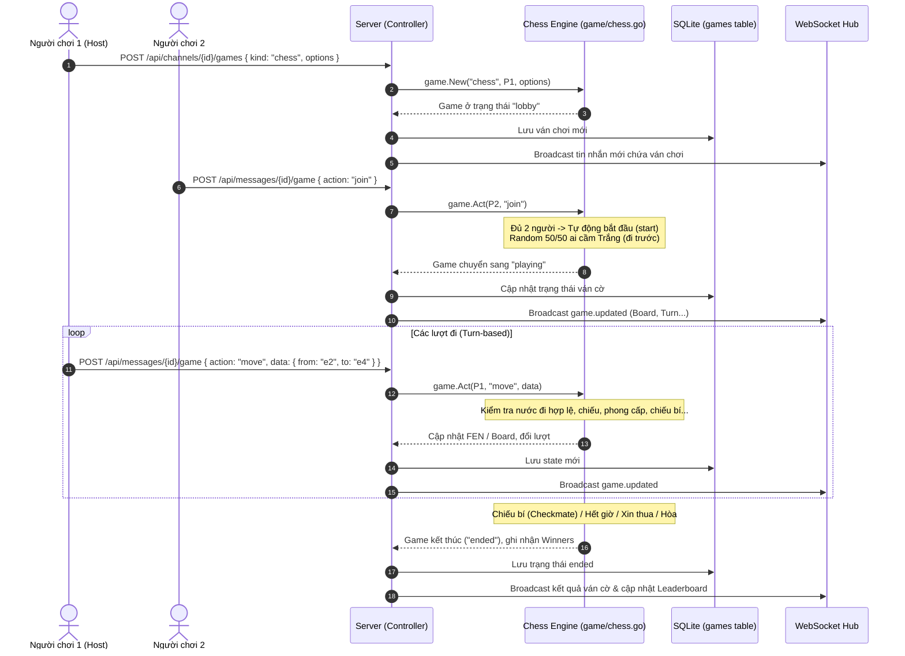

# Đặc tả kỹ thuật (SPEC): Trò chơi Cờ Vua (Chess)

Tài liệu này đặc tả kiến trúc, logic nghiệp vụ, giao diện người dùng và kế hoạch triển khai tính năng trò chơi **Cờ Vua (Chess)** tích hợp trong ứng dụng chat `tidebird/chat`.

---

## 1. Mục tiêu & Phạm vi (Goals & Scope)

### 1.1. Mục tiêu
- Thêm Cờ Vua như một trò chơi 2 người chơi mới bên cạnh Cờ Caro và Oẳn tù tì.
- Chơi được cả trong **kênh chat công khai/riêng tư** và **tin nhắn riêng (DM)**.
- Xử lý luật cờ vua chuẩn quốc tế (FIDE) độc lập, gọn nhẹ, không phụ thuộc thư viện bên ngoài quá nặng nề.
- Tích hợp trực tiếp vào hệ thống **Bảng xếp hạng (Leaderboard)** đã có.

### 1.2. Ngoài phạm vi (Out of Scope v1)
- Chưa hỗ trợ biến thể cờ khác (như cờ chấp, cờ 960 / Fischer Random, cờ 4 người).
- Chưa tích hợp engine phân tích nước cờ sâu như Stockfish (có thể mở rộng ở v2).

---

## 2. Kiến trúc & Luồng hoạt động (Architecture & Flow)

Hệ thống trò chơi hoạt động theo mô hình Event-driven qua WebSocket và HTTP API đã có trong ứng dụng:



---

## 3. Mô hình dữ liệu & API Contracts

### 3.1. Cấu trúc lưu trữ Backend (`game/chess.go`)

```go
type chessOptions struct {
    TurnMinutes int    `json:"turn_minutes"` // Thời gian nước đi: 3, 5, 10 phút (mặc định: 3)
    First       string `json:"first"`        // "random", "host", "guest" (mặc định: "random")
}

type chess struct {
    Base
    Opts         chessOptions `json:"opts"`
    Board        [64]byte     `json:"board"`         // 64 ô từ a1 (index 0) tới h8 (index 63)
    TurnColor    byte         `json:"turn_color"`    // 'w' (Trắng) hoặc 'b' (Đen)
    Castling     byte         `json:"castling"`      // Bitmask quyền nhập thành: K, Q, k, q
    EnPassant    int          `json:"en_passant"`    // Ô mục tiêu bắt tốt qua đường (-1 nếu không có)
    Halfmove     int          `json:"halfmove"`      // Số nửa nước kể từ lần ăn quân / đi tốt gần nhất (luật 50 nước)
    Fullmove     int          `json:"fullmove"`      // Số lượt đi (bắt đầu từ 1, tăng sau mỗi lượt Đen)
    LastMove     *chessMove   `json:"last_move,omitempty"`
    InCheck      bool         `json:"in_check"`      // Bên tới lượt có đang bị chiếu hay không
    DrawOfferedBy int64       `json:"draw_offered_by,omitempty"` // ID người chơi đang đề nghị hoà
}
```

### 3.2. Payload nước đi (`moveData`)

Người chơi gửi nước đi dưới dạng tọa độ cờ vua chuẩn (Algebraic notation):

```json
{
  "action": "move",
  "data": {
    "from": "e7",
    "to": "e8",
    "promotion": "q" // "q" | "r" | "b" | "n" (chỉ gửi khi phong cấp tốt)
  }
}
```

Các hành động khác:
- `action: "resign"`: Xin thua.
- `action: "draw_offer"`: Đề nghị hoà.
- `action: "draw_accept"`: Đồng ý hoà khi đối thủ đã đề nghị.
- `action: "draw_decline"`: Từ chối đề nghị hoà.

### 3.3. Dữ liệu công khai trả về Client (`chessPublic`)

```go
type chessPublic struct {
    FEN          string          `json:"fen"`           // Chuỗi FEN biểu diễn thế cờ hiện tại
    Board        string          `json:"board"`         // Chuỗi 64 ký tự (dễ vẽ cho UI)
    TurnColor    string          `json:"turn_color"`    // "w" hoặc "b"
    TurnPlayerID int64           `json:"turn_player_id"`// ID người chơi tới lượt
    WhitePlayerID int64          `json:"white_player_id"`
    BlackPlayerID int64          `json:"black_player_id"`
    LastMove     *chessMove      `json:"last_move,omitempty"`
    InCheck      bool            `json:"in_check"`
    CheckSquare  string          `json:"check_square,omitempty"` // Ô vua đang bị chiếu (vd: "e1")
    DrawOffered  bool            `json:"draw_offered"`
    DrawOfferedBy int64          `json:"draw_offered_by,omitempty"`
    Captured     map[string]int  `json:"captured"`      // Số quân đã bị ăn của mỗi bên
}
```

---

## 4. Đặc tả Engine & Quy tắc cờ vua

### 4.1. Biểu diễn quân cờ & Bàn cờ
Bàn cờ 8×8 gồm 64 ô đánh số từ 0 (a1) đến 63 (h8):
- **Trắng**: `P` (Tốt), `N` (Mã), `B` (Tượng), `R` (Xe), `Q` (Hậu), `K` (Vua).
- **Đen**: `p`, `n`, `b`, `r`, `q`, `k`.
- **Ô trống**: `.`

$$ \text{index} = \text{rank} \times 8 + \text{file} \quad (\text{rank}: 0..7, \text{file}: 0..7) $$

### 4.2. Các quy tắc đặc biệt bắt buộc xử lý
1. **Nhập thành (Castling)**:
   - Cánh vua ($O-O$) và cánh hậu ($O-O-O$).
   - Vua và Xe tương ứng chưa từng di chuyển trong ván đấu.
   - Không có quân nào nằm giữa Vua và Xe.
   - Vua không đang bị chiếu, và các ô vua đi qua không bị đối phương kiểm soát.
2. **Bắt tốt qua đường (En Passant)**:
   - Khi Tốt đối phương nhảy 2 ô ở nước đi trước đó và đứng cạnh Tốt của mình.
   - Chỉ được thực hiện ngay ở nước cờ tiếp theo.
3. **Phong cấp tốt (Pawn Promotion)**:
   - Tốt trắng tới hàng 8 hoặc Tốt đen tới hàng 1.
   - Bắt buộc chọn biến thành Hậu (Q), Xe (R), Tượng (B) hoặc Mã (N).
4. **Kiểm tra Chiếu & Chiếu bí (Check & Checkmate)**:
   - Mọi nước đi hợp lệ đều phải đảm bảo Vua phe mình **không bị chiếu** sau khi kết thúc nước đi.
   - Nếu Vua bị chiếu và không còn bất kỳ nước cờ hợp lệ nào $\rightarrow$ **Chiếu bí (Checkmate)**, bên chiếu thắng.
5. **Các trường hợp Hoà cờ (Draw)**:
   - **Stalemate (Hết nước đi)**: Đến lượt nhưng không có nước đi hợp lệ và Vua không bị chiếu.
   - **Luật 50 nước**: 50 nước đi không có nước tiến tốt hay ăn quân.
   - **Không đủ lực lượng chiếu bí**: Vua vs Vua; Vua + Tượng vs Vua; Vua + Mã vs Vua.
   - **Đôi bên đồng ý hoà**.

---

## 5. Đặc tả Giao diện người dùng (UI/UX)

```
+-------------------------------------------------------------+
| ♔ CỜ VUA                 Trắng: Alice (Bạn)   Đen: Bob      |
| ⏱ Thời gian: 02:45       Lượt đi: Trắng                     |
+-------------------------------------------------------------+
|   a   b   c   d   e   f   g   h                             |
| 8 [♜] [♞] [♝] [♛] [♚] [♝] [♞] [♜] 8                         |
| 7 [♟] [♟] [♟] [♟] [♟] [♟] [♟] [♟] 7                         |
| 6 [ ] [ ] [ ] [ ] [ ] [ ] [ ] [ ] 6                         |
| 5 [ ] [ ] [ ] [ ] [ ] [ ] [ ] [ ] 5                         |
| 4 [ ] [ ] [ ] [ ] [♙] [ ] [ ] [ ] 4  <- Ô vừa đi (highlight) |
| 3 [ ] [ ] [ ] [ ] [ ] [ ] [ ] [ ] 3                         |
| 2 [♙] [♙] [♙] [♙] [ ] [♙] [♙] [♙] 2                         |
| 1 [♖] [♘] [♗] [♕] [♔] [♗] [♘] [♖] 1  <- Vua chiếu (đỏ)      |
|   a   b   c   d   e   f   g   h                             |
+-------------------------------------------------------------+
| [🔄 Xoay bàn]  [🏳️ Xin hoà]  [🚩 Xin thua]  [🏆 Bảng xếp hạng] |
+-------------------------------------------------------------+
```

### 5.1. Tương tác bàn cờ
- **Click quân cờ**:
  - Chọn quân cờ của mình $\rightarrow$ Ô quân cờ sáng viền xanh.
  - Các ô hợp lệ có thể đi được hiển thị **chấm tròn nhỏ mờ (hint dot)**. Ô có quân đối phương có thể ăn hiển thị vòng tròn bao quanh.
  - Bấm vào ô hợp lệ $\rightarrow$ Gửi nước cờ đi.
- **Xoay bàn cờ (Flip view)**:
  - Tự động xoay: Người cầm Trắng nhìn chiều xuôi (hàng 1 ở đáy), người cầm Đen nhìn chiều ngược (hàng 8 ở đáy).
  - Có nút `🔄 Xoay bàn` cho phép đảo chiều bất kỳ lúc nào.
- **Popup phong cấp**:
  - Khi Tốt đi vào hàng cuối, hiển thị modal nhỏ gồm 4 quân: `♛ Hậu`, `♜ Xe`, `♝ Tượng`, `♞ Mã`. Người chơi chọn quân mong muốn để hoàn tất nước cờ.

---

## 6. Kế hoạch triển khai (Implementation Plan)

| Giai đoạn | Nội dung công việc | File liên quan |
|---|---|---|
| **Phase 1** | **Backend Engine Core**<br/>• Xây dựng struct `chess` và hàm kiểm tra luật FIDE.<br/>• Tạo generator sinh nước đi hợp lệ (`legal moves`).<br/>• Xử lý nhập thành, bắt tốt qua đường, phong cấp.<br/>• Bổ sung unit tests thế cờ. | `game/chess.go`<br/>`game/chess_test.go`<br/>`game/game.go` |
| **Phase 2** | **Controller & Leaderboard**<br/>• Đăng ký `kind: "chess"` trong router API và DM.<br/>• Cập nhật store và bảng xếp hạng thành viên với tab Cờ Vua. | `controller/games.go`<br/>`controller/api.go`<br/>`store/games.go` |
| **Phase 3** | **Frontend UI & Visuals**<br/>• Xây dựng component `<Chess />` 8×8 với bộ quân cờ SVG.<br/>• Tương tác chọn quân, hiển thị gợi ý ô đi, popup phong cấp.<br/>• Tự động xoay bàn cờ theo phe (Trắng/Đen). | `desktop/src/components/Games.tsx`<br/>`desktop/src/lib/games.ts`<br/>`desktop/src/styles.css` |
| **Phase 4** | **Kiểm thử toàn diện & Đóng gói PR**<br/>• Kiểm thử end-to-end qua WebSocket.<br/>• Chạy bộ test suite CI đảm bảo 100% pass.<br/>• Tạo PR vào `main`. | Toàn bộ dự án |

---

## 7. Các quyết định cần thống nhất (Open Decisions)

1. **Thời gian mặc định của nước đi:** Đề xuất mặc định là **3 phút / nước đi** (giống cờ caro) để tránh ván cờ bị ngâm quá lâu khi đối thủ rời kênh.
2. **Hình thức phong cấp:** Mặc định tự động chọn Hậu nếu người chơi không chọn sau 30 giây, hay bắt buộc người chơi phải tự bấm chọn? *(Đề xuất: Mặc định hiện modal 4 nút chọn Hậu/Xe/Tượng/Mã).*
3. **Phân định quân Trắng / Đen:** Tiếp tục áp dụng cơ chế **Random 50/50** ai cầm Trắng (đi trước) khi ván cờ bắt đầu như đã làm ở Cờ Caro.
