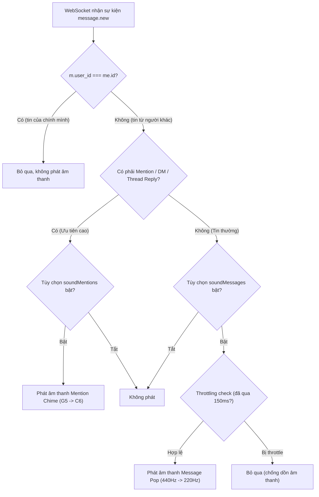

# Đặc tả kỹ thuật (SPEC): Hệ thống Âm thanh Thông báo (Notification Sound System)

Tài liệu này đặc tả kiến trúc, cơ chế sinh âm thanh, logic điều phối và kế hoạch triển khai hệ thống âm thanh thông báo cho tin nhắn mới và nhắc tên (`@mention`) trong ứng dụng chat `tidebird/chat`.

---

## 1. Mục tiêu & Phạm vi (Goals & Scope)

### 1.1. Mục tiêu
- Cung cấp phản hồi âm thanh (audio feedback) tức thì khi có sự kiện tin nhắn mới, giúp người dùng không bỏ lỡ thông tin quan trọng khi làm việc hoặc khi cửa sổ ứng dụng đang chạy nền.
- Phân biệt rõ ràng giữa **tin nhắn thường** và **tin nhắn ưu tiên cao** (`@mention`, tin nhắn riêng DM, trả lời thread).
- Hoạt động ổn định trên cả **Trình duyệt Web** (Chrome, Firefox, Safari) và **Desktop App** (Tauri).
- Không làm tăng dung lượng bundle (không dùng file `.mp3`/`.wav` ngoài), không phụ thuộc mạng, 0ms độ trễ.
- Cho phép người dùng tùy chỉnh bật/tắt linh hoạt trong mục Cài đặt.

### 1.2. Ngoài phạm vi
- Tùy biến nhạc chuông tải lên từ file cá nhân của người dùng (có thể mở rộng ở v2).

---

## 2. Thiết kế Âm thanh (Audio Synthesizer Design)

Sử dụng **Web Audio API** (`AudioContext`, `OscillatorNode`, `GainNode`) để tự sinh sóng âm toán học, tương tự kiến trúc class `Ringer` đã có trong [desktop/src/lib/calls.ts](file:///Users/hoang.nguyen3/tidebird/chat/desktop/src/lib/calls.ts).

### 2.1. Âm thanh Nhắc tên / DM / Trả lời (`Mention / High Priority Chime`)
- **Mục đích**: Gây chú ý, mang tính thông báo rõ ràng nhưng trang nhã, dễ chịu.
- **Dạng sóng**: Sine wave với 2 nốt chuông ngắn nối tiếp (Two-tone Chime):
  - Nốt 1: $G_5$ (783.99 Hz) trong 0.08s, gain 0.15 với exponential ramp down.
  - Nốt 2: $C_6$ (1046.50 Hz) trong 0.25s, gain 0.2 với exponential ramp down để tạo độ ngân vang.
- **Tổng thời gian**: ~0.35 giây.

### 2.2. Âm thanh Tin nhắn thường (`Normal Message Pop`)
- **Mục đích**: Thông báo có tin mới nhẹ nhàng, ngắn gọn, không gây gián đoạn khi đang tập trung.
- **Dạng sóng**: Sine wave dạng tiếng gõ nhẹ ("Pop/Bloop"):
  - Tần số: Quét nhanh (frequency pitch sweep) từ 440 Hz ($A_4$) xuống 220 Hz ($A_3$) trong 0.06s.
  - Gain: 0.12 giảm nhanh về 0.001 trong 0.08s.
- **Tổng thời gian**: ~0.08 giây.

---

## 3. Kiến trúc & Logic Điều phối (Architecture & Control Logic)

### 3.1. Các quy tắc phát âm thanh
1. **Loại trừ tin của bản thân**: Khi người dùng tự gửi tin nhắn, không phát âm thanh tin nhắn đến.
2. **Ưu tiên Mention/DM**: Nếu tin nhắn thỏa mãn điều kiện Mention (`m.mentions.includes(me.id)`), DM (`isDM(channel)`), hoặc Thread Reply (`m.parent_user_id === me.id`), chỉ phát **Mention Chime**, không phát lặp tin nhắn thường.
3. **Throttling (Chống chồng âm thanh)**:
   - Nếu nhận 10 tin nhắn dồn dập trong 1 giây (ví dụ: bot phát tin, nhóm chat sôi nổi), âm thanh tin nhắn thường bị giới hạn tối đa 1 lần mỗi 150ms.
4. **Xử lý Autoplay Policy**:
   - Web Audio API yêu cầu người dùng phải có ít nhất 1 tương tác (click, phím bấm) trước khi phát âm thanh.
   - Hệ thống tự động `resume()` AudioContext ở lần tương tác đầu tiên hoặc khi khởi tạo.

---

## 4. Tùy chọn Người dùng & Lưu trữ (Preferences & Settings)

Lưu trữ trong `localStorage` thông qua tiện ích [storage.ts](file:///Users/hoang.nguyen3/tidebird/chat/desktop/src/lib/storage.ts):

| Key | Kiểu | Mặc định | Ý nghĩa |
|---|---|---|---|
| `soundMentions` | `boolean` | `true` | Bật/tắt âm thanh khi có người nhắc tên (@mention), tin nhắn riêng (DM), trả lời tin. |
| `soundMessages` | `boolean` | `true` | Bật/tắt âm thanh khi có tin nhắn mới thường. |

### 4.1. Giao diện trong `UserSettingsDialog.tsx`
Trong nhóm **Thông báo & Âm thanh**:
- Checkbox: ☑️ *Phát âm thanh khi được nhắc tên & tin nhắn riêng (@mention, DM)*
- Checkbox: ☑️ *Phát âm thanh khi có tin nhắn mới*
- Hàng nút nghe thử:
  - Nút: `🔊 Nghe thử chuông nhắc tên`
  - Nút: `💬 Nghe thử tiếng tin nhắn`

---

## 5. Kế hoạch Triển khai (Implementation Steps)

1. **Module Âm thanh (`desktop/src/lib/sound.ts`)**:
   - Xây dựng lớp/hàm quản lý `AudioContext` singleton an toàn.
   - Hàm `playMentionSound()` và `playMessageSound()`.
   - Hàm `playTestSound("mention" | "message")`.
   - Các hàm getter/setter cho cấu hình: `getSoundMentionsPref()`, `getSoundMessagesPref()`, `setSoundMentionsPref()`, `setSoundMessagesPref()`.
2. **Tích hợp vào ChatProvider (`desktop/src/state/ChatProvider.tsx`)**:
   - Trong listener `sock.on("message.new")`:
     - Kiểm tra điều kiện và gọi `playMentionSound()` hoặc `playMessageSound()`.
3. **Cập nhật Cài đặt (`desktop/src/components/UserSettingsDialog.tsx`)**:
   - Thêm checkbox tùy chỉnh âm thanh và các nút nghe thử.
4. **Kiểm thử & Xác thực**:
   - Kiểm tra build frontend `pnpm -C desktop build`.
   - Kiểm tra toàn bộ test suite backend `go test ./...`.
