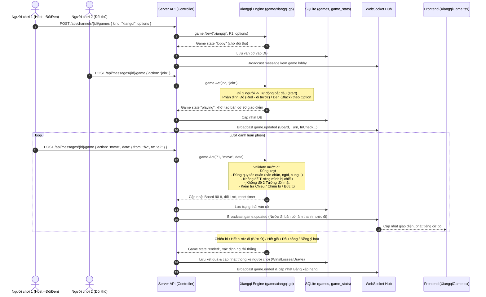

# Đặc tả kỹ thuật (SPEC): Trò chơi Cờ Tướng (Xiangqi / Chinese Chess)

Tài liệu này đặc tả chi tiết toàn bộ kiến trúc, luật chơi, mô hình dữ liệu, giao diện người dùng và kế hoạch triển khai trò chơi **Cờ Tướng (Xiangqi)** tích hợp trong nền tảng chat `tidebird/chat`.

---

## 1. Mục tiêu & Phạm vi (Goals & Scope)

### 1.1. Mục tiêu
- Bổ sung **Cờ Tướng** vào danh mục trò chơi tương tác 2 người chơi (bên cạnh Cờ Caro và Cờ Vua).
- Hoạt động mượt mà trong cả **kênh chat (Channel)** và **tin nhắn riêng (DM)**.
- Xử lý toàn bộ logic và luật Cờ Tướng chuẩn quốc tế (WXF - World Xiangqi Federation) phía Backend Go:
  - Cản mắt tượng, cản chân mã.
  - Pháo nhảy ăn quân qua đúng 1 ngòi cờ.
  - Hai Tướng không được đối mặt trực tiếp trên cùng một cột (Lộ diện Tướng / Flying General).
  - Tốt chưa qua sông vs Tốt đã qua sông.
  - Sĩ và Tướng bị giới hạn hoàn toàn trong Cung (Cửu cung).
  - **Hết nước đi (Stalemate / Bức tử)**: Xử THUA người tới lượt (khác với Cờ Vua là hoà).
  - Chiếu bí (Checkmate), hết giờ, xin hàng, đề nghị hoà.
- Giao diện bàn cờ Cờ Tướng bằng SVG phong cách gỗ truyền thống (mặt bàn gỗ, sông Sở Hà - Hán Giới, đường chéo Cung, dấu chữ thập Pháo/Tốt), quân cờ tròn hiệu ứng chạm khắc chữ Hán + viền nổi bật.
- Tích hợp vào hệ thống **Bảng xếp hạng (Game Leaderboard)** sẵn có.

### 1.2. Ngoài phạm vi (Out of Scope v1)
- Cờ thế (Xiangqi puzzles / endgame database).
- Chơi với máy / Bot AI Cờ Tướng độ khó cao (sẽ xem xét ở v2 sau khi hoàn thiện PvP).
- Biến thể Cờ Úp (Cờ tướng úp mặt quân).

---

## 2. Kiến trúc & Luồng hoạt động (Architecture & Flow)

Hệ thống tuân thủ kiến trúc Event-Driven qua WebSocket kết hợp REST API sẵn có của ứng dụng:



---

## 3. Hệ tọa độ & Biểu diễn dữ liệu bàn cờ

### 3.1. Kích thước & Tọa độ giao điểm
Bàn cờ Cờ Tướng có **9 đường dọc (Files: 0 đến 8)** và **10 đường ngang (Ranks: 0 đến 9)**, tổng cộng **90 giao điểm (Intersections)**. Quân cờ đặt trên các giao điểm:
- Chỉ số mảng phẳng (Flat index): `index = rank * 9 + file` (từ 0 đến 89).
- Tọa độ chuẩn dạng chuỗi (Algebraic notation):
  - Files: Cột từ `a` đến `i` (tương ứng file 0 đến 8).
  - Ranks: Hàng từ `0` đến `9` (hàng 0 ở đáy phía phe Đỏ, hàng 9 ở đỉnh phía phe Đen).
  - Ví dụ: `e0` là Tướng Đỏ ban đầu (`rank=0, file=4`), `b2` là Pháo trái Đỏ (`rank=2, file=1`).

```
  Đen (Black) - Ranks 7..9 Cung đen: file 3..5 (d7..f9)
  9 [r] [h] [e] [a] [k] [a] [e] [h] [r]
  8  .   .   .   .   .   .   .   .   . 
  7  .  [c]  .   .   .   .   .  [c]  . 
  6 [p]  .  [p]  .  [p]  .  [p]  .  [p]
  5  .   .   .   .   .   .   .   .   . 
 ~~~~~~~~~~~~~~~~~ SÔNG (RIVER) ~~~~~~~~~~~~~~~~
  4  .   .   .   .   .   .   .   .   . 
  3 [P]  .  [P]  .  [P]  .  [P]  .  [P]
  2  .  [C]  .   .   .   .   .  [C]  . 
  1  .   .   .   .   .   .   .   .   . 
  0 [R] [H] [E] [A] [K] [A] [E] [H] [R]
     a   b   c   d   e   f   g   h   i
  Đỏ (Red) - Ranks 0..2 Cung đỏ: file 3..5 (d0..f2)
```

### 3.2. Ký hiệu quân cờ (Piece Encoding)
Sử dụng byte ký tự chuẩn:
- **Chữ hoa** biểu diễn quân **Đỏ (Red)**:
  - `K`: Tướng (帥 - Soái / General)
  - `A`: Sĩ (仕 - Sĩ / Advisor)
  - `E`: Tượng (相 - Tượng / Elephant)
  - `H`: Mã (傌 - Mã / Horse)
  - `R`: Xe (俥 - Xe / Chariot)
  - `C`: Pháo (炮 - Pháo / Cannon)
  - `P`: Binh/Tốt (兵 - Binh / Soldier)
- **Chữ thường** biểu diễn quân **Đen (Black)**:
  - `k`: Tướng (將 - Tướng / General)
  - `a`: Sĩ (士 - Sĩ / Advisor)
  - `e`: Tượng (象 - Tượng / Elephant)
  - `h`: Mã (馬 - Mã / Horse)
  - `r`: Xe (車 - Xe / Chariot)
  - `c`: Pháo (砲 - Pháo / Cannon)
  - `p`: Tốt (卒 - Tốt / Soldier)
- `.`: Ô trống.

---

## 4. Đặc tả luật chơi chi tiết (Game Rules & Move Validation)

Mọi nước đi gửi lên server đều phải trải qua pipeline kiểm tra nghiêm ngặt:
1. **Kiểm tra cơ bản**: Đúng lượt người chơi, đúng màu quân, tọa độ xuất phát và đích nằm trong phạm vi 0..89.
2. **Kiểm tra theo loại quân (Piece-specific rules)**:
   - **Tướng (`K`/`k`)**:
     - Chỉ được di chuyển 1 bước theo đường ngang hoặc dọc.
     - Luôn luôn phải nằm trong phạm vi **Cửu cung** (Cột `d..f`, tức file 3..5; Hàng 0..2 cho Đỏ, 7..9 cho Đen).
     - **Luật Lộ diện Tướng (Flying Generals / Facing Generals)**: Sau khi hoàn thành nước đi, hai Tướng trên bàn cờ **không bao giờ được nằm trên cùng một cột mà không có bất kỳ quân cờ nào ở giữa**. Nếu vi phạm, nước đi bị từ chối lập tức.
   - **Sĩ (`A`/`a`)**:
     - Đi chéo 1 bước (`|Δfile| == 1` và `|Δrank| == 1`).
     - Chỉ hoạt động trong phạm vi Cửu cung (chỉ có 5 vị trí hợp lệ: 4 góc cung và tâm cung).
   - **Tượng (`E`/`e`)**:
     - Đi chéo đúng 2 bước (`|Δfile| == 2` và `|Δrank| == 2`).
     - **Không được qua sông**: Đỏ chỉ di chuyển trong hàng 0..4; Đen chỉ trong hàng 5..9.
     - **Cản mắt tượng**: Điểm nằm ở chính giữa đường đi chéo `(from_file + to_file)/2, (from_rank + to_rank)/2` phải là ô trống (`.`). Nếu có bất kỳ quân nào đứng ở đó, Tượng bị chặn và không thể đi.
   - **Mã (`H`/`h`)**:
     - Đi theo hình chữ L (chữ nhật 1x2 hoặc 2x1: `(|Δfile| == 1 && |Δrank| == 2)` hoặc `(|Δfile| == 2 && |Δrank| == 1)`).
     - **Cản chân mã (Hobbling horse's leg)**: Ô ngay sát cạnh ô xuất phát theo hướng đi thẳng đầu tiên phải là ô trống:
       - Nếu đi ngang 2 ô rồi chéo 1 ô (`|Δfile| == 2`): ô cản chân là `(from_file + sign(to_file - from_file), from_rank)`.
       - Nếu đi dọc 2 ô rồi chéo 1 ô (`|Δrank| == 2`): ô cản chân là `(from_file, from_rank + sign(to_rank - from_rank))`.
       - Nếu ô cản chân có bất kỳ quân cờ nào $\rightarrow$ Mã không thể đi.
   - **Xe (`R`/`r`)**:
     - Đi ngang hoặc dọc không giới hạn khoảng cách.
     - Toàn bộ các ô trung gian giữa ô xuất phát và ô đích phải là ô trống (`.`).
     - Ô đích là ô trống (di chuyển) hoặc chứa quân đối phương (ăn quân).
   - **Pháo (`C`/`c`)**:
     - Đi ngang hoặc dọc theo đường thẳng.
     - **Khi di chuyển (ô đích là ô trống)**: Không được nhảy qua bất kỳ quân nào (giống Xe, số quân trung gian = 0).
     - **Khi ăn quân (ô đích chứa quân đối phương)**: Bắt buộc phải có **chính xác 1 quân cờ bất kỳ** (quân ta hoặc quân địch, gọi là "ngòi pháo") nằm giữa ô xuất phát và ô đích. Nếu không có ngòi hoặc có từ 2 ngòi trở lên thì không được ăn.
   - **Tốt/Binh (`P`/`p`)**:
     - **Chưa qua sông**:
       - Đỏ (hàng 0..4): Chỉ được tiến thẳng 1 bước (`Δrank == +1, Δfile == 0`).
       - Đen (hàng 5..9): Chỉ được tiến thẳng 1 bước (`Δrank == -1, Δfile == 0`).
     - **Đã qua sông**:
       - Đỏ (hàng 5..9): Được tiến 1 bước (`Δrank == +1, Δfile == 0`) hoặc đi ngang 1 bước (`Δrank == 0, |Δfile| == 1`).
       - Đen (hàng 0..4): Được tiến 1 bước (`Δrank == -1, Δfile == 0`) hoặc đi ngang 1 bước (`Δrank == 0, |Δfile| == 1`).
     - **Tuyệt đối không bao giờ được đi lùi**. Khi đã chạm đáy bàn cờ đối phương chỉ còn có thể đi ngang.
3. **Kiểm tra tự đặt Tướng vào thế Chiếu**:
   - Thử nghiệm nước đi trên bản sao tạm của bàn cờ.
   - Nếu sau nước đi, Tướng của phe đang đi rơi vào thế bị chiếu (bị tấn công bởi Xe, Pháo, Mã, Tốt hoặc đối mặt Tướng địch), nước đi đó là bất hợp pháp.
4. **Xác định kết thúc ván cờ (Terminal State)**:
   - Sau khi thực hiện nước đi hợp lệ, kiểm tra phe kế tiếp có đang bị chiếu hay không (`in_check`).
   - Duyệt toàn bộ tất cả các nước đi hợp lệ của tất cả quân cờ phe kế tiếp:
     - Nếu **không có bất kỳ nước đi hợp lệ nào**:
       - Trường hợp đang bị chiếu $\rightarrow$ **Chiếu bí (Checkmate)**: Phe đi trước THẮNG.
       - Trường hợp KHÔNG bị chiếu $\rightarrow$ **Bức tử / Chết ngộp (Stalemate)**: Theo luật Cờ Tướng WXF, **bên bị hết nước đi bị xử THUA** (khác cờ vua hoà). Phe đi trước THẮNG.
   - **Chiếu lặp lại nhiều lần (Trường chiếu)**: Giới hạn tối đa 3 lần lặp lại trạng thái bàn cờ khi đang chiếu liên tục, bên liên tục chiếu buộc phải chuyển nước hoặc bị xử thua.
   - **Luật số nước đi không ăn quân**: Nếu sau 60 hiệp (120 nửa nước đi) không có quân nào bị ăn, ván cờ tự động xử Hoà.

---

## 5. Mô hình dữ liệu & API Contracts

### 5.1. Cấu trúc Server Struct (`game/xiangqi.go`)

```go
type xiangqiOptions struct {
    TurnMinutes int    `json:"turn_minutes"` // Thời gian suy nghĩ mỗi nước: 1, 3, 5, 10 phút (mặc định 3)
    First       string `json:"first"`        // "random" (mặc định), "host", "guest"
}

type xiangqiMove struct {
    From     string `json:"from"`               // vd: "b2"
    To       string `json:"to"`                 // vd: "e2"
    Piece    string `json:"piece"`              // vd: "C" (Pháo đỏ)
    Captured string `json:"captured,omitempty"` // vd: "p" (nếu ăn quân)
    IsCheck  bool   `json:"is_check,omitempty"` // Nước đi tạo thế chiếu
}

type xiangqi struct {
    Base
    Opts          xiangqiOptions `json:"opts"`
    Board         [90]byte       `json:"board"`            // Mảng 90 ô (0..89)
    TurnColor     byte           `json:"turn_color"`       // 'r' (Đỏ) hoặc 'b' (Đen)
    Halfmove      int            `json:"halfmove"`         // Đếm số nửa nước chưa ăn quân (luật 60 nước)
    Fullmove      int            `json:"fullmove"`         // Số lượt đi (bắt đầu từ 1)
    LastMove      *xiangqiMove   `json:"last_move,omitempty"`
    InCheck       bool           `json:"in_check"`         // Bên tới lượt có đang bị chiếu không
    DrawOfferedBy int64          `json:"draw_offered_by,omitempty"`
}
```

### 5.2. Các Action của Game

| Action | Payload | Mô tả |
| :--- | :--- | :--- |
| `join` | `{}` | Người chơi thứ hai tham gia phòng |
| `move` | `{"from": "b2", "to": "e2"}` | Đi một quân cờ |
| `draw_offer` | `{}` | Đề nghị hoà ván đấu |
| `draw_accept` | `{}` | Chấp nhận lời mời hoà |
| `draw_decline` | `{}` | Từ chối lời mời hoà |
| `resign` | `{}` | Xin đầu hàng, đối phương thắng |

### 5.3. WebSocket Broadcast State
Mỗi khi trạng thái ván cờ thay đổi, server gửi thông điệp `game.updated` chứa toàn bộ snapshot:
- `board`: Chuỗi hoặc mảng 90 ký tự đại diện bàn cờ.
- `turn_color`: `'r'` hoặc `'b'`.
- `in_check`: boolean.
- `last_move`: `{ from, to, piece, captured, is_check }`.
- `players`: danh sách 2 người chơi kèm màu (`r` hay `b`).
- `status`: `"lobby"` | `"playing"` | `"ended"`.
- `winner_id`: ID người thắng (hoặc rỗng nếu hoà/chưa kết thúc).

---

## 6. Thiết kế Giao diện Người dùng (UI / UX)

### 6.1. Bàn cờ SVG Truyền Thống
File component: `desktop/src/components/XiangqiGame.tsx`
- **Màu nền bàn cờ**: Vân gỗ phong thủy sang trọng (`#dcb35c` hoặc `#c89650`), đường viền kép sắc nét.
- **Lưới tọa độ**: 9 cột dọc và 10 hàng ngang.
- **Sông (Sở Hà - Hán Giới)**:
  - Ngắt quãng các đường dọc tại khoảng giữa hàng 4 và hàng 5.
  - Chữ Hán thư pháp uyển chuyển: `楚 河` (Sở Hà) bên trái, `漢 界` (Hán Giới) bên phải.
- **Cửu cung (Palace)**: Hai đường chéo nối 4 góc cung tại cả hai bên Đỏ và Đen.
- **Dấu chữ thập (Cross markers)**: Đánh dấu các vị trí đặt Pháo và Tốt ban đầu.

### 6.2. Thiết kế Quân Cờ
- **Hình dáng**: Quân cờ tròn như đồng tiền gỗ với hiệu ứng viền nổi (3D beveled shadow).
- **Mặt quân**:
  - **Phe Đỏ**: Nền ngà ấm, viền đỏ, chữ Hán màu đỏ thắm (`#dc2626`).
  - **Phe Đen**: Nền ngà ấm, viền đen/xanh than, chữ Hán màu mực mun (`#1e293b`).
  - Font chữ Hán: Noto Serif TC, Ma Shan Zheng hoặc phông chữ thư pháp chuẩn, kèm phụ đề chữ Quốc ngữ nhỏ bên dưới (ví dụ: `Xe`, `Pháo`, `Mã`, `Tướng`) giúp người chưa rành chữ Hán vẫn nhận biết dễ dàng.

### 6.3. Tương tác & Trải nghiệm
- **Chọn quân & Gợi ý nước đi**:
  - Click vào quân cờ của mình $\rightarrow$ Quân cờ được làm nổi bật (glow viền vàng).
  - Tự động tính toán và hiển thị các chấm tròn xanh/vàng tại các vị trí đi hợp lệ.
  - Vị trí có thể ăn quân hiển thị vòng tròn đỏ cảnh báo.
- **Kéo thả hoặc Nhấp chuột (Drag-and-Drop / Click-to-Move)**: Hỗ trợ linh hoạt cả 2 hình thức.
- **Cảnh báo Chiếu Tướng (Check Alert)**:
  - Tướng bị chiếu sẽ phát ánh sáng đỏ cảnh báo (pulsing red animation).
  - Huy hiệu "CHIẾU TƯỚNG" hiển thị góc bàn cờ.
- **Âm thanh (Web Audio API)**:
  - Tiếng đặt quân cờ chắc nịch (`sound.playPiecePlace()`).
  - Tiếng ăn quân (`sound.playPieceCapture()`).
  - Tiếng chuông cảnh báo chiếu tướng.
- **Khay quân bị ăn (Graveyard)**: Hiển thị các quân cờ đã bị tiêu diệt của hai bên ở hai phía cạnh bàn cờ.
- **Tự động xoay bàn cờ (Flip board)**: Người chơi cầm phe nào sẽ nhìn bàn cờ từ phía phe đó (phe mình ở dưới), kèm nút bấm lật ngược góc nhìn thủ công nếu muốn.

---

## 7. Bảng xếp hạng & Thống kê (Leaderboard Integration)

Mở rộng `store/game_stats.go` và `GameLeaderboard.tsx`:
- Bổ sung loại game `xiangqi` bên cạnh `caro` và `chess`.
- Thống kê:
  - Tổng số ván đã chơi.
  - Thắng (Wins), Thua (Losses), Hoà (Draws).
  - Tỷ lệ thắng (% Win-rate).
  - Chuỗi thắng hiện tại và chuỗi thắng kỷ lục (Win streaks).
- Tab **"Cờ Tướng"** riêng biệt trong hộp thoại Bảng xếp hạng trò chơi.

---

## 8. Kế hoạch triển khai chi tiết (Implementation Steps)

### Giai đoạn 1: Backend Game Engine (`game/xiangqi.go` & `game/xiangqi_test.go`)
- [x] Định nghĩa cấu trúc `xiangqi`, `xiangqiOptions`, `xiangqiMove`.
- [x] Khởi tạo bàn cờ 90 ô với 32 quân ban đầu.
- [x] Viết hàm sinh nước đi hợp lệ cho từng quân:
  - Tướng + Sĩ (trong cung).
  - Tượng (cản mắt tượng, không qua sông).
  - Mã (cản chân mã).
  - Xe (đường thẳng).
  - Pháo (di chuyển tự do, ăn qua đúng 1 ngòi).
  - Tốt (trước & sau khi qua sông).
- [x] Viết hàm kiểm tra Chiếu (`isInCheck`) và Lộ diện Tướng (`areGeneralsFacing`).
- [x] Viết hàm kiểm tra Chiếu bí (Checkmate) và Bức tử (Stalemate xử thua).
- [x] Đăng ký game `xiangqi` vào `newRules()` và `titles` trong `game/game.go`.
- [x] Viết bộ Unit Test phủ kín tất cả các luật đặc thù của Cờ Tướng (`game/xiangqi_test.go`).

### Giai đoạn 2: Tích hợp Controller, Leaderboard & Server API
- [x] Cập nhật `controller/games.go` & `lib/api.ts` chấp nhận game kind `"xiangqi"`.
- [x] Cập nhật bảng xếp hạng trò chơi hỗ trợ phân loại Cờ Tướng.

### Giai đoạn 3: Giao diện Frontend (`desktop/src/components/XiangqiGame.tsx`)
- [x] Dựng component bàn cờ SVG 9x10 với mặt gỗ, Sông Sở Hà Hán Giới và Cung.
- [x] Dựng SVG quân cờ tròn hiệu ứng 3D kèm ký tự Hán Việt (`desktop/src/components/XiangqiPiece.tsx`).
- [x] Logic tương tác: Click to select, move dot indicators, drag and drop.
- [x] Hiển thị thông tin người chơi, thời gian đếm ngược, lịch sử nước đi, quân bị ăn.
- [x] Nút xin hoà, đầu hàng, lật bàn cờ.
- [x] Thêm tab Cờ Tướng vào `GameLeaderboardDialog`.
- [x] Thêm nút tạo ván Cờ Tướng vào menu "Chơi game" trong khung chat và tin nhắn riêng (DM).

### Giai đoạn 4: Kiểm thử, Tối ưu & Tích hợp CI
- [x] Chạy `go test ./...` bảo đảm 100% tests pass.
- [x] Chạy `pnpm -C desktop build` bảo đảm 0 lỗi build.
- [x] Kiểm thử kiểm tra tương thích và luật cờ.
