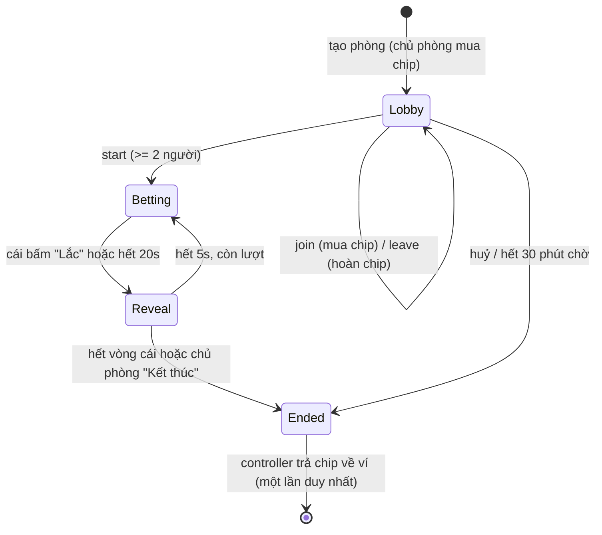
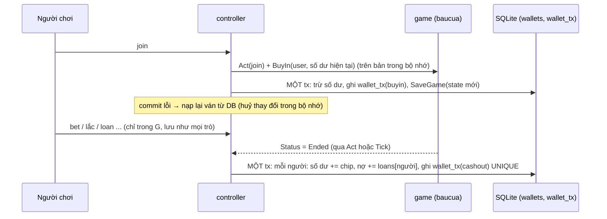

# Đặc Tả Kỹ Thuật (SPEC): Bầu Cua Tôm Cá & Ví Xu Ảo

- **Mã tính năng**: `BAU-CUA-XU`
- **Trạng thái**: 📝 Đang thiết kế
- **Ngày tạo**: 2026-11-23
- **Thư mục liên quan**:
  - Backend: `game/baucua.go` (mới), `game/game.go`, `controller/games.go`, `controller/wallet.go` (mới), `store/wallet.go` (mới), `database/migrations/000019_wallet.*.sql` (mới)
  - Frontend: `desktop/src/components/Games.tsx` (hoặc file riêng `BauCuaGame.tsx`), `desktop/src/components/Wallet.tsx` (mới), `desktop/src/components/Sidebar.tsx`, `desktop/src/lib/api.ts`, `desktop/src/styles.css`

---

## 1. Mục Tiêu & Phạm Vi

### 1.1 Bối cảnh
Nhóm dùng app chủ yếu để nhắn tin vui, trêu nhau và chơi game. Bầu cua là trò để **ăn thua và trêu nhau**: ai cháy túi, ai làm cái bị cả bàn "ăn", ai là con nợ. Xu ảo là thứ để ăn thua. Ví xu được thiết kế chung để sau này các game khác cũng thưởng hoặc cược bằng xu.

### 1.2 Mục tiêu
1. **Ví xu ảo** cho mỗi người, dùng chung toàn server (không tách theo kênh):
   - Khởi đầu **1.000 xu**.
   - Mỗi ngày bấm nhận **100 xu**, tính theo ngày giờ Việt Nam (Asia/Ho_Chi_Minh).
   - **Vay ngân hàng**: mỗi lần vay được 500 xu, cộng 500 vào nợ. Chỉ được vay khi số dư dưới 100 xu.
   - **Trả nợ**: trả bằng số dư, tối đa bằng số nợ.
   - **Bảng đại gia / con nợ của kênh**: xếp hạng thành viên kênh theo tài sản ròng (số dư trừ nợ) và theo số nợ.
2. **Bầu cua tôm cá** (kind `baucua`), 2–10 người, có người **làm cái xoay vòng** như chơi Tết.
3. Xu không bao giờ bị nhân đôi hay mất khi server khởi động lại giữa ván.

### 1.3 Không thuộc phạm vi (v1)
- Không có tiền thật, không nạp, không đổi xu ra bất cứ thứ gì.
- Chưa cho tặng hoặc chuyển xu giữa người với người.
- Các game khác chưa thưởng xu (ví đã sẵn sàng cho việc này).
- AI (`@ai`) chưa đọc được ví hay ván bầu cua.

### 1.4 Điều không được để xảy ra
- Xu bị nhân đôi hoặc biến mất: khi khởi động lại, khi huỷ ván, khi một người chơi vào nhiều bàn.
- Ván bị kẹt vì có người treo máy: mọi pha đều có đồng hồ, hết giờ là tự chạy tiếp.
- Ví âm mà không ai thấy: thiếu xu thì chuyển thành **nợ** công khai, ví không bao giờ âm.

---

## 2. Kiến Trúc & Luồng Hoạt Động

### 2.1 Các cách đã cân nhắc
| Cách | Mô tả | Đánh giá |
|---|---|---|
| **A. Mua chip vào bàn (đã chọn)** | Vào bàn thì chuyển **toàn bộ số dư ví** thành chip của bàn. Cược và trả thưởng diễn ra trong trạng thái ván (package `game`, thuần, test được). Ván kết thúc thì trả chip còn lại về ví. | DB chỉ chạm lúc vào bàn, lúc vay trong bàn và lúc kết thúc. Trạng thái ván lưu sẵn chip nên khởi động lại không mất. |
| B. Mỗi cược ghi thẳng ví | Controller trừ ví mỗi lần đặt, cộng ví mỗi lần mở bát. | Nhiều lần ghi DB, logic tiền chia đôi giữa `game` và controller, dễ lệch khi lỗi giữa chừng. Loại. |
| C. Xu chỉ tồn tại trong ván | Không có ví, mỗi ván phát chip mới. | Mất ý nghĩa "đại gia / con nợ" lâu dài. Loại. |

*Chốt "mang toàn bộ số dư vào bàn" là quyết định của người viết spec, cho đơn giản và để "cháy túi" là cháy thật.*

### 2.2 Vòng đời ván


### 2.3 Luồng tiền

- **Nguyên tắc:** chỉ có **2 thời điểm** chạm ví: mua chip (join/tạo phòng) và trả chip (rời phòng chờ / kết thúc / xoá tin). Mọi thứ ở giữa (cược, trả thưởng, **vay trong bàn**, **nợ do cháy túi**) chỉ nằm trong trạng thái ván (`chips`, `loans`), lưu bằng `SaveGame` như các trò khác. Nợ trong bàn vì vậy chỉ vào ví và hiện trên bảng con nợ **sau khi ván kết thúc**.
- **Mua chip nguyên tử:** controller chạy `Act(join)` + `BuyIn` trên bản trong bộ nhớ, rồi gọi một hàm store mới ghi **trong cùng một transaction**: trừ ví, ghi `wallet_tx(buyin)`, lưu trạng thái ván. Commit lỗi thì bỏ bản trong bộ nhớ (nạp lại từ DB) và trả lỗi. Không có khoảng hở nào để server chết giữa chừng làm mất xu.
- **Trả chip một lần duy nhất:** `wallet_tx` có `UNIQUE(game_id, user_id, kind, seq)`. Cashout ghi bằng `INSERT … ON CONFLICT DO NOTHING` trong cùng transaction với việc cộng ví và trạng thái ván, và chỉ cộng ví khi insert thành công. Gọi lại nhiều lần vẫn an toàn.
- **Nơi gọi cashout:** trong `saveAndBroadcast` khi `Status == Ended` (cạnh chỗ tính Elo), vì ván kết thúc được cả qua `Act` (`cancel`, `finish`) lẫn `Tick`. Ngoài ra lúc khởi động, quét các ván `baucua` đã `ended` mà thiếu dòng cashout rồi chạy bù.
- **Rời phòng chờ:** trả chip của người đó (`wallet_tx(cashout, seq = số lần rời)`) và lưu ván trong cùng một transaction.
- **Xoá tin ván:** xoá tin là xoá mềm, dòng `games` vẫn `playing` và `ActiveGames` bỏ qua tin đã xoá. Vì vậy `deleteMessage` phải tự cashout (cược chưa mở trả lại người cược) **và** đánh dấu ván `ended` trong cùng transaction.

---

## 3. Dữ Liệu & API

### 3.1 SQLite (`000019_wallet.up.sql`)
```sql
CREATE TABLE wallets (
    user_id    INTEGER PRIMARY KEY REFERENCES users (id) ON DELETE CASCADE,
    balance    INTEGER NOT NULL DEFAULT 1000 CHECK (balance >= 0),
    debt       INTEGER NOT NULL DEFAULT 0    CHECK (debt >= 0),
    last_claim TEXT,                          -- 'YYYY-MM-DD' theo giờ VN
    updated_at DATETIME NOT NULL DEFAULT CURRENT_TIMESTAMP
);
CREATE TABLE wallet_tx (
    id         INTEGER PRIMARY KEY AUTOINCREMENT,
    user_id    INTEGER NOT NULL REFERENCES users (id) ON DELETE CASCADE,
    kind       TEXT    NOT NULL,  -- daily | loan | repay | buyin | cashout | refund
    amount     INTEGER NOT NULL,  -- thay đổi số dư (+/-)
    debt_delta INTEGER NOT NULL DEFAULT 0,
    game_id    INTEGER,           -- message id của ván, NULL nếu không thuộc ván
    seq        INTEGER NOT NULL DEFAULT 0,
    created_at DATETIME NOT NULL DEFAULT CURRENT_TIMESTAMP
);
CREATE UNIQUE INDEX idx_wallet_tx_once ON wallet_tx (game_id, user_id, kind, seq) WHERE game_id IS NOT NULL;
CREATE INDEX idx_wallet_tx_user ON wallet_tx (user_id, id);
```
Ví được tạo lười (`INSERT OR IGNORE` với 1.000 xu) ở lần đầu đọc hoặc ghi.

### 3.2 REST
| Method | Path | Mô tả |
|---|---|---|
| GET | `/api/wallet` | `{balance, debt, can_claim, can_loan, in_tables}`. `in_tables` là số xu đang nằm trên các bàn chưa kết thúc. |
| POST | `/api/wallet/claim` | Nhận 100 xu hôm nay. Đã nhận rồi thì trả 409 "Hôm nay bạn nhận rồi, mai quay lại nhé." |
| POST | `/api/wallet/loan` | Vay 500 xu. Chỉ khi số dư < 100, nếu không thì 400. |
| POST | `/api/wallet/repay` | Trả `min(balance, debt)`. |
| GET | `/api/channels/{id}/wallet-board` | Thành viên kênh: `{rich: [...top 10 theo balance-debt], debtors: [...top 10 theo debt > 0]}`. Chỉ thành viên kênh xem được. |

Ví thay đổi thì gửi `wallet.updated {balance, debt}` qua websocket cho chính người đó.

### 3.3 Hành động trong ván (`POST /api/messages/{id}/game`, kind `baucua`)
| action | data | Ai | Ghi chú |
|---|---|---|---|
| `bet` | `{symbol, amount}` | người chơi không làm cái, pha Betting | `symbol` ∈ `bau, cua, tom, ca, ga, nai`. `amount` ∈ {10, 50, 100, 500}. Tổng cược của mình trong lượt không vượt chip. |
| `clear` | — | như trên | Xoá hết cược của mình trong lượt. |
| `roll` | — | cái, pha Betting | Mở bát sớm, cần ít nhất 1 cược trên bàn. |
| `loan` | — | người chơi có chip < 10 | Chỉ trong ván: chip += 500, `loans[người] += 500`. Vào ví lúc cashout. |
| `finish` | — | chủ phòng, pha Reveal hoặc Betting chưa có cược | Kết thúc ván sớm. |

Tuỳ chọn khi tạo: `{rolls_per_dealer: 1|3|5}`, mặc định 3.

### 3.4 Trạng thái ván công khai (view)
`{phase, dealer_id, roll_no, rolls_per_dealer, dealer_order, chips: {uid: n}, loans: {uid: n}, bets: {uid: {symbol: n}}, dice: [s,s,s] | null, last_result: {uid: delta}, history: [[s,s,s], ...10 lượt gần nhất], net: {uid: chip - buyin - loans}}`. Không có phần bí mật, cược công khai cho cả bàn xem.

---

## 4. Luật & Trường Hợp Biên

### 4.1 Luật chơi
- **Thứ tự cái:** theo thứ tự vào phòng, chủ phòng làm cái đầu. Mỗi người cầm cái `rolls_per_dealer` lượt lắc rồi chuyển. Ván kết thúc khi **mọi người đã cầm cái một vòng**, hoặc chủ phòng bấm "Kết thúc".
- **Pha đặt cược (20s):** người không làm cái đặt chip vào 6 ô, đặt nhiều ô được. Cái bấm "Lắc" sớm được. Hết giờ thì tự lắc, kể cả khi không ai cược.
- **Lắc:** 3 xúc xắc, mỗi mặt đều xác suất 1/6, dùng `math/rand/v2` phía server.
- **Trả thưởng** cho mỗi cược `b` vào ô xuất hiện `k` lần: k ≥ 1 thì người cược nhận lại `b` và được cái trả thêm `b×k`. k = 0 thì cái ăn `b`.
- **Pha mở bát (5s):** hiện kết quả và lãi/lỗ từng người, rồi sang lượt kế tiếp.

### 4.2 Trường hợp biên
| Tình huống | Xử lý |
|---|---|
| Cái không đủ chip trả thưởng (**cháy túi**) | Người cược vẫn được trả đủ. Phần thiếu chuyển thành **nợ ngân hàng** của cái (`loans[cái] += thiếu`, chỉ trong ván, vào ví lúc cashout), chip của cái về 0. Nhật ký ghi "💸 X cháy túi, vay ngân hàng N xu", và **mất cái ngay**, chuyển người kế tiếp. |
| Đến lượt làm cái mà chip = 0 | Bỏ qua người đó, nhật ký ghi "X không đủ xu làm cái". Nếu không ai còn chip để làm cái thì kết thúc ván. |
| Người chơi chip = 0 | Không cược được. Hiện nút "Vay ngân hàng 500". |
| Người treo máy / mất mạng | Không ảnh hưởng. Cái treo máy thì hết 20s tự lắc. |
| Ván bị huỷ trong Lobby / hết giờ chờ | Hoàn toàn bộ chip (cashout). |
| Server khởi động lại giữa lượt | Trạng thái (chip, cược, deadline) đã lưu. Nạp lại rồi chạy tiếp. |
| Một người vào 2 bàn cùng lúc | Bàn thứ hai nhận số dư còn lại (thường là 0), vẫn vào được để vay hoặc xem. |
| Tin nhắn ván bị xoá giữa chừng | Cashout ngay toàn bộ chip (kể cả chip trong cược chưa mở thì trả lại người cược). |
| Ví chưa tồn tại | Tạo với 1.000 xu ở lần đầu chạm tới. |

---

## 5. Giao Diện

### 5.1 Ví xu
- **Sidebar:** cạnh `me-card` hiện `🪙 1.250`. Bấm vào mở hộp thoại **Ví xu**.
- **Hộp thoại Ví xu:** số dư, nợ (màu cảnh báo nếu > 0), nút "Nhận 100 xu hôm nay" (bị khoá kèm "Mai quay lại" khi đã nhận), "Vay ngân hàng 500", "Trả nợ". Có 2 tab **Đại gia / Con nợ** của kênh đang mở.

### 5.2 Bàn bầu cua (thẻ game trong kênh)
```
┌───────────────────────────────────────────────┐
│ 🎲 Bầu cua · Cái: Nam (lượt 2/3)   ⏱ 14s      │
│ ┌──────┬──────┬──────┐                         │
│ │ Bầu  │ Cua  │ Tôm  │   mỗi ô hiện tổng cược  │
│ │ 150  │  60  │      │   và avatar người cược  │
│ ├──────┼──────┼──────┤                         │
│ │ Cá   │ Gà   │ Nai  │                         │
│ │      │ 500  │  10  │                         │
│ └──────┴──────┴──────┘                         │
│ Chip: [10] [50] [100] [500]   [Xoá cược]       │
│ Bạn còn 840 xu · Nam (cái) còn 2.300           │
│ [ Lắc! ] (chỉ cái thấy)                        │
└───────────────────────────────────────────────┘
```
- Chọn mệnh giá chip, bấm ô để đặt. Bàn hiện cược của tất cả mọi người.
- **Mở bát:** hiệu ứng lắc bát khoảng 1s, rồi lật 3 mặt xúc xắc. Mỗi người hiện +/− màu xanh/đỏ. Cháy túi thì hiện banner to.
- **Hình 6 con vật:** vẽ bằng SVG hoặc emoji đơn giản trong app (🍐 tạm cho bầu, 🦀 🦐 🐟 🐓 🦌). Không dùng tranh bầu cua có bản quyền. Người làm tự quyết chi tiết.
- **Kết thúc ván:** bảng tổng kết lãi/lỗ cả ván, ai cháy túi bao nhiêu lần, nợ phát sinh.
- Điện thoại: lưới 3×2 co theo bề ngang, chip to dễ bấm.

### 5.3 Tạo ván
Thêm "Bầu cua tôm cá" vào `CreateGameDialog`, kèm tuỳ chọn số lượt mỗi cái (1/3/5). Chơi được cả trong tin nhắn riêng (2 người): thêm `baucua` vào danh sách trò cho phép trong DM ở `startGame`.

---

## 6. Bảng Xếp Hạng
- `/api/channels/{id}/wallet-board` (mục 3.2). Hiện trong hộp thoại Ví xu và ở màn tổng kết ván (top 3 đại gia của kênh).
- Không đụng Elo. Bầu cua không tính Elo.

---

## 7. Kế Hoạch Triển Khai
- [ ] Migration `000019_wallet` + `store/wallet.go` (ví lười, claim, loan, repay, buyin, cashout, refund, board) + test store.
- [ ] `game/baucua.go`: luật, pha, xoay cái, cháy túi, view; interface `staked` cho game dùng chip (`BuyIn`, `Chips`, `Loans`, `Refund`) + test luật (xác suất trả thưởng, cháy túi, bỏ qua cái hết chip, kết thúc vòng).
- [ ] Controller + store: mua chip và lưu ván trong một transaction (join, tạo phòng), trả chip (rời phòng chờ, `saveAndBroadcast` khi Ended, `deleteMessage`), cashout bù lúc khởi động. REST ví + sự kiện `wallet.updated`. Test API (join trừ ví, huỷ hoàn ví, cashout đúng một lần, cháy túi tạo nợ).
- [ ] Frontend: API + types, nút ví ở Sidebar, hộp thoại Ví xu, thẻ bàn bầu cua, tuỳ chọn tạo ván, CSS (desktop + điện thoại).
- [ ] README: thêm mục Bầu cua & Ví xu. `specs/README.md`: thêm dòng spec này.
