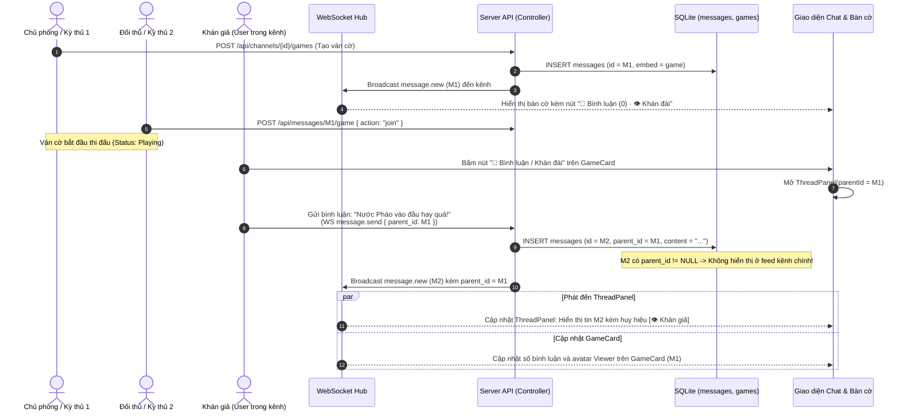
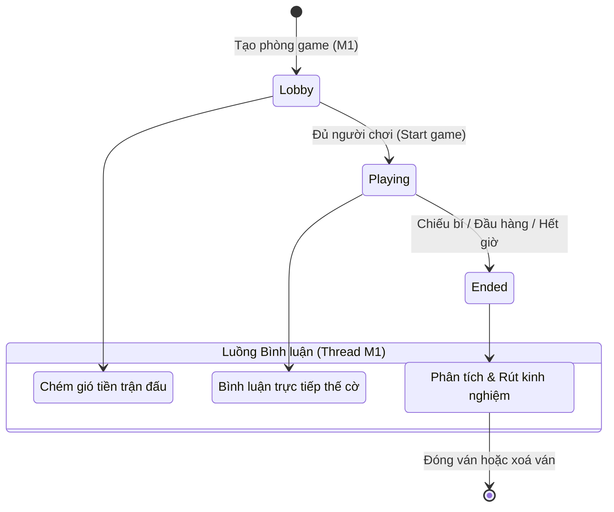

# Đặc tả kỹ thuật (SPEC): Tính Năng Bình Luận Trận Đấu & Hệ Thống Khán Giả (Game Viewer Thread)

Tài liệu này đặc tả chi tiết kiến trúc, luồng sự kiện, quy tắc nghiệp vụ, mô hình dữ liệu và giao diện người dùng cho tính năng **Bình luận trận đấu qua Luồng riêng (Reply Thread)** và **Hệ thống định danh Khán giả (Viewer System)** tích hợp trong nền tảng chat `tidebird/chat`.

---

## 1. Mục tiêu & Phạm vi (Goals & Scope)

### 1.1. Mục tiêu
- **Mở luồng thảo luận riêng cho mỗi ván game**: Bất kỳ ván đấu nào (Cờ Tướng, Cờ Vua, Cờ Caro, Ma Sói, Điệp Viên, v.v.) khi khởi tạo đều có thể mở một **Reply Thread riêng** gắn liền với tin nhắn chứa ván game đó (`parent_id = game_message_id`).
- **Không gây phiền toái cho kênh chung (Zero-Clutter Channel)**: Toàn bộ bình luận, phân tích thế cờ, tranh luận hoặc cổ vũ được giữ hoàn toàn trong luồng riêng của ván game. Không làm trôi tin nhắn hay gây loãng luồng thảo luận chung của kênh.
- **Giao diện chuẩn (Đã thống nhất)**: Sử dụng **`ThreadPanel` ở cạnh phải màn hình** khi mở bình luận, giúp người xem vừa theo dõi được diễn biến bàn cờ vừa đọc/chat luồng bình luận rộng rãi.
- **Độ hiển thị bình luận (Đã thống nhất)**: **Mở tự do** - Cả 2 kỳ thủ đang thi đấu và toàn bộ khán giả đều có thể đọc và tham gia bình luận theo thời gian thực.
- **Định danh Khán giả (Viewer Identity)**:
  - Những người tham gia theo dõi và gửi bình luận trong luồng game (nhưng không trực tiếp tham gia thi đấu ván cờ) được định danh chính thức là **Viewer (Khán giả)**.
  - Phân biệt rõ ràng giữa các vai trò trong luồng: **`[Viewer / Khán giả]`**, **`[Kỳ thủ / Player]`** (kèm màu cờ `[🔴 Đỏ]` / `[⚫ Đen]`), và **`[Chủ phòng / Host]`**.
- **Thanh trạng thái Khán giả & Bình luận trực quan**: Hiển thị số lượng Viewer và số lượng bình luận theo thời gian thực trên thẻ ván cờ (`GameCard`) và ngay trên giao diện bàn cờ (`XiangqiGame.tsx`, `Chess.tsx`, `Caro.tsx`).
- **Bảo vệ sự tập trung của Người chơi (Focus Mode)**: Người chơi có thể tuỳ chọn bật/tắt nhận thông báo từ luồng bình luận để tránh bị xao nhãng khi tính toán nước đi.

### 1.2. Ngoài phạm vi (Out of Scope v1)
- Kênh đàm thoại âm thanh riêng cho khán giả (WebRTC Spectator Voice Room - xem xét ở v2).
- Khán giả can thiệp vào ván cờ (Khán giả chỉ có quyền xem và bình luận, tuyệt đối không được gọi các action điều khiển trận đấu như `move`, `resign`, `draw`).
- Hệ thống cá cược / dự đoán điểm số (Gambling/Prediction points).

---

## 2. Kiến trúc & Luồng hoạt động (Architecture & Event Flow)

Tận dụng kiến trúc **Message-Embedded Game** sẵn có trong `tidebird/chat`:
- Mỗi ván game được lưu trữ như một tin nhắn gốc (`messages.embed.type = "game"`).
- Hệ thống Threading hiện tại (`messages.parent_id`) cho phép mọi tin nhắn đều có thể làm tin nhắn gốc cho một luồng thảo luận con (`WHERE parent_id IS NULL` cho feed kênh chính, và `WHERE parent_id = ?` cho thread).

### 2.1. Luồng sự kiện tương tác (Sequence Diagram)



### 2.2. Vòng đời của Luồng Bình Luận Game


---

## 3. Mô hình dữ liệu & API Contracts

### 3.1. Phân loại Vai trò (User Roles in Game Thread)

Hệ thống phân định vai trò tự động dựa trên quan hệ giữa người gửi tin nhắn và danh sách người chơi trong ván:

```go
type GameUserRole string

const (
    RoleHost    GameUserRole = "host"    // Chủ phòng (tạo ván cờ)
    RolePlayer  GameUserRole = "player"  // Kỳ thủ đang trực tiếp thi đấu (Đỏ/Đen)
    RoleViewer  GameUserRole = "viewer"  // Khán giả (không trong danh sách Players)
)
```

**Bảng ánh xạ vai trò người gửi tin nhắn:**
| Điều kiện người dùng | Vai trò định danh | Huy hiệu hiển thị (UI Badge) |
|---|---|---|
| `user_id == game.red_player_id` | Kỳ thủ Đỏ | `[⚔️ Kỳ thủ · 🔴 Đỏ]` |
| `user_id == game.black_player_id` | Kỳ thủ Đen | `[⚔️ Kỳ thủ · ⚫ Đen]` |
| `user_id == game.host_id` (nếu không thi đấu) | Chủ phòng | `[👑 Chủ phòng]` |
| `user_id` không thuộc danh sách người chơi | **Khán giả** | **`[👁️ Khán giả / Viewer]`** |

---

### 3.2. Cấu trúc Dữ liệu Mở Rộng

#### A. Backend Go (`model/message.go` & `store/store.go`)
Tận dụng cấu trúc `ThreadSummary` sẵn có của tin nhắn:
```go
type ThreadSummary struct {
    ReplyCount     int       `json:"reply_count"`
    LastReplyAt    time.Time `json:"last_reply_at"`
    ParticipantIDs []int64   `json:"participant_ids"`
}
```

Bổ sung thông tin tính toán Khán giả (Viewer Info) khi trả về GameView:
```go
type GameViewerInfo struct {
    // Tổng số lượng khán giả đã để lại bình luận trong luồng
    ViewerCount int `json:"viewer_count"`
    // Danh sách ID người dùng là khán giả (đã loại trừ Players)
    ViewerIDs []int64 `json:"viewer_ids"`
}
```

#### B. Frontend TypeScript (`desktop/src/lib/games.ts` & `desktop/src/lib/api.ts`)
```typescript
export type GameViewerMeta = {
  replyCount: number;
  viewers: PublicUser[];
  hasViewer: boolean;
};
```

---

### 3.3. API & WebSocket Contracts

#### 1. Gửi bình luận vào luồng Game
- **Endpoint**: WebSocket message action `message.send` (hoặc REST `POST /api/channels/{id}/messages`)
- **Payload**:
  ```json
  {
    "type": "message.send",
    "channel_id": 12,
    "parent_id": 845,
    "content": "Nước cờ Mã nhảy qua sông quá hiểm!",
    "client_id": "c-uuid-123"
  }
  ```
- **Xử lý phía Server**:
  - Kiểm tra `parent_id` (tin 845) tồn tại và thuộc channel 12.
  - Lưu vào bảng `messages` với `parent_id = 845`.
  - Broadcast sự kiện `message.new` có trường `parent_id: 845`.

#### 2. Lấy danh sách bình luận của ván game
- **Endpoint**: `GET /api/messages/{id}/thread`
- **Response**: Trả về danh sách đầy đủ các tin nhắn phản hồi trong luồng, kèm thông tin người gửi để frontend gán nhãn `[Viewer]`.

---

## 4. Quy tắc nghiệp vụ & Xử lý trường hợp biên (Rules & Edge Cases)

| Mã | Tình huống (Edge Case) | Cách xử lý chuẩn |
|---|---|---|
| **EC-01** | **Ảnh hưởng kênh chính** | Mọi bình luận đều có `parent_id != NULL`. Bộ lọc tin nhắn kênh chính (`parent_id IS NULL`) tuyệt đối không hiển thị các tin này. Thanh thông báo unread của kênh không bị nhảy số dồn dập. |
| **EC-02** | **Kỳ thủ tự bình luận** | Nếu 1 trong 2 người đang chơi gửi bình luận, tin nhắn của họ nhận badge `[⚔️ Kỳ thủ]` (hoặc `🔴 Đỏ`/`⚫ Đen`) để khán giả biết đây là phát ngôn của người trong cuộc. |
| **EC-03** | **Khán giả gợi ý nước cờ (Backseat Gaming)** | Cung cấp tuỳ chọn phòng cờ **"Ẩn chat khán giả với người chơi" (Spectator Blind)**: Khi bật, 2 kỳ thủ sẽ không thấy tin nhắn của khán giả trong lúc đang chơi cho đến khi trận đấu kết thúc. |
| **EC-04** | **Trận đấu trong tin nhắn riêng (DM)** | Trong DM chỉ có 2 người tham gia. Nút bình luận vẫn hoạt động như ghi chú riêng giữa 2 người, nhưng nhãn `[Khán giả]` sẽ tự động ẩn vì không có người thứ ba. |
| **EC-05** | **Âm thanh thông báo khi có bình luận mới** | Không phát âm thanh `playMessageSound()` cho 2 kỳ thủ đang chơi trừ khi họ được tag trực tiếp bằng `@mention`, đảm bảo không làm gián đoạn việc suy nghĩ nước cờ. |
| **EC-06** | **Trận đấu kết thúc (`Ended`)** | Luồng bình luận vẫn mở vĩnh viễn cùng tin nhắn game để mọi người tiếp tục bàn luận và phân tích lại các nước cờ. |
| **EC-07** | **Xoá ván cờ hoặc xoá tin nhắn gốc** | Khi tin nhắn ván cờ bị xoá bởi Host hoặc Admin, toàn bộ tin nhắn trong luồng sẽ tuân theo chính sách xoá luồng hiện có của hệ thống. |

---

## 5. Thiết kế Giao diện Người dùng (UI / UX)

### 5.1. Nút Bình Luận & Thanh Khán Giả Trên `GameCard` (`desktop/src/components/Games.tsx`)
Ngay phía dưới bàn cờ hoặc trong phần chân thẻ Game, tích hợp thanh **Spectator & Discussion Bar**:

```text
+-------------------------------------------------------------+
| 🎮 Cờ tướng · Ván đấu giữa Alice (Đỏ) và Bob (Đen)          |
| [------------------- BÀN CỜ SVG -------------------------] |
|                                                             |
| 💬 8 bình luận  ·  👁️ 3 Khán giả: [Avatar 1] [Avatar 2] ...  |
| [ 💬 Mở Khán Đài / Bình Luận ]    [ 🏆 Bảng Xếp Hạng ]      |
+-------------------------------------------------------------+
```

- Bấm vào nút **`[ 💬 Mở Khán Đài / Bình Luận ]`**: Mở trực tiếp `ThreadPanel` ở cạnh phải màn hình (trên Desktop) hoặc modal trượt toàn màn hình (trên Mobile).

---

### 5.2. Huy hiệu Định danh trong `ThreadPanel.tsx`
Khi mở luồng của một tin nhắn Game:
- **Header của Panel**: Đổi từ `Luồng` thành `Khán đài: [Tên trò chơi] (Ví dụ: Khán đài Cờ tướng)`.
- **Dòng tin nhắn (`MessageRow`)**:
  - Bên cạnh tên người gửi, hiển thị badge màu sắc trang nhã:
    - Khán giả: `<span className="badge badge-viewer">👁️ Khán giả</span>` (Màu xanh dịu hoặc tím nhạt).
    - Kỳ thủ: `<span className="badge badge-player">⚔️ Kỳ thủ Đỏ</span>` hoặc `[⚫ Kỳ thủ Đen]`.
    - Chủ phòng: `<span className="badge badge-host">👑 Chủ phòng</span>`.
- **Thanh phản ứng nhanh (Quick Cheering Chips)** đặt ngay trên ô soạn thảo:
  - Nút bấm nhanh 1 chạm: `👏 Hay quá!`, `🔥 Căng thẳng!`, `🤔 Cao cờ!`, `☕ Ngồi xem!`. Bấm vào sẽ tự động gửi ngay tin nhắn hoặc chèn vào ô nhập.

---

### 5.3. Nút Thu Gọn Nhanh Trực Tiếp Trên Bàn Cờ (`XiangqiGame.tsx`, `Chess.tsx`)
- Thêm icon `💬 (số bình luận)` trên thanh công cụ điều khiển bàn cờ:
  - Nếu có bình luận mới từ khán giả: Hiển thị chấm đỏ thông báo nhỏ.
  - Kỳ thủ bấm vào có thể xem nhanh popover 3 bình luận gần nhất của khán giả mà không cần rời mắt khỏi bàn cờ.

---

## 6. Kế hoạch Triển khai Chi Tiết (Implementation Plan)

### Giai đoạn 1: Backend Helpers & Data Layer
- [x] Bổ sung hàm helper `GetGameUserRole(g *game.Game, userID int64) string` trong `controller/games.go`.
- [x] Đảm bảo API `GET /api/messages/{id}/thread` trả về đầy đủ metadata để client phân định vai trò.
- [x] Viết unit test backend trong `controller/games_test.go` (`TestGetGameUserRole`) xác minh phân quyền và lấy danh sách viewer.

### Giai đoạn 2: UI Khán Giả Trên `GameCard` & Game Components
- [x] Cập nhật `GameCard` trong [desktop/src/components/Games.tsx](file:///Users/hoang.nguyen3/tidebird/chat/desktop/src/components/Games.tsx) bổ sung thanh Khán giả (`SpectatorBar`) và nút mở luồng `openThread(message.id)`.
- [x] Thêm nút tắt `💬 Khán đài` trên thanh điều khiển của [desktop/src/components/XiangqiGame.tsx](file:///Users/hoang.nguyen3/tidebird/chat/desktop/src/components/XiangqiGame.tsx) và `Chess`.

### Giai đoạn 3: Tối Ưu `ThreadPanel` & Huy Hiệu Viewer
- [x] Cập nhật [desktop/src/components/ThreadPanel.tsx](file:///Users/hoang.nguyen3/tidebird/chat/desktop/src/components/ThreadPanel.tsx) nhận diện khi tin nhắn cha là `embed.type === "game"`.
- [x] Tích hợp huy hiệu `[👁️ Khán giả]`, `[⚔️ Kỳ thủ]` (`🔴 Đỏ`/`⚫ Đen`/`Trắng`), `[👑 Chủ phòng]` bên cạnh tên tác giả trong tin nhắn thread.
- [x] Bổ sung thanh Quick Cheering Chips (`👏 Hay quá!`, `🔥 Căng thẳng!`, `🤔 Nước cờ hiểm!`, `☕ Ngồi xem cao thủ!`, `🍿 Hóng kết quả!`) cho khán giả cổ vũ nhanh 1 chạm.

### Giai đoạn 4: Tuỳ Chọn Tập Trung (Focus Mode) & Kiểm Thử Toàn Diện
- [x] Đảm bảo âm thanh thông báo thread không gây gián đoạn kỳ thủ khi thi đấu (tuân thủ quy tắc mention của app).
- [x] Kiểm thử `pnpm build` (TypeScript frontend) đạt 0 lỗi.
- [x] Kiểm thử `go test ./...` (Go backend) đạt 100% PASS.
- [x] Kiểm thử build toàn hệ thống với `make server`.
