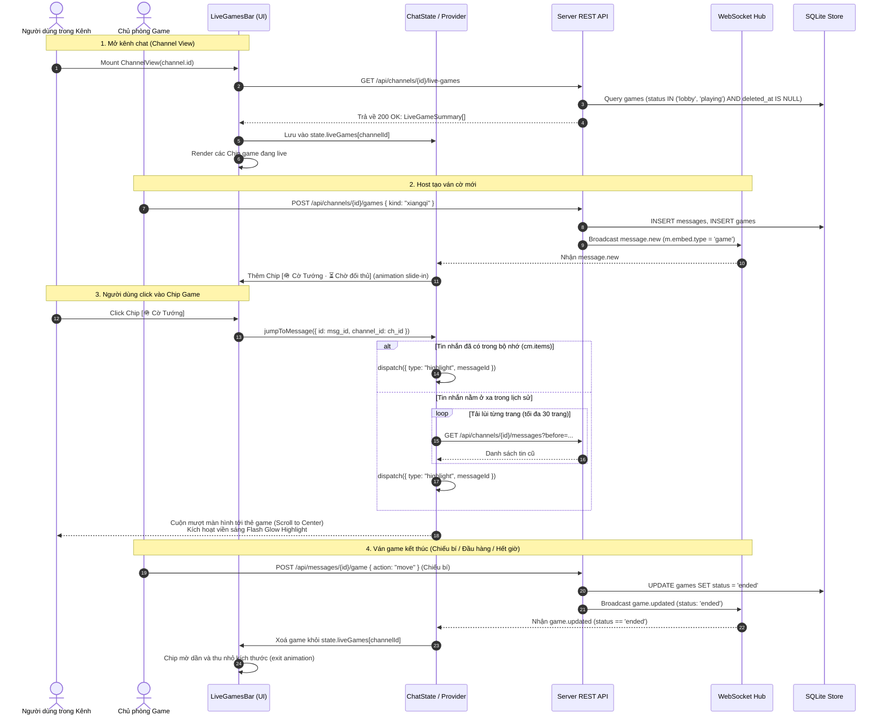
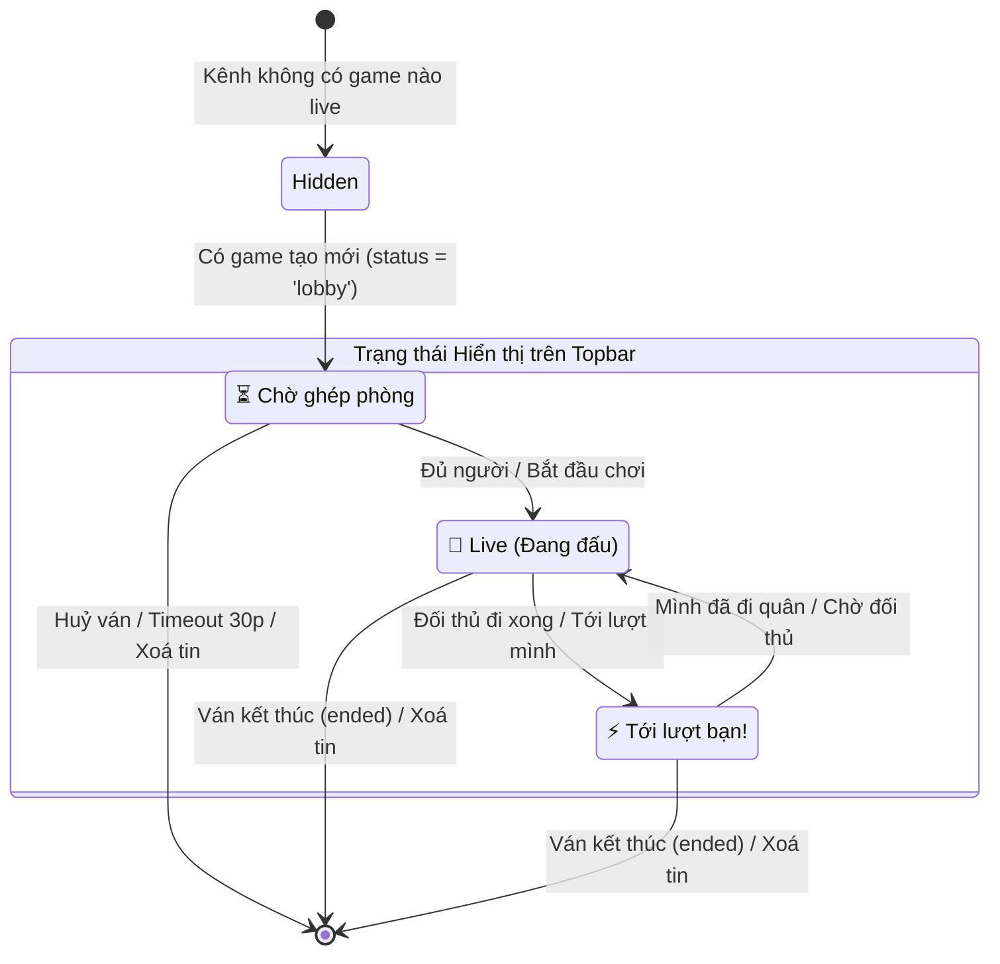

# Đặc tả kỹ thuật (SPEC): Ghim Game Đang Live Ở Topbar Kênh Chat (Live Games Bar)

Tài liệu này đặc tả chi tiết kiến trúc, luồng sự kiện thời gian thực, mô hình dữ liệu, quy tắc nghiệp vụ, giao diện người dùng và kế hoạch triển khai cho tính năng **Thanh ghim các ván game đang diễn ra (Live Games Bar)** ngay dưới Topbar của kênh chat trong ứng dụng `tidebird/chat`.

---

## 1. Mục tiêu & Phạm vi (Goals & Scope)

### 1.1. Bối cảnh & Vấn đề giải quyết
Hiện tại trong `tidebird/chat`, các trò chơi (Cờ Tướng, Cờ Vua, Cờ Caro, Ma Sói, Ai là Gián Điệp, Oẳn Tù Tì, Trạm Vũ Trụ) được tạo và nhúng trực tiếp dưới dạng tin nhắn tương tác (`Message` với `embed.type = "game"`). 
Khi kênh chat có nhiều thành viên và lượng trao đổi thảo luận lớn:
- **Dễ trôi ván cờ**: Các ván cờ hoặc phòng chơi đang chờ người (`lobby`) hoặc các ván đấu kịch tính (`playing`) nhanh chóng bị đẩy lên trên do hàng chục, hàng trăm tin nhắn mới gửi đến.
- **Bỏ lỡ cơ hội tham gia**: Thành viên mới vào kênh không hề hay biết đang có người tìm đối thủ đánh cờ, hoặc đang có ván cờ hay để vào xem/cổ vũ.
- **Khó theo dõi khi đến lượt**: Kỳ thủ đang đợi đối phương đi cờ nếu lỡ chat qua lại sẽ bị trôi mất bàn cờ, phải cuộn ngược dòng lịch sử để tìm lại thẻ game.

### 1.2. Mục tiêu chính (Core Goals)
1. **Live Games Topbar / Chips Bar**: Ghim một thanh danh sách mini các ván game đang hoạt động (`status IN ('lobby', 'playing')`) nằm cố định ngay dưới thanh tiêu đề kênh (`room-header`) trong [ChannelView.tsx](file:///Users/hoang.nguyen3/tidebird/chat/desktop/src/components/ChannelView.tsx).
2. **Nhận diện trạng thái trực quan**:
   - Ván đang chờ đối thủ: `⏳ Chờ người` / `Ghép phòng`.
   - Ván đang thi đấu: `🔴 Live` / `Đang đấu`.
   - Lượt đi cá nhân: Huy hiệu nổi bật `⚡ Tới lượt bạn!` nếu người dùng hiện tại đang trong ván và tới phiên của mình.
   - Định danh người chơi: Tên Host / Đối thủ (ví dụ: `Alice vs Bob`).
3. **Chuyển hướng mượt mà (Jump to Message)**:
   - Click vào bất kỳ Chip game nào sẽ kích hoạt cơ chế cuộn mượt (`jumpToMessage`), tự động nạp lịch sử tin nhắn cũ nếu ván cờ nằm ở quá khứ, đưa bàn cờ ra giữa khung nhìn (`scrollIntoView({ block: "center", behavior: "smooth" })`).
   - Kích hoạt hiệu ứng sáng viền / nhấp nháy phát quang tạm thời (flash glow highlight) trên thẻ game để người dùng định vị tức thì.
4. **Đồng bộ thời gian thực (Real-time Reactivity)**:
   - Tự động xuất hiện chip khi có ván mới được tạo (`message.new`).
   - Tự động cập nhật trạng thái khi có người tham gia / đổi lượt / thay đổi pha (`game.updated`).
   - Tự động gỡ bỏ mượt mà (graceful exit animation) khi ván cờ kết thúc (`ended`), bị huỷ, hoặc tin nhắn chứa ván bị xoá.
5. **Zero Waste Layout**: Khi kênh không có ván game nào đang live, thanh bar hoàn toàn ẩn đi (`height: 0` / unmount), không chiếm dụng không gian hiển thị của luồng chat.

### 1.3. Ngoài phạm vi (Out of Scope v1 - Dành cho v2)
- **Mini Floating Window (Picture-in-Picture)**: Xem bàn cờ thu nhỏ lơ lửng góc màn hình trong khi vẫn đang đọc tin nhắn khác.
- **Bộ lọc game nâng cao**: Lọc theo thể loại cờ, tìm theo tên người chơi (v1 chỉ hiển thị toàn bộ game active của kênh dạng cuộn ngang).
- **Global Cross-Channel Live Games**: Danh mục tập trung gom mọi ván cờ từ tất cả các kênh trên toàn server.

---

## 2. Kiến trúc & Luồng hoạt động (Architecture & Flow)

### 2.1. Tổng quan Kiến trúc

Hệ thống kết hợp cơ chế nạp dữ liệu kép (**Dual-Source Hydration**) giữa REST API và WebSocket Event Bus:

```text
┌────────────────────────────────────────────────────────────────────────┐
│                        ChannelView (Frontend)                          │
├────────────────────────────────────────────────────────────────────────┤
│  [Top Header: #general]                                                │
│  ┌──────────────────────────────────────────────────────────────────┐  │
│  │ LiveGamesBar: [🪖 Cờ Tướng · 🔴 Live] [♟️ Cờ Vua · ⏳ Chờ ghép]   │  │
│  └──────────────────────────────────────────────────────────────────┘  │
│  [Messages Stream (cuộn mượt khi click Chip)]                          │
└───────────────────▲───────────────────────────────▲────────────────────┘
                    │ REST                              │ WebSocket
                    │ GET /api/channels/{id}/live-games │ game.updated / message.new
┌───────────────────┴───────────────────────────────┴────────────────────┐
│                       Server Go (Controller)                           │
│  - Controller: controller/games.go, controller/channels.go             │
│  - In-Memory Registry: a.games.sessions[messageID]                     │
│  - SQLite Database: bảng `games` & `messages`                          │
└────────────────────────────────────────────────────────────────────────┘
```

1. **Khởi tạo khi vào kênh (Hydration)**:
   - Gọi endpoint `GET /api/channels/{id}/live-games`.
   - Server truy vấn các game có trạng thái `status IN ('lobby', 'playing')` và `deleted_at IS NULL`.
   - Kết hợp trạng thái bộ nhớ đệm (`gameSession`) để trả về danh sách `LiveGameSummary` mới nhất (bao gồm cả góc nhìn người dùng `viewJSON(s.g, viewerID)`).
2. **Đồng bộ theo thời gian thực (Live Updates)**:
   - Khi có tin mới mang ván game (`message.new` có `embed.type === "game"`): Thêm vào danh sách Live Games của kênh.
   - Khi ván cờ cập nhật (`game.updated`):
     - Nếu `status === "ended"`: Gỡ bỏ khỏi Live Games Bar.
     - Nếu `status === "lobby"` hoặc `"playing"`: Cập nhật thông tin chip (người chơi, lượt đi, trạng thái).
   - Khi tin nhắn bị xoá (`message.deleted`): Gỡ chip tương ứng nếu `message_id` khớp.
3. **Điều hướng cuộn tin nhắn (`jumpToMessage`)**:
   - Sử dụng action `jumpToMessage({ id: message_id, channel_id: channelId })` sẵn có trong [ChatProvider.tsx](file:///Users/hoang.nguyen3/tidebird/chat/desktop/src/state/ChatProvider.tsx#L753-L774).
   - Nếu ván game nằm xa trong lịch sử, client lặp gọi `loadOlder(channelId)` tối đa 30 trang (~1500 tin) đến khi định vị được tin nhắn.
   - Dispatch action `highlight` để kích hoạt hiệu ứng cuộn mượt và hiệu ứng viền phát quang.

---

### 2.2. Biểu đồ Sequence tương tác chi tiết (Mermaid)



---

### 2.3. Vòng đời Trạng thái Chip trên Topbar (State Diagram)



---

## 3. Mô hình dữ liệu & API Contracts

### 3.1. Backend Data Models (Go)

Tạo struct `LiveGameSummary` trong [controller/games.go](file:///Users/hoang.nguyen3/tidebird/chat/controller/games.go):

```go
package controller

import (
	"encoding/json"
	"time"

	"chat/game"
	"chat/model"
)

// LiveGameSummary chứa thông tin tóm tắt của một ván game đang hoạt động để hiển thị trên Topbar.
type LiveGameSummary struct {
	MessageID   int64            `json:"message_id"`
	ChannelID   int64            `json:"channel_id"`
	Kind        string           `json:"kind"`        // "xiangqi", "chess", "caro", "werewolf", v.v.
	Title       string           `json:"title"`       // Tiêu đề game: "Cờ tướng", "Cờ vua"...
	Status      string           `json:"status"`      // "lobby" | "playing"
	CreatedAt   time.Time        `json:"created_at"`
	Host        model.PublicUser `json:"host"`
	Players     []game.Player    `json:"players"`
	TurnUserID  *int64           `json:"turn_user_id,omitempty"` // ID người đang tới lượt đi
	IsMyTurn    bool             `json:"is_my_turn"`             // True nếu tới lượt của người gọi API
	ReplyCount  int              `json:"reply_count"`            // Số lượng bình luận trong luồng
	ViewerCount int              `json:"viewer_count"`           // Số lượng khán giả đang theo dõi
	Game        json.RawMessage  `json:"game"`                   // View JSON đầy đủ (tuỳ biến theo viewer)
}
```

### 3.2. REST API Specification

#### `GET /api/channels/{id}/live-games`
- **Mục đích**: Lấy danh sách tất cả các ván game đang ở trạng thái `lobby` hoặc `playing` trong kênh chỉ định.
- **Quyền hạn**: Bắt buộc đăng nhập (`requireAuth`) và là thành viên của kênh (`requireMember`).
- **HTTP Method**: `GET`
- **Path Parameter**: `id` (int64) - ID của Channel hoặc DM.
- **Phản hồi mẫu (`200 OK`)**:

```json
[
  {
    "message_id": 1042,
    "channel_id": 12,
    "kind": "xiangqi",
    "title": "Cờ tướng",
    "status": "playing",
    "created_at": "2026-11-20T08:30:00Z",
    "host": {
      "id": 101,
      "username": "minh.tran",
      "display_name": "Trần Minh",
      "avatar": "https://.../avatar1.png"
    },
    "players": [
      { "id": 101, "name": "Trần Minh" },
      { "id": 105, "name": "Hoàng Nam" }
    ],
    "turn_user_id": 101,
    "is_my_turn": true,
    "reply_count": 8,
    "viewer_count": 3,
    "game": {
      "kind": "xiangqi",
      "title": "Cờ tướng",
      "status": "playing",
      "host_id": 101,
      "players": [{ "id": 101, "name": "Trần Minh" }, { "id": 105, "name": "Hoàng Nam" }],
      "state": {
        "turn": "red",
        "turn_player_id": 101,
        "round": 14
      }
    }
  }
]
```

### 3.3. SQLite Store Query

Bổ sung phương thức truy vấn tối ưu vào [store/games.go](file:///Users/hoang.nguyen3/tidebird/chat/store/games.go):

```go
// ActiveGamesByChannel trả về danh sách các ván game chưa kết thúc trong một kênh cụ thể.
func (s *Store) ActiveGamesByChannel(ctx context.Context, channelID int64) ([]GameRow, error) {
	rows, err := s.db.QueryContext(ctx, `
		SELECT g.message_id, m.channel_id, g.kind, g.state 
		FROM games g 
		JOIN messages m ON m.id = g.message_id
		WHERE m.channel_id = ? 
		  AND g.status IN ('lobby', 'playing') 
		  AND m.deleted_at IS NULL
		ORDER BY m.id DESC`, channelID)
	if err != nil {
		return nil, err
	}
	defer rows.Close()
	var out []GameRow
	for rows.Next() {
		var g GameRow
		var state string
		if err := rows.Scan(&g.MessageID, &g.ChannelID, &g.Kind, &state); err != nil {
			return nil, err
		}
		g.State = []byte(state)
		out = append(out, g)
	}
	return out, rows.Err()
}
```

### 3.4. Frontend State & Models (TypeScript)

Trong file [desktop/src/lib/api.ts](file:///Users/hoang.nguyen3/tidebird/chat/desktop/src/lib/api.ts):

```typescript
export type LiveGameItem = {
  message_id: number;
  channel_id: number;
  kind: GameKind;
  title: string;
  status: "lobby" | "playing";
  created_at: string;
  host: PublicUser;
  players: GamePlayer[];
  turn_user_id?: number | null;
  is_my_turn: boolean;
  reply_count: number;
  viewer_count: number;
  game: GameView;
};
```

Trong [desktop/src/state/chat.ts](file:///Users/hoang.nguyen3/tidebird/chat/desktop/src/state/chat.ts):

```typescript
// Thêm vào ChatState:
export type ChatState = {
  // ... các state sẵn có
  /** channelId -> Danh sách các ván game đang active */
  liveGames: Record<number, LiveGameItem[]>;
};

// Thêm các action vào ChatAction:
export type ChatAction =
  | { type: "liveGames.loaded"; channelId: number; games: LiveGameItem[] }
  | { type: "liveGames.upsert"; channelId: number; game: LiveGameItem }
  | { type: "liveGames.remove"; channelId: number; messageId: number };
```

---

## 4. Quy tắc nghiệp vụ & Ma trận trường hợp biên (Domain Rules & Edge Cases)

| Mã EC | Kịch bản / Tình huống biên | Cách xử lý hệ thống |
| :--- | :--- | :--- |
| **EC-01** | **Nhiều game live đồng thời trong cùng 1 kênh** | Thanh `LiveGamesBar` sử dụng container cuộn ngang (`overflow-x: auto`) kèm hiệu ứng mờ viền (fade mask). Áp dụng thuật toán sắp xếp ưu tiên hiển thị: <br/>1. Ván tới lượt mình (`is_my_turn == true`) đứng đầu.<br/>2. Ván mình đang tham gia thi đấu.<br/>3. Ván đang đấu (`playing`).<br/>4. Ván đang chờ đối thủ (`lobby`).<br/>5. Game mới tạo xếp trước (`created_at DESC`). |
| **EC-02** | **Ván game nằm quá xa trong lịch sử chat (> 100 tin)** | Khi click Chip, kích hoạt trạng thái loading nhẹ trên chip (`isJumping = true`). Hàm `jumpToMessage` tự động nạp tin nhắn lùi dần theo từng trang (`loadOlder`) tối đa 30 đợt (~1500 tin). Khi tin được mount vào DOM, gọi `scrollIntoView({ block: "center", behavior: "smooth" })` và kích hoạt `highlight`. Nếu sau 30 trang không tìm thấy (tin bị archive/lỗi), hiện thông báo Toast nhẹ: *"Không tìm thấy vị trí ván chơi."* |
| **EC-03** | **Ván bị huỷ, kết thúc, hoặc tin nhắn bị xoá** | - **Game kết thúc (`ended`)**: Nhận sự kiện WS `game.updated` với `status: 'ended'`. Chip áp dụng transition mờ dần (`opacity: 0`, `scale(0.9)`) trong 200ms rồi xoá khỏi state.<br/>- **Tin nhắn bị xoá**: Nhận WS `message.deleted` -> gỡ chip ngay lập tức.<br/>- **Hết hạn phòng chờ**: Server ticker tự động dọn phòng chờ sau 30 phút, phát `game.updated` kết thúc. |
| **EC-04** | **Hiển thị trên Màn hình nhỏ / Mobile (`COMPACT_QUERY`)** | Tự động chuyển đổi layout Chip sang dạng rút gọn: Chiều cao giảm từ 44px xuống 36px, ẩn bớt text phụ, chỉ giữ lại icon game + tên game + chấm trạng thái (🔴 / ⏳) + nhãn lượt đi rút gọn. Hỗ trợ cảm ứng vuốt trượt cảm ứng mượt mà (`-webkit-overflow-scrolling: touch`). |
| **EC-05** | **Kênh Chat Riêng (Direct Message - DM)** | Các game 2 người chơi (Cờ Caro, Cờ Vua, Cờ Tướng, RPS) được hỗ trợ trong DM. Nếu có ván đang chơi trong DM, Topbar vẫn hiển thị thanh Live Game tương ứng. Khi ván kết thúc hoặc không có game, thanh hoàn toàn ẩn đi. |
| **EC-06** | **Chuyển kênh chat liên tục (Rapid Channel Switching)** | State `liveGames` được lưu theo `channelId` riêng biệt (`Record<number, LiveGameItem[]>`). Khi chuyển sang kênh mới, nếu đã có cache thì render ngay lập tức, đồng thời nạp ngầm danh sách mới nhất để tránh giật lag giao diện. |

---

## 5. Thiết kế Giao diện Người dùng & Tương tác (UI / UX Design)

### 5.1. Vị trí đặt Component trong Cây DOM

Trong [desktop/src/components/ChannelView.tsx](file:///Users/hoang.nguyen3/tidebird/chat/desktop/src/components/ChannelView.tsx):

```tsx
<section className="room">
  {/* 1. Header chuẩn của kênh */}
  <header className="room-header">
    {/* Avatar, tên kênh, actions */}
  </header>

  {/* 2. Banner mất mạng / Group Call (nếu có) */}
  {disconnected && <div className="banner">...</div>}
  {!direct && <GroupCallBanner channel={channel} />}

  {/* 3. LIVE GAMES TOPBAR - Ghim cố định tại đây */}
  <LiveGamesBar channelId={channel.id} />

  {/* 4. Danh sách tin nhắn cuộn */}
  <MessageList channel={channel} />

  {/* 5. Khung soạn thảo tin nhắn */}
  <Composer ref={composer} channel={channel} />
</section>
```

### 5.2. Cấu trúc Component & Mockup Giao diện

#### Cấu trúc DOM của `LiveGamesBar`:
```tsx
<aside className="live-games-bar" aria-label="Các trò chơi đang diễn ra">
  <div className="live-games-scroll">
    {games.map((g) => (
      <button
        key={g.message_id}
        className={`live-game-chip ${g.is_my_turn ? "is-my-turn" : ""} is-${g.status}`}
        onClick={() => handleJump(g)}
        title="Nhấn để cuộn tới bàn cờ"
      >
        <span className="live-game-icon">{getGameIcon(g.kind)}</span>
        <div className="live-game-info">
          <div className="live-game-header">
            <span className={`live-status-dot dot-${g.status}`} />
            <strong className="live-game-title">{g.title}</strong>
            <span className="live-status-text">
              {g.status === "lobby" ? "Đang chờ" : "Live"}
            </span>
          </div>
          <div className="live-game-meta">
            <span className="live-game-players">{formatPlayers(g)}</span>
            {g.is_my_turn && <span className="live-turn-badge">⚡ Lượt bạn</span>}
          </div>
        </div>
        <span className="live-jump-arrow" aria-hidden>↓</span>
      </button>
    ))}
  </div>
</aside>
```

#### Visual Layout Mockup:

```text
┌────────────────────────────────────────────────────────────────────────┐
│ # 🎮-giai-tri          Mô tả kênh giải trí nội bộ         [👥 24] [Mời] │ <- room-header
├────────────────────────────────────────────────────────────────────────┤
│ 🎮 GAME ĐANG LIVE:                                                     │
│ ┌─────────────────────────┐  ┌─────────────────────────┐               │
│ │ 🪖 Cờ Tướng     🔴 Live  │  │ ♟️ Cờ Vua       ⏳ Chờ    │  [→ Cuộn tiếp]│ <- LiveGamesBar
│ │ Minh vs Nam   [⚡Lượt bạn]│  │ Host: Hoàng   (1/2)     │               │
│ └─────────────────────────┘  └─────────────────────────┘               │
├────────────────────────────────────────────────────────────────────────┤
│ [10:15] Nam: Nước đi hiểm quá anh ơi!                                  │
│ [10:16] Thẻ ván cờ: Cờ Tướng [Bàn cờ SVG...]                           │ <- Khi click chip,
│         (Viền phát sáng Flash Glow khi được cuộn tới)                  │    cuộn mượt tới đây
│ [10:17] Minh: Haha, tập trung đỡ Pháo đầu nhé!                         │
└────────────────────────────────────────────────────────────────────────┘
```

### 5.3. Icon và Định dạng Từng Trò Chơi

Bảng ánh xạ icon và hiển thị thông tin từng loại game:

| Loại game (`kind`) | Icon | Tiêu đề | Hiển thị khi `lobby` | Hiển thị khi `playing` |
| :--- | :---: | :--- | :--- | :--- |
| `xiangqi` | 🪖 | Cờ tướng | `Chủ phòng · Chờ đối thủ` | `Kỳ thủ Đỏ vs Kỳ thủ Đen` |
| `chess` | ♟️ | Cờ vua | `Chủ phòng · Chờ đối thủ` | `Trắng vs Đen` |
| `caro` | ⭕ | Cờ caro | `Chủ phòng · Chờ đối thủ` | `X vs O` |
| `werewolf` | 🐺 | Ma Sói | `Chủ phòng · (x/16 người)` | `Giai đoạn Ngày/Đêm · (x còn sống)` |
| `spy` | 🕵️ | Gián điệp | `Chủ phòng · (x/12 người)` | `Đang mô tả / Bỏ phiếu` |
| `rps` | ✊ | Oẳn tù tì | `Chủ phòng · Chờ người thách đấu` | `P1 vs P2` |
| `station` | 🛰️ | Trạm vũ trụ | `Chủ phòng · (x/12 người)` | `Trận chiến không gian` |

### 5.4. Hiệu ứng Hoạt hoạ (Animation & CSS Styling)

1. **Hiệu ứng Nhấp nháy Chấm trạng thái Live (`pulse-dot`)**:
```css
@keyframes live-pulse {
  0% { transform: scale(0.95); box-shadow: 0 0 0 0 rgba(239, 68, 68, 0.7); }
  70% { transform: scale(1); box-shadow: 0 0 0 6px rgba(239, 68, 68, 0); }
  100% { transform: scale(0.95); box-shadow: 0 0 0 0 rgba(239, 68, 68, 0); }
}
.live-status-dot.dot-playing {
  background-color: #ef4444;
  border-radius: 50%;
  animation: live-pulse 2s infinite;
}
```

2. **Hiệu ứng Viền Phát Quang của Thẻ Game khi được Cuộn tới**:
```css
.msg.is-highlight .game-card {
  box-shadow: 0 0 0 2px var(--signal), 0 0 24px color-mix(in srgb, var(--signal) 45%, transparent);
  border-color: var(--signal);
  transform: translateY(-1px);
  transition: all 0.3s cubic-bezier(0.16, 1, 0.3, 1);
}
```

3. **Transition Xuất hiện / Biến mất của Chip**:
```css
.live-game-chip {
  transition: transform 0.2s ease, opacity 0.2s ease, max-width 0.3s ease;
  will-change: transform, opacity;
}
.live-game-chip:hover {
  transform: translateY(-2px);
  border-color: var(--signal);
}
.live-game-chip.is-leaving {
  opacity: 0;
  transform: scale(0.9);
  max-width: 0;
  margin: 0;
  padding: 0;
}
```

---

## 6. Kế hoạch triển khai từng bước (Implementation Plan)

### Giai đoạn 1: Backend Store & REST API
- [x] **B1.1**: Thêm hàm `ActiveGamesByChannel(ctx, channelID)` trong [store/games.go](file:///Users/hoang.nguyen3/tidebird/chat/store/games.go) truy vấn các ván `status IN ('lobby', 'playing')` chưa bị xoá.
- [x] **B1.2**: Định nghĩa struct `LiveGameSummary` trong [controller/games.go](file:///Users/hoang.nguyen3/tidebird/chat/controller/games.go).
- [x] **B1.3**: Xây dựng handler `listLiveGames(w, r)` trong [controller/games.go](file:///Users/hoang.nguyen3/tidebird/chat/controller/games.go) (kết hợp in-memory sessions và `viewJSON(s.g, viewerID)`).
- [x] **B1.4**: Đăng ký route `GET /api/channels/{id}/live-games` trong [controller/api.go](file:///Users/hoang.nguyen3/tidebird/chat/controller/api.go).
- [x] **B1.5**: Viết unit test cho endpoint `GET /api/channels/{id}/live-games` trong [controller/games_test.go](file:///Users/hoang.nguyen3/tidebird/chat/controller/games_test.go).

### Giai đoạn 2: Frontend State Management & API Client
- [x] **B2.1**: Khai báo kiểu `LiveGameItem` và API method `api.liveGames(channelId)` trong [desktop/src/lib/api.ts](file:///Users/hoang.nguyen3/tidebird/chat/desktop/src/lib/api.ts).
- [x] **B2.2**: Bổ sung `liveGames: Record<number, LiveGameItem[]>` vào `ChatState` và các actions `liveGames.loaded`, `liveGames.upsert`, `liveGames.remove` trong [desktop/src/state/chat.ts](file:///Users/hoang.nguyen3/tidebird/chat/desktop/src/state/chat.ts).
- [x] **B2.3**: Xử lý action trong reducer [desktop/src/state/chat.ts](file:///Users/hoang.nguyen3/tidebird/chat/desktop/src/state/chat.ts).
- [x] **B2.4**: Tích hợp listeners WebSocket trong [desktop/src/state/ChatProvider.tsx](file:///Users/hoang.nguyen3/tidebird/chat/desktop/src/state/ChatProvider.tsx):
  - Lắng nghe `game.updated`: Cập nhật chip hoặc gỡ bỏ khi `status === 'ended'`.
  - Lắng nghe `message.new`: Upsert chip khi tin mới có embed game.
  - Lắng nghe `message.deleted`: Xoá chip nếu tin nhắn game bị xoá.
- [x] **B2.5**: Thêm hàm `loadLiveGames(channelId)` vào context provider.

### Giai đoạn 3: UI Component `LiveGamesBar` & Tích hợp vào Kênh
- [x] **B3.1**: Tạo component `LiveGamesBar.tsx` tại [desktop/src/components/LiveGamesBar.tsx](file:///Users/hoang.nguyen3/tidebird/chat/desktop/src/components/LiveGamesBar.tsx).
- [x] **B3.2**: Render danh sách chip với đầy đủ icon, nhãn trạng thái (🔴 / ⏳), tên kỳ thủ và huy hiệu `⚡ Tới lượt bạn!`.
- [x] **B3.3**: Gắn `LiveGamesBar` vào ngay dưới `header.room-header` trong [desktop/src/components/ChannelView.tsx](file:///Users/hoang.nguyen3/tidebird/chat/desktop/src/components/ChannelView.tsx).
- [x] **B3.4**: Thêm CSS styling cho `.live-games-bar`, `.live-game-chip`, animation pulsing dot, và responsive compact layout trong [desktop/src/styles.css](file:///Users/hoang.nguyen3/tidebird/chat/desktop/src/styles.css).

### Giai đoạn 4: Hoàn thiện Tương tác Cuộn & Hiệu ứng Highlight
- [x] **B4.1**: Gắn event handler `onClick` trên từng chip gọi `jumpToMessage({ id: g.message_id, channel_id: g.channel_id })`.
- [x] **B4.2**: Hiển thị loading indicator nhỏ trên chip trong thời gian tìm nạp tin nhắn cũ nếu ván cờ nằm ở xa.
- [x] **B4.3**: Bổ sung CSS highlight phát quang cho `.msg.is-highlight .game-card` trong [desktop/src/styles.css](file:///Users/hoang.nguyen3/tidebird/chat/desktop/src/styles.css).

### Giai đoạn 5: Kiểm thử Toàn diện & Tối ưu hoá
- [x] **B5.1**: Kiểm thử tự động Backend: Chạy `go test ./...` đảm bảo không regression.
- [x] **B5.2**: Kiểm thử tính năng nhiều ván cờ diễn ra song song trong 1 kênh (cuộn ngang mượt mà).
- [x] **B5.3**: Kiểm thử trường hợp biên: Ván cờ cũ cách 200 tin nhắn, click chip cuộn chính xác và highlight sáng rõ.
- [x] **B5.4**: Kiểm thử trường hợp ván cờ kết thúc (đầu hàng / chiếu bí) -> chip biến mất ngay lập tức không cần F5.

---

## 7. Các điểm quyết định cần xác nhận (Decision Points)

1. **Vị trí thanh Live Games khi có Group Call Banner**:
   - *Đề xuất*: Đặt dưới `GroupCallBanner` và ngay trên `MessageList`. Như vậy cuộc gọi thoại nhóm (nếu có) được ưu tiên trên cùng, tiếp theo là các ván game đang diễn ra, sau đó là luồng chat.
2. **Quy tắc sắp xếp thứ tự các Chip trên thanh Bar**:
   - *Đề xuất*: Ưu tiên các ván `is_my_turn == true` (đến lượt mình đi cờ) xếp đầu tiên bên trái để thu hút sự chú ý của người chơi, tiếp theo là ván đang `playing`, cuối cùng là phòng đang `lobby` chờ người.
3. **Hiển thị trên Kênh Trò Chuyện Riêng (DM)**:
   - *Đề xuất*: Vẫn cho phép hiển thị Live Game Bar trong DM nếu giữa 2 người có ván Caro / Cờ Vua / Cờ Tướng đang chơi dở. Nếu không có ván nào thì thanh ẩn hoàn toàn.
