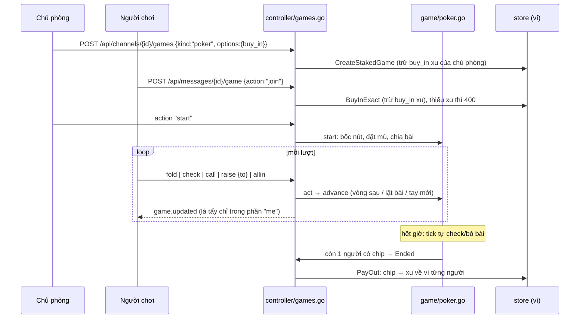
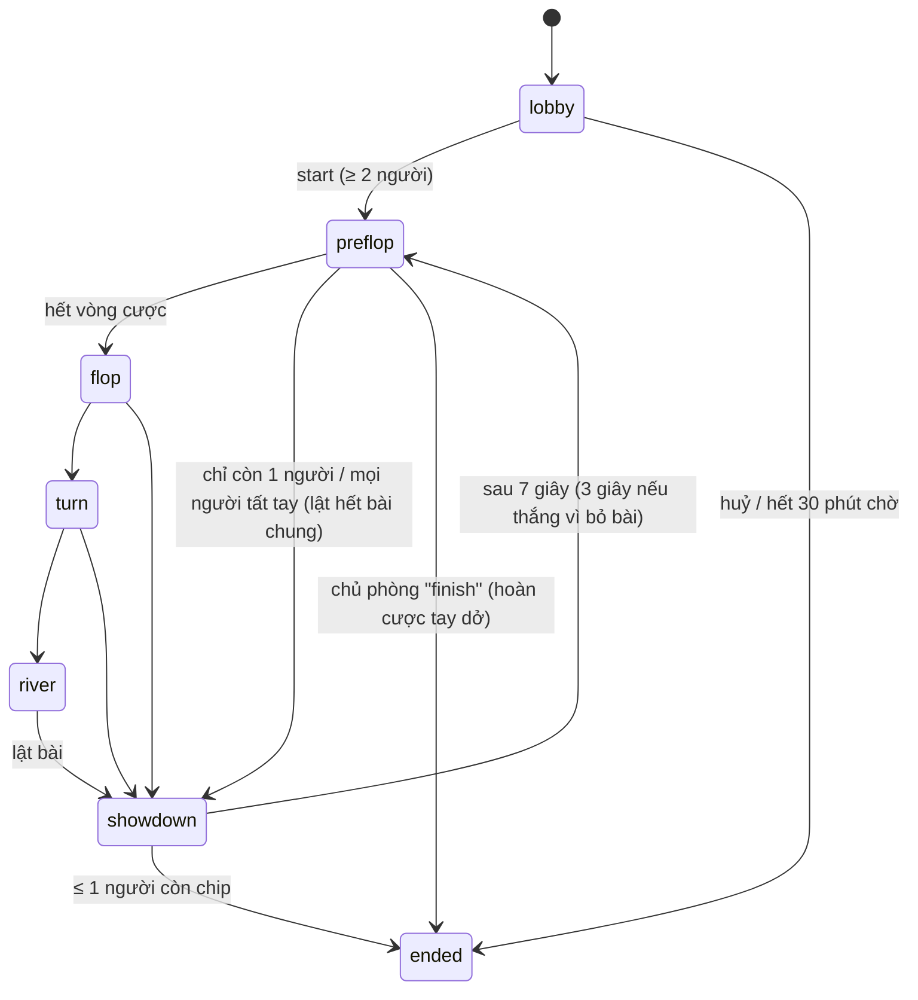

# Đặc tả kỹ thuật (SPEC): Poker Texas Hold'em cược xu

Tài liệu này đặc tả chi tiết kiến trúc, mô hình dữ liệu, luồng tương tác thời gian thực, quy tắc nghiệp vụ và kế hoạch triển khai cho tính năng **Poker Texas Hold'em cược xu** trong hệ thống chat `tidebird/chat`.

---

## 1. Mục tiêu & Phạm vi (Goals & Scope)

### 1.1. Bối cảnh & Vấn đề giải quyết
Khu game trong chat có trò cược xu (bầu cua, oẳn tù tì, cờ tướng) nhưng chưa có trò bài nhiều người. Poker Texas
Hold'em là trò bài phổ biến nhất thế giới, chơi 2–9 người, hợp với kênh chat; người mới cần hướng dẫn ngay trong game.

### 1.2. Mục tiêu chính (Core Goals)
- [x] Texas Hold'em **không giới hạn (No-Limit)** đúng luật quốc tế (theo TDA), 2–9 người, mở trong kênh hoặc tin nhắn riêng.
- [x] **Cược bằng xu trong ví**: mua vào cố định do chủ phòng chọn, hết ván chip đổi lại thành xu.
- [x] **Hướng dẫn cho người mới**: luật, diễn biến một tay, các hành động, thứ tự bộ bài có hình minh hoạ, mẹo chơi.
- [x] Mọi luật chạy trên máy chủ; client chỉ hiển thị. Không lộ lá tẩy của người khác.

### 1.3. Ngoài phạm vi (Out of Scope v1 - Dành cho v2)
- Mua thêm chip giữa ván (rebuy / add-on), vào bàn khi ván đã chạy, rời bàn giữa ván (người chơi có thể "vắng mặt").
- Luật nút chết (dead button): v1 dùng nút di chuyển đơn giản (nút sang người kế tiếp còn chip).
- Úp bài khi thua lúc lật (muck), lật bài theo thứ tự người tố cuối: v1 lật hết bài của người còn lại.
- Các biến thể khác (Pot-Limit Omaha, Limit), bảng xếp hạng Elo cho poker.

---

## 2. Kiến trúc & Luồng hoạt động (Architecture & Flow)

Poker là một `rules` trong `game/` (file `game/poker.go`, đánh giá bài ở `game/poker_eval.go`), cùng khuôn với các trò khác:
controller giữ ván trong bộ nhớ, lưu `Marshal()` vào bảng `games` sau mỗi thay đổi, phát `View()` riêng cho từng người qua
`game.updated`. Không thêm bảng hay endpoint mới.

### 2.1. Biểu đồ Sequence Diagram (Mermaid)



### 2.2. Vòng đời Trạng thái (State Diagram)



---

## 3. Mô hình dữ liệu & API Contracts

### 3.1. Backend Data Models (Go)

```go
type pokerOptions struct {
    BuyIn       int64 `json:"buy_in"`       // 100 | 200 (mặc định) | 500 | 1000 | 2000 | 5000
    TurnSeconds int   `json:"turn_seconds"` // 20 | 30 (mặc định) | 60
    BlindUp     int   `json:"blind_up"`     // tăng mù sau mỗi 5 | 10 | 15 tay; 0 = không tăng
}
```

Trạng thái lưu (`poker`): ghế theo thứ tự vào phòng, `stack` từng người, số tay, nút, mù, vòng (`phase`), bộ bài còn lại,
bài chung, lá tẩy, cược vòng này (`bet`) và cả tay (`total`), mức cược hiện tại, mức tố tối thiểu, ai đã hành động từ lần
tố đủ gần nhất (`acted`), người đang tới lượt, kết quả tay vừa xong, số lần hết giờ liên tiếp, ai vắng mặt.

Mù: mù nhỏ = `max(1, buy_in/100) × hệ số`, mù lớn gấp đôi; hệ số theo cấp `[1, 2, 3, 4, 6, 8, 12, 16, 24, 32, 48, 64]`,
cấp = `(số tay − 1) / blind_up`.

### 3.2. REST Endpoints & WebSocket Events

Dùng lại API game chung:

| Hành động (`POST /api/messages/{id}/game`) | Dữ liệu | Ai |
|---|---|---|
| `join` / `leave` / `start` / `cancel` | | chung mọi trò (cancel chỉ ở phòng chờ) |
| `fold`, `check`, `call`, `allin` | | người tới lượt |
| `raise` | `{to}`: tổng mức cược của mình ở vòng này | người tới lượt |
| `back` | | người đang vắng mặt |
| `finish` | | chủ phòng |

View công khai (`state`): `opts, phase, hand_no, sb, bb, next_blinds, button_id, sb_id, bb_id, seats[{id, stack, bet,
in_hand, folded, all_in, away, out, last, cards, net}], board, pot, cur_bet, turn_id, result{pots[{amount, winners, hand}],
shown, hands, best, won, showdown, busted}`. Phần riêng (`me`): `hole, hand_name, to_call, can_check, can_call, can_raise,
min_to, max_to, away`. Khán giả không có `me`; `cards` chỉ là số lá úp.

---

## 4. Quy tắc nghiệp vụ & Trường hợp biên (Domain Rules & Edge Cases)

| Tình huống | Xử lý |
|---|---|
| Nút tay đầu | Bốc ngẫu nhiên trong những người có chip; mỗi tay sau sang người kế tiếp còn chip. |
| Mù | Người bên trái nút mù nhỏ, kế tiếp mù lớn. Còn 2 người: người cầm nút là mù nhỏ, nói trước ở preflop, nói sau ở các vòng sau. |
| Mù thiếu chip | Đặt hết chip (tất tay); người sau vẫn phải theo đủ mức mù lớn. |
| Thứ tự nói | Preflop: người bên trái mù lớn (mù lớn được nói cuối, được check / tố). Flop/turn/river: người đầu tiên còn bài bên trái nút. |
| Chia bài | Từng lá một, bắt đầu từ người bên trái nút; đốt 1 lá trước flop, turn, river. |
| Cược tối thiểu | 1 mù lớn. Tố: tăng thêm ít nhất bằng lần tố đủ gần nhất của vòng đó. |
| Tất tay thiếu mức tố | Được phép; không mở lại quyền tố cho người đã hành động (họ chỉ được theo / bỏ). Người chưa hành động vẫn tố được. |
| Đối thủ đều đã tất tay | Không tố được nữa, chỉ theo / bỏ. |
| Mọi người tất tay hoặc chỉ còn 1 người cược được | Lật hết bài chung rồi lật bài. |
| Mọi người khác bỏ bài | Người còn lại ăn hết, không lật bài. |
| Pot phụ | Chia theo mức góp của từng người; người đã bỏ bài góp nhưng không có quyền ăn. Cược không ai theo được trả về người cược. |
| Hoà | Chia đều; chip lẻ cho người thắng ngồi gần bên trái nút nhất. |
| So bộ | 5 lá tốt nhất trong 7; A-2-3-4-5 là sảnh thấp nhất; chất không phân hơn kém. |
| Hết giờ lượt | Tự check nếu được, không thì bỏ bài. Hết giờ 2 lượt liền: "vắng mặt", tới lượt là tự check/bỏ ngay, tới khi bấm "Quay lại" hoặc tự hành động. |
| Hết chip | Bị loại (không được chia bài nữa). Còn ≤ 1 người có chip: ván kết thúc, người đó thắng. |
| Chủ phòng kết thúc giữa tay | Huỷ tay: ai cược bao nhiêu nhận lại bấy nhiêu, rồi chip về ví. Thắng = người lãi nhiều nhất. |
| Huỷ khi đang chơi | Bị chặn ("Bấm Kết thúc ván"). Tin chứa ván bị xoá / máy chủ khởi động lại giữa tay: hoàn cược tay dở rồi trả chip về ví. |
| Tiền | 1 xu = 1 chip. Vào bàn trừ đúng `buy_in` (thiếu xu: 400). Rời phòng chờ hoàn lại. Tổng chip luôn bằng tổng mua vào. Tài khoản mới / dùng chung máy bị chặn như các bàn cược khác. |

---

## 5. Thiết kế Giao diện Người dùng (UI / UX)

### 5.1. Bố cục Component
- `desktop/src/components/PokerGame.tsx`:
  - `Poker`: thanh trên (số tay, mù, còn bao nhiêu tay tăng mù, đồng hồ lượt, nút "📖 Luật"); bàn nỉ xanh với 5 ô bài chung
    và pot; dải kết quả tay (ai ăn pot chính / phụ, bằng bộ gì); danh sách ghế (avatar, nút D, SB/BB, chip, hành động gần
    nhất, trạng thái, lá úp hoặc lá đã lật, cược vòng này, chip vừa ăn); khu "Bài của bạn" (2 lá tẩy, tên bộ hiện tại);
    thanh hành động khi tới lượt: Bỏ bài, Check/Theo, Cược/Tố (thanh kéo + ô số + nút Tối thiểu, ½ pot, Pot, Tất tay).
  - `PokerGuide` / `PokerGuideButton`: hộp hướng dẫn cho người mới (mục tiêu, diễn biến một tay, hành động, 10 bộ bài có
    hình lá minh hoạ, xu và chip, mẹo).
  - `PokerLedger`: hết ván, xếp người chơi theo lãi/lỗ.
- `Games.tsx`: phòng chờ hiện mức mua vào, mù, thời gian lượt và nút hướng dẫn; nút "Vào bàn (N xu)" (thiếu xu thì tắt);
  hộp mở game có chọn mức mua vào, thời gian lượt, tốc độ tăng mù và nút hướng dẫn.

### 5.2. Hiệu ứng & Phản hồi Âm thanh
- Ghế tới lượt viền sáng; người thắng nền vàng; 5 lá tạo bộ thắng được viền vàng trên bàn.
- Lá đỏ (cơ, rô) / đen (bích, chuồn), mặt sau lá úp kẻ sọc. Ví đổi thì có tiếng xu như các trò cược khác.
- Màn hình hẹp: ghế xếp một cột, lá bài nhỏ lại.

---

## 6. Tích hợp Thống kê / Bảng xếp hạng (Leaderboard & Stats)
- v1 không tính Elo (trò nhiều người, may rủi). Lãi/lỗ của từng người nằm trong lịch sử ví (`buyin` / `cashout`).

---

## 7. Kế hoạch triển khai từng bước (Implementation Plan)

### Giai đoạn 1: Backend Core & Data Store
- [x] `game/poker_eval.go`: đánh giá 5 lá, chọn 5 lá tốt nhất trong 7.
- [x] `game/poker.go`: luật chơi, mù, vòng cược, pot phụ, hết giờ, vắng mặt, kết thúc; đăng ký kind `poker`.
- [x] Controller: cho mở trong tin nhắn riêng, trả bù chip khi khởi động lại (`GamesNeedingCashout`).
- [x] Unit test `game/poker_test.go` và test luồng tiền `controller/wallet_test.go`.

### Giai đoạn 2: Frontend State & UI Components
- [x] Khai báo kiểu `PokerState`, `PokerMe`, `GAME_INFO.poker`, nhãn "Tới lượt bạn" trong `desktop/src/lib/games.ts`.
- [x] `PokerGame.tsx` (bàn, thanh hành động, hướng dẫn, tổng kết) và tích hợp vào `Games.tsx`.

### Giai đoạn 3: Kiểm thử Toàn diện & Hoàn thiện
- [x] Kiểm tra typecheck `pnpm build`.
- [x] Kiểm tra backend test `go test ./...`.
- [x] Cập nhật tài liệu và kiểm thử thực tế.
