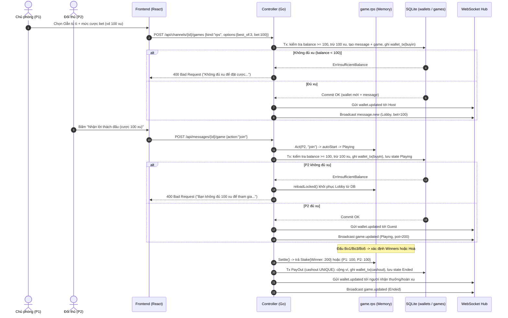
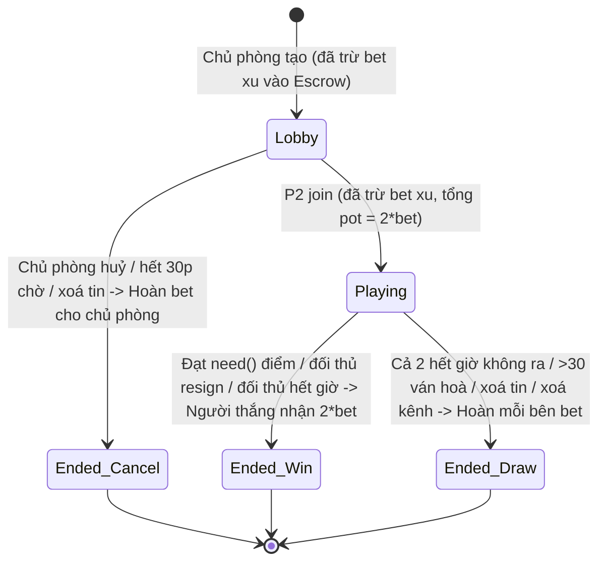

# Đặc tả kỹ thuật (SPEC): Cược Xu Ảo Trong Trò Chơi Oẳn Tù Tì

- **Mã tính năng**: `RPS-BETTING`
- **Trạng thái**: ✅ Đã triển khai
- **Ngày tạo**: 2026-11-25
- **Tài liệu liên quan**: [BAU_CUA_XU_SPEC.md](file:///Users/hoang.nguyen3/tidebird/chat/specs/BAU_CUA_XU_SPEC.md)
- **Thư mục liên quan**:
  - Backend: `game/rps.go`, `game/game.go`, `store/wallet.go`, `controller/wallet.go`, `controller/games.go`, `controller/edit.go`
  - Frontend: `desktop/src/lib/games.ts`, `desktop/src/components/Games.tsx`, `desktop/src/components/Wallet.tsx`, `desktop/src/styles.css`

---

## 1. Mục tiêu & Phạm vi (Goals & Scope)

### 1.1. Bối cảnh & Vấn đề giải quyết
- Hệ thống đã có **Ví xu ảo** (`wallets`, `wallet_tx`) dùng chung toàn server từ tính năng Bầu Cua (`BAU_CUA_XU_SPEC.md`), mỗi người chơi khởi đầu với `1.000` xu, nhận hằng ngày `100` xu và vay ngân hàng `500` xu khi dưới `100` xu.
- Trò chơi **Oẳn tù tì (`rps`)** hiện tại chỉ đấu 1v1 tính thắng/thua & điểm Elo, chưa gắn mức cược xu ảo nên thiếu tính kịch tính ăn thua nhanh giữa hai người trong kênh hoặc tin nhắn riêng (DM).
- Cần bổ sung cơ chế **đặt cược xu ảo với các mức cố định** cho `rps`, đảm bảo **ai không đủ số tiền cược thì không được mở phòng (hoặc không được tham gia nhận thách đấu)**.

### 1.2. Mục tiêu chính (Core Goals)
- [x] Cho phép chủ phòng chọn **mức cược cố định (`bet`)** khi tạo phòng Oẳn tù tì, bao gồm mức chơi vui (`0` xu) và các mức cược xu cố định: `50`, `100`, `200`, `500`, `1.000` xu.
- [x] **Ràng buộc số dư nghiêm ngặt**:
  - Chủ phòng không đủ `balance >= bet` -> **từ chối mở phòng**, không tạo tin nhắn game trong kênh.
  - Người chơi thứ 2 không đủ `balance >= bet` -> **không được tham gia (`join`)**, không trừ tiền, phòng giữ nguyên trạng thái `lobby`.
- [x] **Tạm giữ cược nguyên tử (Escrow)** trên ví hiện có (`wallets` / `wallet_tx`): chỉ trừ đúng `bet` xu của mỗi người (không rút sạch toàn bộ ví như Bầu cua), trả thưởng `2 * bet` cho người thắng hoặc hoàn trả `bet` cho mỗi bên khi hoà/huỷ.
- [x] Đảm bảo **bảo toàn tổng xu** trong mọi kịch bản: hoà, chịu thua, hết giờ, huỷ phòng chờ, xoá tin nhắn game, xoá kênh, server khởi động lại giữa chừng.
- [x] Hiển thị rõ mức cược, tổng giải thưởng (`pot`), trạng thái đủ/thiếu xu ngay trên thẻ Lobby/Playing của `Rps` và hộp thoại `CreateGameDialog`.

### 1.3. Ngoài phạm vi (Out of Scope v1 - Dành cho v2)
- Không cho nhập mức cược tuỳ ý ngoài danh sách mức cố định.
- Không cho vay nóng ngay bên trong thẻ Oẳn tù tì (người chơi thiếu xu phải mở hộp thoại Ví xu để nhận thưởng ngày hoặc vay ngân hàng trước khi tạo/tham gia).
- Không hỗ trợ cược chênh lệch (ví dụ mỗi người cược mức khác nhau) hay cược nhiều hiệp lẻ từng ván (cược tính cho kết quả **chung cuộc** cả trận Bo1/Bo3/Bo5).
- Không áp dụng cược xu khi chơi cùng bot AI (`@ai`), ván do AI tạo luôn có `bet = 0`.
- Không mở rộng sang Cờ tướng / Cờ vua / Caro trong SPEC này.

---

## 2. Kiến trúc & Luồng hoạt động (Architecture & Flow)

### 2.1. Thiết kế tích hợp ví xu (Tái sử dụng `staked` + chế độ cược cố định)
Thay vì viết bảng DB mới, `rps` (khi `bet > 0`) tái sử dụng cơ chế `wallets` + `wallet_tx` hiện có thông qua mở rộng nhỏ ở interface `staked` (`game/game.go`):
- **Bầu cua (`baucua`)**: chế độ *mang toàn bộ số dư vào bàn* (`all-in buy-in`, cho phép `0` xu vào bàn để vay trong bàn).
- **Oẳn tù tì (`rps`, `bet > 0`)**: chế độ *cược mức cố định* (`exact buy-in = bet`, bắt buộc `balance >= bet`, phần dư còn lại vẫn giữ nguyên trong ví của người chơi).
- **Oẳn tù tì (`rps`, `bet == 0`)**: `Staked() == false`, hoạt động hoàn toàn như hiện tại, không chạm DB ví và không sinh bản ghi `wallet_tx`.

### 2.2. Biểu đồ Sequence Diagram (Mermaid)



### 2.3. Vòng đời Trạng thái & Dòng tiền (State Diagram)



---

## 3. Mô hình dữ liệu & API Contracts

### 3.1. Hằng số & Backend Data Models (Go)

#### a) Trong `game/rps.go`
```go
// Các mức cược xu cố định cho Oẳn tù tì (0 = chơi vui miễn phí).
var RpsBetLevels = []int64{0, 50, 100, 200, 500, 1000}

type rpsOptions struct {
	BestOf int   `json:"best_of"` // 1, 3, 5
	Bet    int64 `json:"bet"`     // 0, 50, 100, 200, 500, 1000
}

type rps struct {
	Base
	Opts     rpsOptions      `json:"opts"`
	Picks    [2]string       `json:"picks"`
	Rounds   []rpsRound      `json:"rounds,omitempty"`
	Score    [2]int          `json:"score"`
	Escrow   map[int64]int64 `json:"escrow,omitempty"`   // Số xu đang tạm giữ của mỗi người chơi
	BuyCount map[int64]int64 `json:"buy_count,omitempty"`// Số lần buy-in (seq cho wallet_tx)
}

type rpsPublic struct {
	BestOf int        `json:"best_of"`
	Bet    int64      `json:"bet"`              // Mức cược cố định mỗi người (0 nếu miễn phí)
	Pot    int64      `json:"pot"`              // Tổng xu trong bàn hiện tại (0, bet hoặc 2*bet)
	Score  [2]int     `json:"score"`
	Rounds []rpsRound `json:"rounds"`
	Ready  [2]bool    `json:"ready"`
}
```
- **Chuẩn hoá (`normalize`)**: nếu `Opts.Bet` không nằm trong `RpsBetLevels` thì từ chối hoặc đưa về giá trị hợp lệ? -> **Đề xuất**: kiểm tra hợp lệ ở `New()` / `normalize()`: nếu client gửi mức cược không thuộc `RpsBetLevels` khi tạo phòng thì trả `game.Error("Mức cược không hợp lệ.")` (không tự ý sửa âm thầm từ `999` thành `0` tránh gây hiểu lầm cho người đặt cược!). Khi `Load` dữ liệu cũ (chưa có trường `bet`), mặc định `Opts.Bet = 0`.
- **Thực thi interface `staked` cho `rps`** (chỉ kích hoạt khi `g.Opts.Bet > 0`):
  - `g.Staked()` trả về `true` khi `g.Opts.Bet > 0`, ngược lại `false` khi `g.Opts.Bet == 0`.
  - `stakeRequirement() (exact bool, amount int64)`: trả về `(true, g.Opts.Bet)` với `rps` (`baucua` trả `(false, 0)`).
  - `buyIn(uid, amount int64)`: ghi nhận `g.Escrow[uid] += amount`, `g.BuyCount[uid]++`.
  - `stakeOf(uid int64) Stake`:
    - Nếu `g.Status != Ended`: trả về `Stake{UserID: uid, Chips: g.Escrow[uid], Loans: 0}` (giúp `chipsOnTables` hiển thị đúng số xu đang bị giữ).
    - Nếu `g.Status == Ended`:
      - Nếu `len(g.Winners) == 1`: người thắng (`uid == g.Winners[0]`) nhận toàn bộ tổng `Escrow` (tức `2 * bet`, hoặc `bet` nếu kết thúc bất thường khi mới có 1 người); người thua nhận `0`.
      - Nếu `len(g.Winners) == 0` (hoà, huỷ phòng, hết giờ chờ, xoá tin, server restart): mỗi người nhận lại đúng `g.Escrow[uid]` (`bet`).

#### b) Trong `store/wallet.go`
```go
var ErrInsufficientBalance = errors.New("insufficient balance")
```
Bổ sung các hàm nguyên tử cho cược mức cố định:
1. `CreateStakedGame(ctx, channelID, userID int64, embed model.Embed, status string, state []byte, stakeAmount int64, applyBuyIn func() (string, []byte, error)) (model.Message, Wallet, error)`:
   - Chạy trong **một `sql.Tx` duy nhất**:
     1. `loadWallet` (tạo ví 1.000 xu nếu chưa có).
     2. Kiểm tra `w.Balance < stakeAmount` -> rollback và trả `ErrInsufficientBalance`.
     3. Tạo `messages` + `games` (lấy `message_id`), gọi `applyBuyIn()` để cập nhật `Escrow` & `state` mới.
     4. Trừ ví `balance = balance - stakeAmount`, ghi `wallet_tx(kind='buyin', amount=-stakeAmount, game_id=msg.ID, seq=1)`.
     5. Commit và trả về `model.Message` đầy đủ + `Wallet` mới.
   - Đảm bảo nếu không đủ tiền thì **không bao giờ** sinh tin nhắn phòng game mồ côi trong kênh.
2. `BuyInExact(ctx, gameID, userID, seq, exactAmount int64, apply func(amount int64) (status string, state []byte, err error)) (Wallet, error)`:
   - Chạy trong **một `sql.Tx` duy nhất**:
     1. `loadWallet`.
     2. Nếu `w.Balance < exactAmount` -> trả `ErrInsufficientBalance` (không trừ tiền, không lưu game).
     3. Gọi `apply(exactAmount)`.
     4. `UPDATE wallets SET balance = balance - ? WHERE user_id = ?` (`exactAmount`), ghi `wallet_tx(kind='buyin', amount=-exactAmount, game_id, seq)`.
     5. `UPDATE games SET status = ?, state = ? WHERE message_id = ?`.
3. `GamesNeedingCashout(ctx context.Context, kinds ...string) ([]GameRow, error)`:
   - Mở rộng nhận danh sách `kinds` (vd `"baucua"`, `"rps"`) và lọc thêm với `rps` chỉ lấy những ván có `Escrow` / `bet > 0` (hoặc kiểm tra `g.Staked()` khi load ở `settlePendingCashouts`).

### 3.2. REST Endpoints & WebSocket Events

| Endpoint / Event | Thay đổi | Mô tả chi tiết |
|---|---|---|
| `POST /api/channels/{id}/games` | Mở rộng `options` | `kind: "rps"`, `options: {best_of: 1\|3\|5, bet: 0\|50\|100\|200\|500\|1000}`. Nếu `balance < bet` trả HTTP `400 Bad Request` kèm thông báo số xu thiếu. |
| `POST /api/messages/{id}/game` | Kiểm tra ví khi `action: "join"` | Nếu `rps` có `bet > 0` và `balance < bet`: trả HTTP `400 Bad Request`, rollback state về `Lobby`, không broadcast `game.updated`. |
| `GET /api/wallet` | Không đổi schema | `in_tables` tự động bao gồm xu đang tạm giữ trong các phòng `rps` chưa kết thúc (`Lobby` / `Playing`) nhờ `s.g.Staked()` & `StakeOf`. |
| WS `wallet.updated` | Tái sử dụng | Gửi `{type: "wallet.updated", balance, debt}` cho người chơi ngay khi tạo phòng, join phòng, huỷ phòng, hoặc hết ván nhận thưởng/hoàn tiền. |
| WS `game.updated` | Mở rộng `state` | `game.state` của `rps` có thêm `bet` và `pot`. |

### 3.3. Frontend TypeScript Types (`desktop/src/lib/games.ts`)
```ts
export const RPS_BET_LEVELS = [0, 50, 100, 200, 500, 1000] as const;

export type RpsState = {
  best_of: number;
  bet: number;
  pot: number;
  score: [number, number];
  rounds: { picks: [RpsChoice | "", RpsChoice | ""]; winner: number }[];
  ready: [boolean, boolean];
};
```

---

## 4. Quy tắc nghiệp vụ & Trường hợp biên (Domain Rules & Edge Cases)

### 4.1. Quy tắc chơi & Thanh toán
- **Mức cược cố định**: Chỉ cho phép `0`, `50`, `100`, `200`, `500`, `1.000` xu.
- **Điều kiện tham gia**:
  - Người mở phòng (`host`) phải có `balance >= bet` tại thời điểm bấm "Mở phòng".
  - Người nhận thách đấu (`guest`) phải có `balance >= bet` tại thời điểm bấm "Nhận lời thách đấu".
  - Nếu thiếu dù chỉ 1 xu, server từ chối và giữ nguyên ví + trạng thái phòng.
- **Tỷ lệ ăn thua (Zero-sum)**:
  - Tổng pot = `2 * bet`, không thu phí sàn (rake = 0%).
  - Thắng chung cuộc: nhận `2 * bet` (lãi `+bet`).
  - Thua chung cuộc: nhận `0` (lỗ `-bet`).
  - Hoà chung cuộc: mỗi bên nhận lại `bet` (lãi `0`).
- **Chống gian lận khi đang đấu (`Playing`)**:
  - Hiện tại `game/game.go` cho phép `HostID` gọi action `"cancel"` bất kể `Lobby` hay `Playing`. Với `rps` (đặc biệt khi `bet > 0`), nếu chủ phòng đang bị dẫn điểm (vd `0–1` trong Bo3) mà bấm `cancel` để lấy lại tiền cược sẽ là lỗ hổng nghiêm trọng.
  - **Quy tắc bắt buộc**: Khi `rps` đang ở trạng thái `Playing`, **cấm** action `"cancel"` (trả lỗi `"Ván đã bắt đầu, hãy dùng Chịu thua nếu muốn bỏ cuộc."`). Chỉ được `"cancel"` khi đang ở `Lobby`. Người muốn dừng khi đang `Playing` phải bấm `"resign"` (chịu thua, đối thủ ăn toàn bộ `2 * bet`).

### 4.2. Ma trận Trường hợp biên (Edge Case Matrix)

| Mã | Tình huống (Edge Case) | Cách xử lý chuẩn |
|---|---|---|
| **EC-01** | Chủ phòng mở nhiều phòng `rps` cược liên tiếp vượt quá số dư | Mỗi phòng trừ trực tiếp trong SQLite Tx (`UPDATE ... WHERE` kiểm tra `balance >= bet`), phòng sau không đủ số dư còn lại sẽ bị từ chối `400`. |
| **EC-02** | Hai người cùng lúc bấm `join` một phòng `rps` cược | `gameAction` giữ mutex `s.mu` của ván: người đầu tiên vào và chuyển trạng thái thành `Playing`; người thứ 2 vào sau thấy `Playing` -> `Error("Ván đã bắt đầu, không vào được nữa.")` và **không** bị trừ xu. |
| **EC-03** | Người chơi 2 bấm `join` nhưng không đủ xu (`balance < bet`) | `BuyInExact` trả `ErrInsufficientBalance`, controller gọi `reloadLocked` khôi phục `Lobby` trong bộ nhớ, **không** lưu DB, **không** broadcast, trả HTTP `400`: `"Không đủ X xu để tham gia (bạn đang có Y xu)."` |
| **EC-04** | Người chơi 2 vừa bị trừ xu ở ván khác đúng mili-giây trước khi `join` | Kiểm tra & trừ `balance >= bet` nằm trong `sql.Tx` (SQLite write lock tuần tự hoá), không bao giờ xảy ra số dư âm (`CHECK (balance >= 0)`). |
| **EC-05** | Chủ phòng huỷ phòng ở `Lobby` hoặc hết 30 phút chờ không ai vào | Ván chuyển `Ended` (`Winners = nil`), `Settle()` trả lại `bet` cho chủ phòng qua `payOutLocked` (`cashout`, `UNIQUE` index chống cộng trùng). |
| **EC-06** | Đang `Playing`, hết 30s một ván mà **cả hai** đều không ra tay | Theo luật hiện tại của `rps`: ván tự huỷ (`Winners = nil`). `Settle()` hoàn lại `bet` cho cả 2 người chơi. |
| **EC-07** | Đang `Playing`, hết 30s chỉ **một người** ra tay | Người đã ra thắng ván nhỏ đó. Nếu đủ `need()` điểm -> thắng chung cuộc và nhận toàn bộ `2 * bet`. |
| **EC-08** | Vượt quá 30 ván hoà liên tiếp (`len(Rounds) >= 30`) | Kết thúc hoà (`Winners = nil`), hoàn lại `bet` cho cả 2 người. |
| **EC-09** | Người chơi bấm `Chịu thua (resign)` khi đang `Playing` | Đối thủ trở thành `Winners` duy nhất và nhận toàn bộ `2 * bet`. |
| **EC-10** | Tin nhắn ván bị xoá (`deleteMessage`) hoặc kênh bị xoá (`settleChannelGames`) | `Abort` kết thúc ván (`Winners = nil`), hoàn trả ngay toàn bộ `Escrow` về ví những người đã đặt cược (`payOutLocked`). |
| **EC-11** | Server sập / khởi động lại khi ván đã `Ended` nhưng chưa kịp `cashout` | `settlePendingCashouts` lúc khởi động quét cả `baucua` lẫn `rps` (`GamesNeedingCashout(ctx, "baucua", "rps")`) và trả bù an toàn 1 lần duy nhất. |
| **EC-12** | Ván `rps` cũ trong DB (tạo trước khi có tính năng cược) được mở lại / tải lên | JSON cũ thiếu `bet`/`escrow` -> mặc định `Bet = 0`, `Staked() == false`, hoạt động bình thường không lỗi. |
| **EC-13** | Chủ phòng tạo phòng ở `Lobby`, chưa kịp vào đối thủ thì tự đấu với chính mình (`join`) | Đã có sẵn check `b.isPlayer(p.ID)` trong `game.go` -> trả lỗi `"Bạn đã ở trong phòng rồi."`. |

---

## 5. Thiết kế Giao diện Người dùng (UI / UX)

### 5.1. Hộp thoại tạo game (`CreateGameDialog` trong `Games.tsx`)
Khi chọn `rps`:
- Ngoài select **Thể thức** (`1 ván quyết định`, `Chạm 2 (3 ván)`, `Chạm 3 (5 ván)`), thêm mục **Mức cược (xu)**:
  - Hiển thị dưới dạng nhóm nút chọn nhanh (segmented/pill buttons) hoặc select kèm số dư hiện tại của bản thân (`Ví của bạn: 🪙 1.000 xu`).
  - Các mức cố định: `Miễn phí (0 xu)`, `50 xu`, `100 xu`, `200 xu`, `500 xu`, `1.000 xu`.
  - Các mức lớn hơn `state.wallet.balance` được gắn trạng thái disabled hoặc cảnh báo trực quan `"Không đủ xu"` (nhưng vẫn có tooltip giải thích và server vẫn kiểm tra lại).
  - Nếu người dùng không đủ xu cho mức đang chọn, hiển thị gợi ý ngắn mở **Ví xu** để nhận thưởng ngày / vay ngân hàng.

### 5.2. Thẻ game trong kênh (`Lobby` & `Rps`)
```text
┌─────────────────────────────────────────────────────────┐
│ ✊ Oẳn tù tì · Đang chờ người chơi · 1/2                │
│ Chạm 2 ván thắng · Cược 🪙 100 xu (Thắng ăn 200 xu)     │
│ ┌──────────────────────┐  ┌──────────────────────┐      │
│ │ [Avatar] An (chủ)    │  │       Chỗ trống      │      │
│ └──────────────────────┘  └──────────────────────┘      │
│ [ Nhận lời thách đấu · Cược 100 xu ]   (hoặc Disabled   │
│   kèm chữ: "Không đủ 100 xu (hiện có 40 xu)")           │
└─────────────────────────────────────────────────────────┘
```
- **Ở `Lobby`**:
  - Dòng `game-setup` hiển thị rõ badge cược khi `bet > 0`: `🪙 Cược 100 xu · Người thắng nhận 200 xu` (hoặc `Chơi vui (miễn phí)` khi `bet === 0`).
  - Đối với người chưa tham gia (`!isPlayer && !full`):
    - Nếu `bet > 0` và `myBalance < bet`: nút `Nhận lời thách đấu` hiển thị trạng thái **disabled** (hoặc cảnh báo ngay cạnh nút: `"Cần 100 xu để tham gia (bạn còn 40 xu)"`), không cho bấm gửi request thừa (và kể cả có gọi API trực tiếp, backend vẫn chặn).
    - Nếu đủ xu: nút hiển thị `Nhận lời thách đấu (100 xu)`.
- **Ở `Playing` & `Ended` (`Rps` component)**:
  - Trên phần đầu `.rps` hiển thị badge tổng thưởng `🏆 Pot: 200 xu (Cược 100 xu/người)` khi `bet > 0`.
  - Khi `status === "ended"`:
    - Nếu có người thắng (`winners.length === 1`): hiển thị kết quả rõ `+100 xu` cho người thắng và `-100 xu` cho người thua ngay dưới tên hoặc dòng kết quả.
    - Nếu hoà/huỷ: hiển thị `"Hoàn lại 100 xu mỗi bên"`.
- **Ở `Wallet.tsx`**:
  - Cập nhật dòng chú thích `in_tables`: từ `"X xu đang trên bàn bầu cua"` thành `"X xu đang cược trên bàn"` để phản ánh đúng cả Bầu cua và Oẳn tù tì.

### 5.3. Hiệu ứng & Phản hồi Âm thanh
- Tái sử dụng hệ thống CSS tokens hiện có (`--signal`, `--surface`, `--line`) và phản hồi âm thanh sẵn có của game / ví xu; đảm bảo responsive tốt trên màn hình hẹp (desktop + mobile) và tuân thủ `make verify-css`.

---

## 6. Tích hợp Thống kê / Bảng xếp hạng (Leaderboard & Stats)
- **Bảng xếp hạng Elo (`RATED_KINDS`)**: Oẳn tù tì vẫn giữ tính điểm Elo như hiện tại (`game/elo.go`, `RATED_KINDS`), không tách riêng Elo cho ván cược và ván miễn phí (nhưng giữ nguyên hành vi: chỉ tính Elo khi `Status == Ended` và có kết quả ván).
- **Bảng Đại gia / Con nợ (`/api/channels/{id}/wallet-board`)**: Xu thắng/thua từ Oẳn tù tì đi qua bảng `wallets` và `wallet_tx` nên tự động phản ánh vào tài sản ròng trên bảng Đại gia của kênh!

---

## 7. Kế hoạch triển khai từng bước (Implementation Plan)

### Giai đoạn 1: Backend Core (`game` & `store`)
- [x] Mở rộng `game/rps.go`: thêm `RpsBetLevels`, trường `Bet` trong `rpsOptions`, `Escrow`/`BuyCount` trong `rps`, `Bet`/`Pot` trong `rpsPublic`, triển khai `staked` khi `Bet > 0`, xử lý `Settle()` khi thắng / hoà / huỷ / abort.
- [x] Cập nhật `game/game.go`: chặn `cancel` khi `rps` đang `Playing` (hoặc thêm hook `canCancel()` trên `rules`), bổ sung method hỗ trợ phân biệt buy-in toàn bộ (`baucua`) vs buy-in cố định (`rps`).
- [x] Mở rộng `store/wallet.go`: thêm `ErrInsufficientBalance`, `CreateStakedGame` (tạo game + trừ đúng mức cược trong 1 Tx), `BuyInExact` (trừ đúng mức cược khi join), và cập nhật `GamesNeedingCashout` nhận danh sách `kinds`.
- [x] Viết unit test trong `game/rps_test.go` (hoặc `game/game_test.go`) và `store/wallet_test.go`: test đủ/thiếu xu, thắng nhận `2*bet`, hoà hoàn `bet`, chặn `cancel` lúc `Playing`, idempotent cashout.

### Giai đoạn 2: Backend Controller (`controller`)
- [x] Cập nhật `controller/games.go`:
  - Trong `startGame`: với `rps` có `bet > 0`, dùng `CreateStakedGame` để kiểm tra đủ số dư và trừ cược nguyên tử trước khi tạo tin nhắn; push `wallet.updated`.
  - Trong `gameAction`: khi `join` game cược cố định, gọi `BuyInExact`; nếu trả `ErrInsufficientBalance` thì `reloadLocked` và trả HTTP `400 Bad Request` kèm thông báo thân thiện.
- [x] Cập nhật `controller/wallet.go`: `settlePendingCashouts` quét cả `"baucua"` và `"rps"`.
- [x] Cập nhật `controller/ai_games.go`: đảm bảo nếu AI gợi ý mở `rps` thì mặc định `bet = 0`.
- [x] Viết integration test trong `controller/wallet_test.go` (hoặc `controller/rps_bet_test.go`): test mở phòng thiếu xu bị từ chối (không tạo message), join thiếu xu bị từ chối (phòng vẫn Lobby), thắng/thua/hoà/resign/huỷ/xoá tin/khởi động lại đều bảo toàn tổng xu.

### Giai đoạn 3: Frontend State & UI Components (`desktop`)
- [x] Cập nhật `desktop/src/lib/games.ts`: thêm `RPS_BET_LEVELS` và `bet`, `pot` vào `RpsState`.
- [x] Cập nhật `desktop/src/components/Games.tsx`:
  - Thêm selector chọn mức cược + hiển thị số dư ví trong `CreateGameDialog` cho `rps`.
  - Cập nhật `Lobby`: hiển thị mức cược, khoá nút `Nhận lời thách đấu` kèm lý do nếu ví không đủ `bet`, cập nhật `RULES.rps`.
  - Cập nhật `Rps`: hiển thị banner Pot / mức cược và kết quả biến động xu cuối ván.
- [x] Cập nhật `desktop/src/components/Wallet.tsx`: sửa nhãn `in_tables` thành `"X xu đang cược trên bàn"`.
- [x] Cập nhật `desktop/src/styles.css`: style cho chip mức cược, banner pot và thông báo thiếu xu (desktop & mobile).

### Giai đoạn 4: Kiểm thử Toàn diện & Xác thực
- [x] Chạy `go test ./...` xác nhận tất cả backend tests pass.
- [x] Chạy `pnpm build` (trong `desktop/`) xác nhận TypeScript & Vite build sạch.
- [x] Chạy `make verify` (`./scripts/verify-all.sh`) và đánh dấu hoàn thành toàn bộ checklist.
