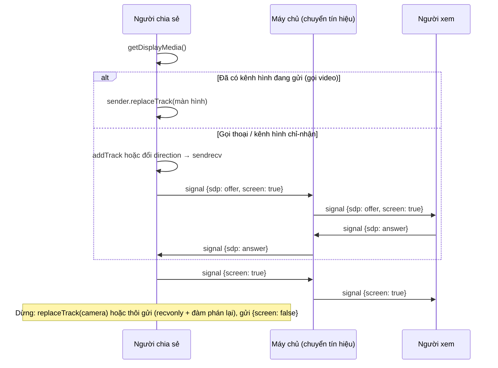

# Chia Sẻ Màn Hình Trong Cuộc Gọi (Screen Share)

## 1. Mục tiêu & Phạm vi (Goals & Scope)

- Trong cuộc gọi 1-1 và gọi nhóm, người dùng chia sẻ màn hình / cửa sổ / tab cho người còn lại.
- Gọi thoại (chưa có kênh hình) vẫn chia sẻ được: đàm phán lại SDP để thêm kênh hình.
- Không thay đổi server: cờ `screen` đi trong `data` của `call.signal` / `groupcall.signal`, server chuyển nguyên văn.

Ngoài phạm vi (v2+): chia sẻ âm thanh hệ thống, vừa camera vừa màn hình cùng lúc, ghim / phóng to một ô trong gọi nhóm, điện thoại (trình duyệt di động không có `getDisplayMedia`).

## 2. Kiến trúc & Luồng hoạt động (Architecture & Flow)



Đàm phán lại theo mẫu "perfect negotiation" (`Renegotiator` trong `desktop/src/lib/screenshare.ts`):

- 1-1: người nghe máy là bên "nhường" (polite). Nhóm: bên có mã phiên (`peer_id`) lớn hơn nhường.
- Hai bên cùng gửi offer: bên không nhường bỏ qua offer đến; bên nhường rollback, trả lời, rồi gửi lại thay đổi của mình.
- Tín hiệu nhận được xử lý tuần tự cho mỗi kết nối (`serial`), tránh tưởng nhầm đụng độ khi offer đến ngay sau answer.
- Answer cho offer đã rút lại (đang `stable`) bị bỏ qua thay vì làm lỗi cuộc gọi.

## 3. Mô hình dữ liệu & API Contracts

```ts
type SignalData = {
  sdp?: RTCSessionDescriptionInit;
  candidate?: RTCIceCandidateInit;
  screen?: boolean; // có khi bật/tắt chia sẻ và kèm mỗi SDP
};
```

- `CallState`: thêm `screen?: MediaStream` (của mình), `remoteScreen?: boolean`, `notice?: string`.
- `GroupState.active.screen?: MediaStream`; `GroupPeer.screen?: boolean`.
- Không đổi REST, websocket server, SQLite.

## 4. Quy tắc nghiệp vụ & Trường hợp biên (Domain Rules & Edge Cases)

| Trường hợp | Xử lý |
|---|---|
| Huỷ hộp chọn màn hình | Không làm gì, không báo lỗi |
| Trình duyệt không hỗ trợ | Ẩn nút; gọi trực tiếp thì báo "chưa hỗ trợ chia sẻ màn hình" |
| Bấm "Dừng chia sẻ" của trình duyệt | `track.onended` → dừng như bấm nút trong app |
| Gọi video, dừng chia sẻ | Quay lại camera (giữ trạng thái tắt/bật camera) |
| Gọi thoại, dừng chia sẻ | Thôi gửi hình (recvonly), bên kia ẩn khung hình |
| Người mới vào gọi nhóm khi đang chia sẻ | Kết nối mới gửi màn hình thay camera, SDP kèm `screen: true` |
| Hai bên cùng bật/tắt một lúc | Perfect negotiation như mục 2 |
| Cúp máy / rời khi đang chia sẻ | Dừng track màn hình, xoá trạng thái |

## 5. Thiết kế Giao diện Người dùng (UI / UX)

- Nút "Màn hình" (biểu tượng màn hình) cạnh Micro / Camera; đang chia sẻ thì nền xanh, nhãn "Dừng chia sẻ".
- 1-1: người xem thấy màn hình toàn khung (`object-fit: contain`), dòng trên cùng "đang chia sẻ màn hình"; người chia sẻ thấy bản xem trước nhỏ (không lật gương).
- Nhóm: ô của người chia sẻ nền đen, không cắt hình, tên kèm "· màn hình".

## 6. Tích hợp Thống kê / Bảng xếp hạng

Không áp dụng.

## 7. Kế hoạch triển khai từng bước (Implementation Plan)

- [x] `lib/screenshare.ts`: `canShareScreen`, `captureScreen`, `setVideoSource`, `Renegotiator`
- [x] `lib/calls.ts`: `toggleScreen` / `stopScreen`, cờ `screen`, xử lý tín hiệu tuần tự
- [x] `lib/groupcall.ts`: như trên cho từng kết nối trong nhóm, người mới vào nhận màn hình
- [x] `CallOverlay.tsx`, `GroupCall.tsx`, `styles.css`: nút, khung hình màn hình
- [x] Kiểm thử đàm phán lại trên Chromium (2 RTCPeerConnection, đụng offer ngẫu nhiên): 6 lần × 19 bước đều đạt
- [ ] Thử tay trên 2 máy thật (Chrome + Firefox, qua tunnel HTTPS)
