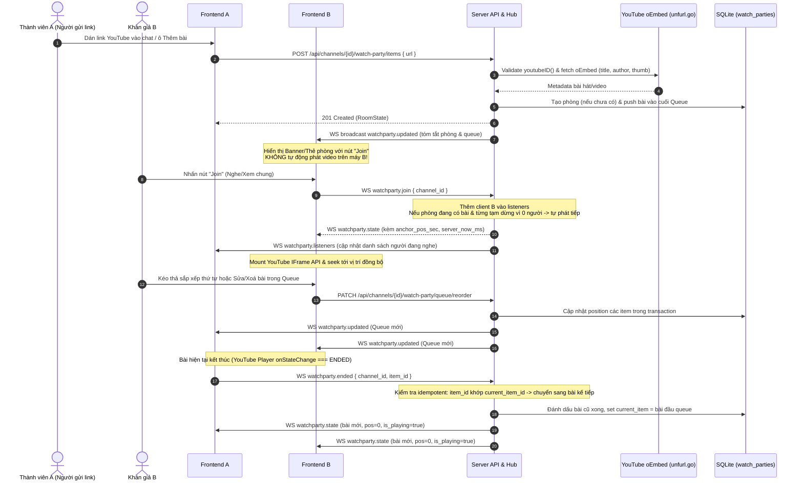
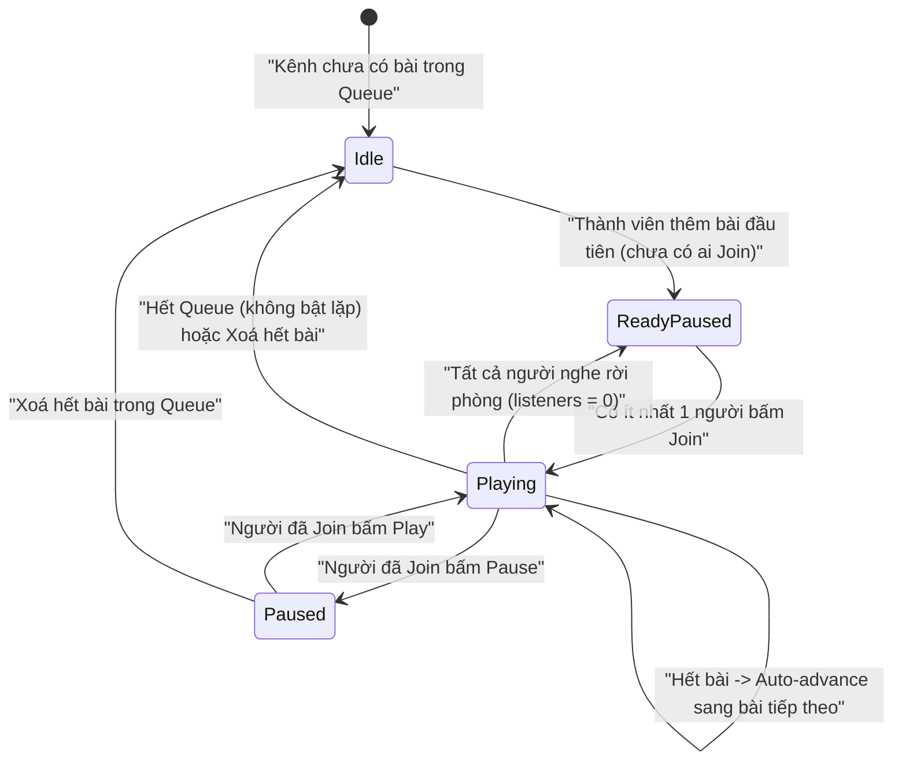

# Đặc tả kỹ thuật (SPEC): Phòng Nghe Nhạc & Xem Video YouTube Chung Theo Hàng Đợi

Tài liệu này đặc tả chi tiết kiến trúc, mô hình dữ liệu, cơ chế đồng bộ thời gian thực, hàng đợi cộng tác (Queue) và giao diện người dùng cho tính năng **Phòng Nghe Nhạc & Xem Video YouTube Chung (Watch Party / Music Queue)** trong hệ thống `tidebird/chat`.

---

## 1. Mục tiêu & Phạm vi (Goals & Scope)

### 1.1. Bối cảnh & Vấn đề giải quyết
- Hiện tại, khi một thành viên dán link YouTube vào kênh chat, `LinkPreview.tsx` chỉ hiển thị một thẻ xem trước đơn lẻ và mỗi người tự bấm phát độc lập trên máy mình — không đồng bộ thời gian, không có danh sách phát nối tiếp, và không biết ai đang cùng nghe/xem.
- Người dùng cần một không gian **Nghe nhạc / Xem video chung theo kênh**:
  - Có thể khởi tạo nhanh ngay từ link YouTube vừa dán trong khung chat hoặc từ panel phòng nhạc.
  - **Bắt buộc nhấn Join (Opt-in)** mới được kết nối vào luồng nghe/xem chung (người không Join không bị tự động phát video/âm thanh làm phiền).
  - Hoạt động theo **Hàng đợi (Queue)**: bài mới thêm luôn được đẩy xuống cuối danh sách và chạy lần lượt; **mọi thành viên** đều có quyền cộng tác **thêm, xoá, sửa và sắp xếp thứ tự** bài trong hàng đợi.

### 1.2. Mục tiêu chính (Core Goals)
- [x] **Opt-in Join bắt buộc**: Khán giả chỉ nghe/xem đồng bộ khi chủ động bấm nút **`Join` / `Tham gia nghe chung`**; trước khi Join chỉ thấy thông tin tóm tắt (bài đang phát, số người đang nghe, hàng đợi).
- [x] **Hàng đợi cộng tác (Collaborative FIFO Queue)**:
  - Thêm bài từ link YouTube (`youtube.com/watch`, `youtu.be`, `youtube.com/shorts`, `youtube.com/live`, `music.youtube.com`) -> tự động parse `video_id`, lấy tiêu đề/tác giả/thumbnail qua `oEmbed` (tái sử dụng `controller/unfurl.go`) và đẩy vào cuối hàng đợi.
  - Phát tuần tự từng bài (`auto-advance` khi bài hiện tại kết thúc).
  - Mọi thành viên trong kênh đều có thể: **thêm bài**, **sắp xếp thứ tự** (kéo thả hoặc nút lên/xuống), **sửa thông tin bài** (đổi tên hiển thị / thay link bài chờ), **xoá bài**, **qua bài (Next)**, và **Play/Pause/Seek**.
- [x] **Đồng bộ phát (Playback Sync)**: Server giữ mốc neo thời gian (`anchor_pos_sec`, `anchor_server_ms`, `is_playing`) và phát sự kiện WebSocket `watchparty.state` để toàn bộ người đã Join phát đồng bộ (sai số chấp nhận `<= 1.8s`).
- [x] **Lưu trữ bền vững**: Hàng đợi được lưu trong SQLite để không mất danh sách bài khi F5, đổi kênh hoặc khởi động lại server; trạng thái listener (ai đang Join) đồng bộ thời gian thực qua WebSocket.
- [x] **Trải nghiệm đa nhiệm**: Hỗ trợ thu gọn thành **Mini Player** nổi khi chuyển sang kênh chat khác mà vẫn đang Join phòng nghe nhạc.

### 1.3. Ngoài phạm vi (Out of Scope v1 - Dành cho v2)
- Tự động tìm kiếm YouTube bằng từ khoá trong app (YouTube Data API v3 search — v1 nhận trực tiếp URL YouTube hoặc link playlist đơn lẻ lấy video đầu).
- Upload file MP3/MP4 nội bộ vào hàng đợi chung (v1 chỉ hỗ trợ YouTube).
- Phân quyền DJ/Host khắt khe (v1 áp dụng mô hình **cộng tác mở** trong kênh theo đúng yêu cầu: ai cũng có thể thêm, xoá, sửa, sắp xếp).
- Nghe chung trong DM mã hoá đầu cuối (v1 tập trung cho **Channel thường**; DM có thể mở rộng ở v2).

---

## 2. Kiến trúc & Luồng hoạt động (Architecture & Flow)

### 2.1. Biểu đồ Sequence Diagram (Dán link, Join & Phát theo Queue)



### 2.2. Vòng đời Trạng thái Phòng Nghe Chung (State Diagram)



---

## 3. Mô hình dữ liệu & API Contracts

### 3.1. SQLite Schema (`database/migrations/000021_watch_party.up.sql`)

```sql
-- Phòng Nghe nhạc / Xem chung của mỗi kênh (tối đa 1 phòng / kênh)
CREATE TABLE IF NOT EXISTS watch_parties (
    channel_id        INTEGER PRIMARY KEY REFERENCES channels (id) ON DELETE CASCADE,
    current_item_id   INTEGER, -- NULL nếu hàng đợi rỗng
    is_playing        INTEGER NOT NULL DEFAULT 0, -- 0: paused, 1: playing
    anchor_pos_sec    REAL    NOT NULL DEFAULT 0, -- vị trí (giây) tại thời điểm anchor_updated_at
    anchor_updated_ms INTEGER NOT NULL DEFAULT 0, -- epoch ms phía server
    loop_mode         TEXT    NOT NULL DEFAULT 'off', -- 'off' | 'queue' | 'single'
    version           INTEGER NOT NULL DEFAULT 1,
    updated_at        DATETIME NOT NULL DEFAULT CURRENT_TIMESTAMP
);

-- Danh sách bài hát/video trong hàng đợi của phòng
CREATE TABLE IF NOT EXISTS watch_party_items (
    id            INTEGER PRIMARY KEY AUTOINCREMENT,
    channel_id    INTEGER NOT NULL REFERENCES channels (id) ON DELETE CASCADE,
    video_id      TEXT    NOT NULL, -- 11 ký tự YouTube ID
    url           TEXT    NOT NULL,
    title         TEXT    NOT NULL,
    author        TEXT    NOT NULL DEFAULT '',
    thumbnail_url TEXT    NOT NULL DEFAULT '',
    duration_sec  INTEGER NOT NULL DEFAULT 0, -- 0 nếu chưa biết; cập nhật khi player báo lên
    position      INTEGER NOT NULL,           -- thứ tự trong queue (0, 1, 2...); bài đã phát có status = 'played'
    status        TEXT    NOT NULL DEFAULT 'queued', -- 'playing' | 'queued' | 'played'
    added_by      INTEGER NOT NULL REFERENCES users (id) ON DELETE CASCADE,
    created_at    DATETIME NOT NULL DEFAULT CURRENT_TIMESTAMP,
    updated_at    DATETIME NOT NULL DEFAULT CURRENT_TIMESTAMP
);

CREATE INDEX IF NOT EXISTS idx_wp_items_channel_status_pos
    ON watch_party_items (channel_id, status, position, id);
```

### 3.2. Go Structs (`model/watchparty.go` & `controller/watchparty.go`)

```go
type WatchPartyItem struct {
	ID           int64      `json:"id"`
	ChannelID    int64      `json:"channel_id"`
	VideoID      string     `json:"video_id"`
	URL          string     `json:"url"`
	Title        string     `json:"title"`
	Author       string     `json:"author"`
	ThumbnailURL string     `json:"thumbnail_url"`
	DurationSec  int        `json:"duration_sec"`
	Position     int        `json:"position"`
	Status       string     `json:"status"` // "playing" | "queued" | "played"
	AddedBy      PublicUser `json:"added_by"`
	CreatedAt    time.Time  `json:"created_at"`
}

type WatchPartyState struct {
	ChannelID       int64            `json:"channel_id"`
	CurrentItem     *WatchPartyItem  `json:"current_item,omitempty"`
	Queue           []WatchPartyItem `json:"queue"`
	IsPlaying       bool             `json:"is_playing"`
	AnchorPosSec    float64          `json:"anchor_pos_sec"`
	AnchorUpdatedMs int64            `json:"anchor_updated_ms"`
	ServerNowMs     int64            `json:"server_now_ms"`
	LoopMode        string           `json:"loop_mode"` // "off" | "queue" | "single"
	Listeners       []PublicUser     `json:"listeners"`
	ListenerCount   int              `json:"listener_count"`
	Joined          bool             `json:"joined"` // True với chính user đang nhận view này
	Version         int              `json:"version"`
}
```

### 3.3. REST API Endpoints (`controller/watchparty.go` & `controller/api.go`)

Mọi endpoint đều yêu cầu `requireAuth` + `requireMember(channel_id)` và chỉ áp dụng cho kênh thường (`!ch.IsDM()`):

| Method & Path | Payload | Mô tả |
| :--- | :--- | :--- |
| `GET /api/channels/{id}/watch-party` | - | Lấy trạng thái phòng, bài đang phát, hàng đợi `queue`, danh sách `listeners` và cờ `joined`. |
| `POST /api/channels/{id}/watch-party/items` | `{ url: string, title?: string, announce_in_chat?: boolean }` | Parse YouTube ID + oEmbed, đẩy bài vào cuối `queue` (nếu phòng chưa có bài đang phát thì đặt làm `current_item`). Nếu `announce_in_chat = true`, gửi 1 tin nhắn thẻ mời nghe chung trong kênh. |
| `PATCH /api/channels/{id}/watch-party/items/{itemId}` | `{ title?: string, url?: string, duration_sec?: number }` | **Sửa bài**: đổi tên hiển thị tuỳ chỉnh hoặc đổi link YouTube cho bài trong hàng đợi (hoặc cập nhật `duration_sec` từ player). |
| `DELETE /api/channels/{id}/watch-party/items/{itemId}` | - | **Xoá bài**: xoá bài khỏi queue; nếu xoá đúng `current_item` thì tự động chuyển sang bài kế tiếp. |
| `PUT /api/channels/{id}/watch-party/queue/reorder` | `{ item_ids: number[], version?: number }` | **Sắp xếp thứ tự**: nhận danh sách ID mới của toàn bộ `queued` items và cập nhật `position = 0..N-1` trong 1 transaction. |
| `DELETE /api/channels/{id}/watch-party/queue` | - | Xoá toàn bộ các bài đang chờ trong hàng đợi (hoặc tuỳ chọn `include_current=true`). |
| `POST /api/channels/{id}/watch-party/control` | `{ action: "play" \| "pause" \| "seek" \| "next" \| "prev" \| "loop", position_sec?: number, loop_mode?: string }` | Điều khiển phát nhạc (yêu cầu người bấm phải đang **Join** phòng, ngoại trừ `next` hoặc hiển thị nút nhắc Join). |

### 3.4. WebSocket Events (`controller/events.go` & `controller/socket.go`)

#### Client → Server:
- `watchparty.join { channel_id }`: Tham gia nghe/xem chung kênh `channel_id`. (Nếu client đang Join ở một kênh khác, server tự động `leave` khỏi kênh cũ trước khi Join kênh mới).
- `watchparty.leave { channel_id }`: Rời khỏi phòng nghe chung (nhạc dừng trên máy mình, các thành viên khác vẫn nghe tiếp).
- `watchparty.ended { channel_id, item_id }`: Client đang Join báo bài `item_id` đã phát hết (`YT.PlayerState.ENDED`) để server chuyển bài kế tiếp.
- `watchparty.sync_duration { channel_id, item_id, duration_sec }`: Client báo thời lượng thật của video từ `player.getDuration()` (nếu DB đang là `0`).

#### Server → Client:
- `ready`: Bổ sung `watch_parties?: WatchPartySummary[]` (danh sách phòng đang có nhạc/người nghe trong các kênh user tham gia để hiển thị ngay trên Topbar/Sidebar).
- `watchparty.state` (broadcast tới cả kênh qua `hub.ToChannel`, kèm bản riêng `joined: true` cho các client đang trong `listeners`): gửi toàn bộ `WatchPartyState` mỗi khi thêm/sửa/xoá/sắp xếp queue, play/pause/seek, chuyển bài, hoặc có người Join/Leave.
- `watchparty.error { channel_id, message }`: Báo lỗi riêng cho client nếu thao tác không hợp lệ.

---

## 4. Quy tắc nghiệp vụ & Xử lý trường hợp biên (Domain Rules & Edge Cases)

### 4.1. Quy tắc bắt buộc Join & Quyền điều khiển
1. **Ràng buộc Join để nghe/xem chung**:
   - Người chưa bấm **Join**: UI tuyệt đối **không render YouTube `<iframe>` phát nhạc**; chỉ hiển thị thanh/thẻ phòng với thông tin bài hiện tại, số người đang nghe và nút **`🎧 Join`**.
   - Chỉ thành viên đang ở trạng thái **Joined** mới có thể bấm điều khiển phát (`Play`, `Pause`, `Seek`, `Next`, `Loop`), đảm bảo tránh trường hợp người ngoài không nghe nhưng bấm phá nhịp phát.
2. **Quyền cộng tác Hàng đợi (Queue)**:
   - **Tất cả thành viên trong kênh** đều có quyền: **Thêm bài mới** (đẩy về cuối Queue), **Sắp xếp thứ tự** (kéo thả hoặc nút lên/xuống), **Sửa** (tên hiển thị, đổi URL), **Xoá** bài bất kỳ trong Queue.
3. **Thẻ tin nhắn khi dán link YouTube**:
   - Khi thành viên dán link YouTube vào chat như bình thường (`LinkPreview.tsx`):
     - Vẫn giữ nút xem đơn lẻ như cũ nếu muốn xem nhanh một mình, **VÀ** hiển thị thêm nút hành động **`🎧 Thêm vào Nghe chung`** (hoặc **`🎵 Mở phòng Nghe chung`**).
     - Khi bấm nút này, link được gửi vào `POST /api/channels/{id}/watch-party/items` và tự động mời người bấm `Join` nếu chưa Join!
   - Đồng thời trong Composer (`+` menu) có mục **"🎵 Nghe nhạc / Xem chung"** để mở nhanh hộp thoại dán link & quản lý hàng đợi.

### 4.2. Ma trận Trường hợp biên (Edge Cases Matrix)

| Tình huống biên | Nguyên nhân | Cách xử lý chuẩn |
| :--- | :--- | :--- |
| **Người cuối cùng bấm Leave / đóng tab** | `len(listeners)` giảm từ `1 -> 0` | Lưu lại `anchor_pos_sec` tại thời điểm người cuối rời đi và tự chuyển `is_playing = false` (tạm dừng). Khi có người mới bấm `Join`, tiếp tục phát từ vị trí đó — tránh nhạc tự trôi hết sạch hàng đợi khi không có ai nghe. |
| **Nhiều client cùng gửi `watchparty.ended`** | 10 người cùng nghe -> cả 10 máy đều gửi `ended` gần như cùng lúc | Server khoá mutex phòng `wp.mu`, kiểm tra `wp.currentItemID == req.ItemID`. Người đầu tiên khớp sẽ chuyển sang bài tiếp theo và đổi `currentItemID`; 9 request còn lại bị bỏ qua an toàn (idempotent). |
| **Autoplay bị trình duyệt chặn có tiếng** | Người dùng bấm `Join` trên tab nền hoặc Safari chặn autoplay | Nhờ thao tác bấm nút **`Join`** là user gesture trực tiếp, client khởi tạo/gọi `playVideo()` ngay trong handler click (hoặc fallback bật muted + hiện nút nổi `"🔊 Bấm để bật tiếng"` nếu WebView vẫn chặn). |
| **Video YouTube bị chặn nhúng (Error 101 / 150)** | Chủ kênh YouTube tắt cho phép embed ngoài | Player bắt sự kiện `onError` (`101` / `150` / `100`), hiển thị thông báo rõ `"Video này không cho phép nhúng phát ngoài YouTube"`, kèm nút **"Mở trên YouTube"** và nút **"Bỏ qua bài này (Next)"**. |
| **2 người sắp xếp Queue đồng thời** | A và B cùng kéo thả item | Backend cập nhật theo thứ tự trong SQLite transaction và tăng `version`. Frontend nhận `watchparty.state` mới nhất từ WebSocket và đồng bộ lại ngay danh sách. |
| **Sửa URL của bài ĐANG phát (`current_item`)** | Thành viên sửa link của bài đang chạy | Nếu sửa link hợp lệ khác: server parse `video_id` mới, reset `anchor_pos_sec = 0`, `anchor_updated_ms = now`, giữ trạng thái `is_playing` và broadcast để các máy reload sang video mới. |
| **Xoá bài ĐANG phát (`current_item`)** | Thành viên bấm xoá bài đang chạy | Tự động chuyển sang bài kế tiếp trong Queue (`position` nhỏ nhất); nếu Queue rỗng -> về trạng thái `Idle`. |
| **Mạng chậm / Đồng hồ client lệch giờ server** | Đồng hồ máy client nhanh/chậm vài giây | Server luôn đính kèm `server_now_ms` trong `watchparty.state`; client tính `clockOffset = server_now_ms - Date.now()` để quy đổi vị trí phát chính xác, và chỉ `seekTo` khi lệch `> 1.8 giây`. |
| **Người dùng chuyển sang kênh chat khác khi đang Join** | Đang nghe nhạc ở `#giai-tri`, bấm sang `#dev` | Không tự `Leave` khi đổi kênh trên UI; hiển thị **Mini Player nổi** ở góc dưới Sidebar/màn hình kèm nút mở lại phòng và nút `Rời phòng`. Chỉ tự `Leave` khi bấm Rời, đóng tab, hoặc bấm Join phòng ở kênh khác. |
| **Thành viên đang trong cuộc gọi thoại/video** | Vừa bật GroupCall vừa Join Watch Party | Hiện cảnh báo nhẹ khi Join trong lúc đang gọi; cung cấp thanh trượt âm lượng riêng (`0% - 100%`) lưu vào `localStorage`. |
| **Dán link không phải YouTube / YouTube Shorts / Playlist** | Link rác hoặc link playlist `?list=...` | Dùng `youtubeID()` trong `controller/unfurl.go` kiểm tra chặt; nếu là link có cả `?v=ID&list=...` thì lấy video `ID` đó; nếu link không hợp lệ trả lỗi `400 Bad Request`. |

---

## 5. Thiết kế Giao diện Người dùng (UI / UX)

### 5.1. Vị trí tích hợp trên giao diện kênh (`ChannelView.tsx`)
1. **Topbar Banner (`WatchPartyBanner.tsx`)** — đặt ngay cạnh/dưới `GroupCallBanner` và `LiveGamesBar`:
   - **Khi chưa Join**:
     - Hiển thị thumbnail nhỏ bài đang phát + tiêu đề + sóng nhạc tĩnh + số người đang nghe (`🎧 4 người đang nghe chung`) + số bài trong hàng đợi (`📋 5 bài chờ`).
     - Nút chính nổi bật: **`🎧 Join nghe chung`** (kèm nút `Xem hàng đợi` để xem/thêm bài mà chưa cần bật nhạc).
   - **Khi đã Join**:
     - Mở **Watch Party Panel** (có thể thu gọn thành thanh bar mỏng hoặc mở rộng xem video 16:9 + danh sách Queue bên cạnh).
2. **Thẻ Link YouTube trong khung chat (`LinkPreview.tsx`)**:
   - Bên dưới khung preview YouTube có thêm thanh hành động nhỏ:
     - **`🎧 Thêm vào Nghe chung`** (nếu kênh đã có phòng) hoặc **`🎵 Nghe chung bài này`** (tạo/mở phòng và Join).
3. **Watch Party Panel (`WatchPartyPanel.tsx`)**:
   - **Khu vực Trình phát (Trái / Trên)**:
     - Chỉ render khi `joined === true`.
     - Khung YouTube IFrame Player API (`youtube-nocookie.com`) tỷ lệ `16:9` (hoặc chế độ **Chỉ nghe nhạc / Thu gọn video** giúp tiết kiệm diện tích khi vừa nghe nhạc vừa chat!).
     - Thanh điều khiển đồng bộ phía dưới video: `⏯️ Phát/Tạm dừng`, `⏭️ Qua bài`, thanh tua `Seek` + thời gian hiện tại/tổng, chế độ lặp `🔁 Tắt / Lặp danh sách / Lặp 1 bài`, thanh âm lượng cục bộ (riêng mỗi máy), và nút **`🚪 Rời phòng`**.
     - Hàng avatar các khán giả đang nghe chung (`Listeners`).
   - **Khu vực Hàng đợi (Phải / Dưới)**:
     - Ô nhập nhanh: **`Dán link YouTube để thêm vào cuối hàng đợi...`** + nút **`+ Thêm`**.
     - Danh sách Queue (đánh số `#1, #2...`):
       - Hiển thị thumbnail nhỏ, tiêu đề bài hát, tác giả/kênh YouTube, tên người thêm (`Added by @...`).
       - Các nút thao tác cho **mọi thành viên**:
         - Kéo thả (drag handle `⠿`) hoặc nút **`▲` / `▼`** để đổi thứ tự.
         - Nút **`✏️ Sửa`** (mở inline input sửa tiêu đề hiển thị hoặc thay link YouTube).
         - Nút **`🗑️ Xoá`** để bỏ bài khỏi hàng đợi.
4. **Mini Player toàn cục (`WatchPartyMiniPlayer.tsx` trong `Workspace.tsx`)**:
   - Khi đã `Join` một phòng ở kênh A và chuyển sang xem kênh B, hiển thị một widget gọn ở góc dưới bên trái (trên `WalletButton` ở `Sidebar`) gồm tên bài hát đang chạy, nút `⏯️`, `⏭️`, quay về kênh A, và nút `✕ Rời`.
   - *Lưu ý quan trọng*: Element YouTube Player nên giữ mount ổn định ở cấp `Workspace.tsx` (ẩn/thu nhỏ qua CSS hoặc chuyển slot portal) để khi chuyển kênh nhạc **không bị khựng hoặc tải lại iframe**!

---

## 6. Tích hợp Thống kê / Trải nghiệm bổ sung (Stats & Polish)

- Trong `WatchPartyPanel`, hiển thị lịch sử ngắn **Đã phát gần đây (`Played History`)** (tối đa 10 bài gần nhất) kèm nút **`+ Thêm lại vào cuối Queue`** để mọi người bật lại bài hay chỉ với 1 cú click.
- Khi có người thêm bài mới hoặc qua bài, có thể hiện log nhẹ hoặc toast nhỏ trong panel (`"@linh đã thêm 'Lạc Trôi' vào hàng đợi"`).

---

## 7. Kế hoạch triển khai từng bước (Step-by-Step Implementation Plan)

### Giai đoạn 1: Database & Store (Backend)
- [x] Tạo migration `database/migrations/000021_watch_party.up.sql` & `.down.sql` (`watch_parties`, `watch_party_items`).
- [x] Định nghĩa struct trong `model/watchparty.go`.
- [x] Xây dựng `store/watchparty.go`:
  - `GetWatchParty`, `AddWatchPartyItem` (tự tạo phòng nếu chưa có, đẩy bài mới về cuối `MAX(position)+1` hoặc đặt làm `current_item` nếu rỗng).
  - `UpdateWatchPartyItem` (sửa tiêu đề / URL / `duration_sec`), `DeleteWatchPartyItem` (xoá & tự advance nếu xoá bài đang phát).
  - `ReorderWatchPartyQueue`, `ClearWatchPartyQueue`, `SetWatchPartyPlayback` (`play`/`pause`/`seek`/`next`/`loop`).
- [x] Viết unit tests trong `store/watchparty_test.go` (FIFO append, reorder, edit, delete current item auto-advance, loop modes, empty queue).

### Giai đoạn 2: Controller, Realtime Sync & YouTube oEmbed
- [x] Tái sử dụng helper `youtubeID()` & `fetchYouTubeMeta()` từ `controller/unfurl.go` (refactor nhẹ để dùng chung cho cả preview và watch party).
- [x] Xây dựng `controller/watchparty.go`:
  - Quản lý in-memory `listeners` theo `channel_id` + `*socket.Client` (tương tự `groupRegistry`).
  - Xử lý WS `watchparty.join`, `watchparty.leave`, `watchparty.ended`, `watchparty.sync_duration` và tự động cleanup khi client disconnect.
  - Xử lý REST endpoints (`/api/channels/{id}/watch-party*`) và broadcast `watchparty.state`.
  - Rule tự tạm dừng khi `len(listeners) == 0` và idempotent `watchparty.ended`.
- [x] Đăng ký routes trong `controller/api.go`, events trong `controller/events.go`, `controller/socket.go`.
- [x] Viết integration tests trong `controller/watchparty_test.go` (dán link -> broadcast không tự join -> user khác Join -> reorder/edit/delete -> ended idempotency -> last listener leave pauses playback).

### Giai đoạn 3: Frontend YouTube IFrame Sync & Queue UI
- [x] Thêm types & API calls vào `desktop/src/lib/api.ts`, `desktop/src/lib/socket.ts`, `desktop/src/state/chat.ts`, `desktop/src/state/ChatProvider.tsx`.
- [x] Xây dựng wrapper YouTube IFrame API (`desktop/src/lib/youtubePlayer.ts`) hỗ trợ load script, `playVideo`, `pauseVideo`, `seekTo`, `setVolume`, `onEnded`, `onError`.
- [x] Xây dựng components (`desktop/src/components/WatchParty.tsx`):
  - `WatchPartyBanner` (Banner trên kênh với nút Join bắt buộc).
  - `WatchPartyPanel` (Player đồng bộ + Danh sách Listeners + Queue kéo thả/lên xuống/thêm/xoá/sửa).
  - `WatchPartyPlayerDock` & `AddWatchPartyDialog` (giữ iframe sống liên tục khi chuyển kênh).
- [x] Tích hợp nút **"🎧 Nghe chung"** vào `LinkPreview.tsx` (khi dán link YouTube) và `Composer.tsx` (menu `+`), cùng style trong `desktop/src/styles.css`.

### Giai đoạn 4: Kiểm thử & Xác thực
- [x] Chạy `go test -count=1 ./...` & `go vet ./...`.
- [x] Chạy `pnpm -C desktop build` & `./scripts/verify-css.sh --strict`.
