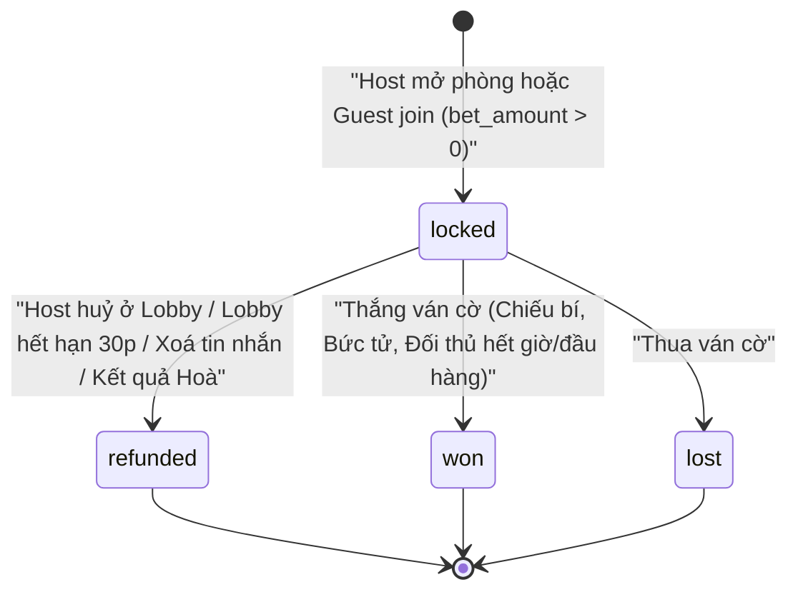

# Đặc tả kỹ thuật (SPEC): Hệ Thống Ví Tiền Ảo & Đặt Cược Cờ Tướng

Tài liệu này đặc tả chi tiết kiến trúc, cơ sở dữ liệu sổ cái (ledger), luồng giữ tiền bảo chứng (escrow), giao dịch P2P, quy tắc nghiệp vụ, giao diện người dùng và kế hoạch triển khai cho tính năng **Ví Xu & Đặt Cược Cờ Tướng** trong hệ thống `tidebird/chat`.

---

## 1. Mục tiêu & Phạm vi (Goals & Scope)

### 1.1. Bối cảnh & Vấn đề giải quyết
- Hiện tại trò chơi **Cờ Tướng** (`game/xiangqi.go`, `XiangqiGame.tsx`) mới chỉ dừng ở mức đánh giao hữu và thống kê thắng/thua/hoà trên Bảng xếp hạng.
- Người chơi nội bộ muốn tăng tính kịch tính, trách nhiệm trong mỗi nước cờ và tạo hệ sinh thái tương tác thông qua **mức cược (stake)** khi mở bàn và **giao dịch tiền ảo (Xu)** giữa các thành viên.
- Hiện hệ thống chưa có bất kỳ bảng ví tiền, số dư hay lịch sử giao dịch nào trong SQLite.

### 1.2. Mục tiêu chính (Core Goals)
- [ ] **Hệ thống Ví Xu nội bộ (`wallets` + `wallet_transactions`)**:
  - Mỗi tài khoản được cấp vốn khởi tạo **10,000 Xu** (bao gồm backfill cho các tài khoản hiện có).
  - Hỗ trợ **Điểm danh hàng ngày** (+2,000 Xu/ngày) và **Nhận cứu trợ (Bailout)** (+1,000 Xu khi tổng tài sản khả dụng + đang khoá dưới ngưỡng tối thiểu).
  - Hỗ trợ **Chuyển Xu P2P** giữa các thành viên kèm ghi chú và lưu vết sổ cái đầy đủ.
  - Mọi biến động số dư tuân thủ nguyên tắc **Sổ cái chỉ ghi thêm (Append-Only Ledger)** trong cùng transaction SQLite (`BEGIN IMMEDIATE`), đảm bảo bất biến `wallet.balance == SUM(wallet_transactions.amount)`.
- [ ] **Đặt cược Cờ Tướng 1v1 với cơ chế Escrow**:
  - Chủ phòng chọn mức cược khi mở bàn Cờ Tướng (`0` = giao hữu miễn phí, hoặc chọn mức định sẵn / tự nhập).
  - Tiền cược của 2 kỳ thủ được **tạm giữ an toàn (`locked_balance`)** khi tạo phòng (host) và khi tham gia (guest).
  - Tự động thanh toán **100% không thu phế** khi ván kết thúc (thắng nhận `2 × stake`, hoà hoàn `1 × stake` mỗi bên, huỷ/hết hạn lobby hoàn `1 × stake`).
- [ ] **Chống gian lận & Chống thanh toán trùng**:
  - Khoá quyền huỷ trận (`cancel`) khi ván có cược đã chuyển sang trạng thái `playing`.
  - Dùng `idempotency_key` ở mức DB để đảm bảo không bao giờ trừ hoặc cộng tiền 2 lần khi tick hết giờ và thao tác người dùng xảy ra đồng thời.
- [ ] **Giao diện & Realtime**:
  - Cập nhật số dư tức thời qua WebSocket (`wallet.updated`).
  - Tích hợp Ví Xu (chuyển tiền, điểm danh, lịch sử giao dịch) vào Sidebar và hiển thị thông tin kèo cược trực quan ngay trên thẻ ván Cờ Tướng.

### 1.3. Ngoài phạm vi (Out of Scope v1 - Dành cho v2)
- Khán giả (Spectators) đặt cược bên ngoài vào cửa Đỏ/Đen.
- Thu phế (rake/fee) của hệ thống hoặc tạo giải đấu (tournament prize pool).
- Đặt cược cho các trò chơi khác (`chess`, `caro`, `rps`, `werewolf`) — tuy nhiên thiết kế `wallets` và `game_bets` đủ tổng quát để mở rộng cho các game khác ở v2.
- Nạp/rút tiền thật qua cổng thanh toán bên ngoài (chỉ dùng Xu ảo nội bộ).

---

## 2. Kiến trúc & Luồng hoạt động (Architecture & Flow)

### 2.1. Biểu đồ Sequence Diagram (Đặt cược & Thanh toán ván Cờ Tướng)

```mermaid
sequenceDiagram
    autonumber
    actor P1 as Chủ phòng (Host)
    actor P2 as Đối thủ (Guest)
    participant UI as Frontend (React)
    participant API as Controller (controller/games.go)
    participant Game as Xiangqi Engine (game/xiangqi.go)
    participant Store as Wallet & Game Store (SQLite)
    participant WS as WebSocket Hub

    P1->>UI: Tạo bàn Cờ Tướng (bet_amount = 1000)
    UI->>API: POST /api/channels/{id}/games
    API->>Store: CreateXiangqiWithBet(host, stake=1000)
    Note over Store: BEGIN IMMEDIATE<br/>1. Kiểm tra balance >= 1000<br/>2. balance -= 1000, locked_balance += 1000<br/>3. Insert messages, games, game_bets (locked), wallet_transactions (bet_lock)<br/>COMMIT
    Store-->>API: Message + Game + Wallet snapshot
    API->>WS: Broadcast message.new & ToUser(P1, wallet.updated)

    P2->>UI: Bấm "Tham gia (Cược 1,000 Xu)"
    UI->>API: POST /api/messages/{id}/game { action: "join" }
    API->>Store: LockGameBet(P2, messageID, stake=1000)
    alt Số dư P2 < 1000
        Store-->>API: ErrInsufficientBalance
        API-->>UI: 400 Bad Request ("Số dư không đủ...")
    else Đủ số dư
        Store-->>API: OK (locked)
        API->>Game: s.g.Act(P2, "join") -> autoStart Playing
        API->>Store: SaveGame(Playing)
        API->>WS: Broadcast game.updated & ToUser(P2, wallet.updated)
    end

    Note over P1,P2: Thi đấu luân phiên (move / draw_offer / resign / timeout)

    alt Kết thúc ván (Thắng / Hoà / Hết giờ)
        API->>Store: SettleGameBets(messageID, winners)
        Note over Store: BEGIN IMMEDIATE (Idempotent theo game_bets.status='locked')<br/>- Nếu có winner: winner balance += 2*stake, locked -= stake; loser locked -= stake<br/>- Nếu hoà: mỗi người balance += stake, locked -= stake<br/>- Ghi wallet_transactions với idempotency_key duy nhất<br/>COMMIT
        API->>WS: ToUser(P1, wallet.updated) & ToUser(P2, wallet.updated)
        API->>WS: Broadcast game.updated (Ended)
    end
```

### 2.2. Vòng đời Trạng thái Tiền cược (`game_bets.status`)



---

## 3. Mô hình dữ liệu & API Contracts

### 3.1. SQLite Schema (`database/migrations/000017_wallet_and_betting.up.sql`)

```sql
-- Ví Xu của từng thành viên
CREATE TABLE IF NOT EXISTS wallets (
    user_id         INTEGER PRIMARY KEY REFERENCES users (id) ON DELETE CASCADE,
    balance         INTEGER NOT NULL DEFAULT 10000 CHECK (balance >= 0),
    locked_balance  INTEGER NOT NULL DEFAULT 0 CHECK (locked_balance >= 0),
    last_checkin_at DATETIME,
    bailout_date    TEXT,              -- Ngày (YYYY-MM-DD) tính lượt cứu trợ
    bailout_count   INTEGER NOT NULL DEFAULT 0,
    updated_at      DATETIME NOT NULL DEFAULT CURRENT_TIMESTAMP
);

-- Sổ cái giao dịch (Append-Only Ledger)
-- Bất biến: wallets.balance = SUM(amount) của user_id trong bảng này
CREATE TABLE IF NOT EXISTS wallet_transactions (
    id              INTEGER PRIMARY KEY AUTOINCREMENT,
    user_id         INTEGER NOT NULL REFERENCES users (id) ON DELETE CASCADE,
    type            TEXT    NOT NULL,  -- signup_bonus | daily_checkin | bailout | transfer_out | transfer_in | bet_lock | bet_refund | bet_win | bet_loss
    amount          INTEGER NOT NULL,  -- Biến động số dư khả dụng (+ cộng, - trừ, 0 với bet_loss vì đã trừ ở bet_lock)
    balance_after   INTEGER NOT NULL,
    ref_type        TEXT,              -- 'game' | 'transfer' | 'system'
    ref_id          INTEGER,           -- message_id hoặc transfer_id
    peer_user_id    INTEGER REFERENCES users (id) ON DELETE SET NULL,
    note            TEXT    NOT NULL DEFAULT '',
    idempotency_key TEXT    UNIQUE,
    created_at      DATETIME NOT NULL DEFAULT CURRENT_TIMESTAMP
);

CREATE INDEX IF NOT EXISTS idx_wallet_tx_user_created ON wallet_transactions (user_id, id DESC);

-- Trạng thái tiền cược tạm giữ (Escrow) cho từng ván chơi
CREATE TABLE IF NOT EXISTS game_bets (
    message_id  INTEGER NOT NULL REFERENCES games (message_id) ON DELETE CASCADE,
    user_id     INTEGER NOT NULL REFERENCES users (id) ON DELETE CASCADE,
    amount      INTEGER NOT NULL CHECK (amount > 0),
    status      TEXT    NOT NULL DEFAULT 'locked', -- locked | won | lost | refunded
    payout      INTEGER NOT NULL DEFAULT 0,
    created_at  DATETIME NOT NULL DEFAULT CURRENT_TIMESTAMP,
    settled_at  DATETIME,
    PRIMARY KEY (message_id, user_id)
);

-- Backfill ví 10,000 Xu và bút toán khởi tạo cho các user đã tồn tại trước migration
INSERT OR IGNORE INTO wallets (user_id, balance, locked_balance)
SELECT id, 10000, 0 FROM users;

INSERT OR IGNORE INTO wallet_transactions (user_id, type, amount, balance_after, ref_type, note, idempotency_key)
SELECT id, 'signup_bonus', 10000, 10000, 'system', 'Vốn khởi tạo tài khoản', 'signup_bonus:' || id
FROM users;
```

> [!IMPORTANT]
> Cần dùng `BEGIN IMMEDIATE` (hoặc khoá mutex ở Go store kết hợp `BEGIN IMMEDIATE` trên SQLite) cho mọi thao tác đọc-kiểm-tra-ghi trên `wallets` để tránh race condition khi 2 request đồng thời rút vượt số dư.

### 3.2. Backend Go Structs (`model/wallet.go` & `game/xiangqi.go`)

```go
// model/wallet.go
type Wallet struct {
	UserID        int64      `json:"user_id"`
	Balance       int64      `json:"balance"`
	LockedBalance int64      `json:"locked_balance"`
	CanCheckin    bool       `json:"can_checkin"`
	CanBailout    bool       `json:"can_bailout"`
	LastCheckinAt *time.Time `json:"last_checkin_at,omitempty"`
	UpdatedAt     time.Time  `json:"updated_at"`
}

type WalletTransaction struct {
	ID           int64       `json:"id"`
	UserID       int64       `json:"user_id"`
	Type         string      `json:"type"`
	Amount       int64       `json:"amount"`
	BalanceAfter int64       `json:"balance_after"`
	RefType      string      `json:"ref_type,omitempty"`
	RefID        *int64      `json:"ref_id,omitempty"`
	PeerUser     *PublicUser `json:"peer_user,omitempty"`
	Note         string      `json:"note"`
	CreatedAt    time.Time   `json:"created_at"`
}
```

Mở rộng `xiangqiOptions` trong `game/xiangqi.go`:
```go
const (
	MaxXiangqiBet = 1_000_000 // Giới hạn cược tối đa 1,000,000 Xu/ván
)

type xiangqiOptions struct {
	TurnMinutes int    `json:"turn_minutes"` // 1, 3, 5, 10 (mặc định 3)
	First       string `json:"first"`        // "random" | "host" | "guest"
	BetAmount   int64  `json:"bet_amount"`   // >= 0 (0 = giao hữu miễn phí)
}
```
> **Lưu ý**: `Game.View()` và `XiangqiState` sẽ trả kèm `opts.bet_amount` (và tổng pot `pot = bet_amount * len(locked_players)` hoặc tính ở UI/state) để cả kỳ thủ lẫn khán giả đều thấy rõ mức cược của bàn.

### 3.3. REST API Endpoints (`controller/wallet.go` & `controller/api.go`)

| Method & Path | Request Body / Query | Response (`200` / `201`) | Mô tả |
| :--- | :--- | :--- | :--- |
| `GET /api/wallet` | - | `Wallet` | Lấy số dư khả dụng, số tiền đang khoá, trạng thái điểm danh / cứu trợ. |
| `GET /api/wallet/transactions` | `?limit=30&before_id=0&type=all` | `{ items: WalletTransaction[], has_more: bool }` | Lịch sử giao dịch phân trang theo cursor `before_id`. |
| `POST /api/wallet/checkin` | `{}` | `{ wallet: Wallet, transaction: WalletTransaction }` | Điểm danh hàng ngày nhận `+2,000 Xu` (1 lần/ngày theo giờ `Asia/Ho_Chi_Minh`). |
| `POST /api/wallet/bailout` | `{}` | `{ wallet: Wallet, transaction: WalletTransaction }` | Nhận hỗ trợ `+1,000 Xu` khi `balance + locked_balance < 500` (tối đa 3 lần/ngày). |
| `POST /api/wallet/transfer` | `{ to_user_id: number, amount: number, note?: string }` | `{ wallet: Wallet, transaction: WalletTransaction }` | Chuyển Xu P2P cho thành viên khác (`amount >= 1`). |
| `GET /api/games/leaderboard` | `?kind=xiangqi` | `LeaderboardResponse` | Bổ sung thống kê `net_profit` (lãi/lỗ ròng Xu) và `top_richest` (Top Xu). |

### 3.4. WebSocket Events (`controller/events.go`)

1. **`ready` event**: Bổ sung trường `Wallet *model.Wallet` (`json:"wallet,omitempty"`) để client có ngay số dư khi vừa kết nối.
2. **`wallet.updated` event** (chỉ gửi riêng qua `a.hub.ToUser(userID, ...)`):
```json
{
  "type": "wallet.updated",
  "wallet": {
    "user_id": 2,
    "balance": 9000,
    "locked_balance": 1000,
    "can_checkin": true,
    "can_bailout": false
  },
  "transaction": {
    "id": 42,
    "type": "bet_lock",
    "amount": -1000,
    "balance_after": 9000,
    "note": "Đặt cược ván Cờ tướng #128"
  }
}
```
3. **Thông báo chuyển tiền (tuỳ chọn)**: Khi `POST /api/wallet/transfer` thành công, ngoài gửi `wallet.updated` cho cả người gửi và người nhận, UI có thể hiển thị toast thông báo real-time cho người nhận ("Bạn vừa nhận +500 Xu từ @hoang").

---

## 4. Quy tắc nghiệp vụ & Xử lý trường hợp biên (Domain Rules & Edge Cases)

### 4.1. Quy tắc đặt cược & Bảo toàn tiền (Escrow Rules)
1. **Phân biệt hành động ở `game/game.go`**:
   - **Lỗ hổng hiện tại**: Trong `game/game.go`, lệnh `"cancel"` hiện cho phép `HostID` huỷ ván ngay cả khi `Status == Playing`. Với bàn có cược, chủ phòng đang thua có thể bấm Huỷ để thoát thua.
   - **Quy tắc mới**: Khi ván có cược (`bet_amount > 0`, hoặc áp dụng chung cho `xiangqi` khi đã `Playing`), hành động `"cancel"` **bị từ chối** nếu `Status != Lobby` (trả lỗi `"Ván đã bắt đầu, không thể huỷ. Bạn chỉ có thể xin đầu hàng hoặc đề nghị hoà."`).
2. **Hỗ trợ DM**: Cho phép mở Cờ Tướng trong DM (`controller/games.go` thêm `"xiangqi"` vào danh sách trò 2 người hợp lệ trong DM bên cạnh `caro`, `rps`, `chess`).
3. **Đảm bảo tính nguyên tử khi `join` và `create`**:
   - Tạo phòng cược: Nếu `CreateGame` thành công nhưng lock tiền thất bại thì rollback cả transaction (không sinh ra tin nhắn game mồ côi).
   - `join` phòng cược: Phải kiểm tra `s.g.Status() == Lobby`, chưa đủ người, và không phải người đang ở trong phòng **trước khi** lock tiền; chỉ chuyển `s.g` sang `Playing` sau khi `LockGameBet` commit thành công. Nếu `s.g.Act("join")` báo lỗi bất ngờ sau đó -> gọi `RefundUserBet` ngay.
4. **Quy tắc trả thưởng khi kết thúc (`SettleGameBets`)**:
   - Người thắng duy nhất (`len(winners) == 1`):
     - Người thắng: `locked_balance -= stake`, `balance += 2 * stake`, ghi `bet_win` (`+2 * stake`).
     - Người thua: `locked_balance -= stake`, `balance` giữ nguyên, ghi `bet_loss` (`amount = 0`, `note = "Thua cược -1,000 Xu"`).
   - Hoà cờ (`len(winners) == 0` khi `Status == Ended` và đã có 2 người lock):
     - Cả 2 người: `locked_balance -= stake`, `balance += stake`, ghi `bet_refund` (`+stake`).
   - Huỷ phòng ở Lobby / Hết hạn Lobby 30 phút (`Tick`) / Xoá tin nhắn chứa ván (`deleteMessage`):
     - Hoàn `100%` cho mọi user đang có `game_bets.status = 'locked'` trên `message_id` đó.

### 4.2. Ma trận Trường hợp biên (Edge Cases Matrix)

| Tình huống biên | Nguyên nhân | Cách xử lý chuẩn |
| :--- | :--- | :--- |
| **Số dư không đủ khi mở bàn / join** | `balance < bet_amount` | Từ chối `400 Bad Request` kèm thông báo rõ số Xu cần thiết; không tạo phòng / không cho vào bàn. |
| **Nhập mức cược âm / quá lớn / không nguyên** | Payload gửi `bet_amount < 0` hoặc `> MaxXiangqiBet` | Normalize / validate ngay từ đầu: từ chối nếu `< 0` hoặc `> 1,000,000`. |
| **2 người cùng bấm `join` 1 bàn cùng lúc** | Race condition ở slot thứ 2 | `controller/games.go` giữ `s.mu.Lock()` suốt quá trình kiểm tra + `LockGameBet` + `s.g.Act("join")`, người thứ 2 nhận lỗi `"Phòng đã đủ 2 người."` và không bị trừ tiền. |
| **Người chơi tự mở nhiều bàn để tiêu âm tiền** | Gửi 2 request `createGame` hoặc `transfer` song song | SQLite transaction `BEGIN IMMEDIATE` + ràng buộc `CHECK (balance >= 0)` đảm bảo chỉ 1 request đủ tiền được thực thi, request còn lại trả lỗi thiếu số dư. |
| **Server crash / khởi động lại khi đang giữ tiền** | Tắt server giữa ván Cờ Tướng | Tiền nằm bền vững trong SQLite (`locked_balance` & `game_bets`). Khi server restart, `RunGames()` nạp lại các ván chưa `ended` và tiếp tục đồng hồ + settle bình thường khi kết thúc. |
| **Thanh toán trùng (Double settlement)** | `tickGames()` và `gameAction()` xử lý gần nhau | `SettleGameBets` kiểm tra điều kiện `WHERE message_id = ? AND status = 'locked'` trong `BEGIN IMMEDIATE` + `idempotency_key` `UNIQUE` (`game_settle:<message_id>:<user_id>`). |
| **Tin nhắn chứa ván cược bị xoá** | Chủ phòng / quản trị xoá tin nhắn khi ván còn `lobby`/`playing` | Trong `deleteMessage` (`controller/edit.go`), trước hoặc ngay khi soft-delete tin nhắn game, gọi `RefundGameBets(ctx, msg.ID, "Tin nhắn ván cờ đã bị xoá")`. |
| **Tự chuyển tiền cho chính mình** | `to_user_id == me.ID` | Từ chối `400 Bad Request`: `"Không thể tự chuyển Xu cho chính mình."` |
| **Người nhận chuyển tiền không tồn tại / bị khoá** | `to_user_id` không có trong `users` hoặc `status != 'active'` | Từ chối `404` / `400`: `"Không tìm thấy người nhận hợp lệ."` |
| **Spam điểm danh hoặc cứu trợ** | Gửi nhiều request `POST /api/wallet/checkin` song song | Kiểm tra `last_checkin_at` theo ngày `Asia/Ho_Chi_Minh` trong `BEGIN IMMEDIATE` + `idempotency_key = "checkin:<user_id>:<YYYY-MM-DD>"`. Cứu trợ dùng `bailout_date` + `bailout_count < 3` và `balance + locked_balance < 500`. |

---

## 5. Thiết kế Giao diện Người dùng (UI / UX)

### 5.1. Vị trí & Thành phần Giao diện Mới (`desktop/src/components/`)

1. **Sidebar Wallet Badge (`Sidebar.tsx`)**:
   - Hiển thị huy hiệu số dư gọn gàng ngay khu vực footer/header người dùng: `🪙 10,000 Xu` (nếu có tiền đang khoá hiển thị tooltip `Đang cược: 1,000 Xu`).
   - Bấm vào mở **`WalletDialog.tsx`**.
2. **Hộp thoại Ví Xu & Giao dịch (`WalletDialog.tsx`)**:
   - **Header Card**: Hiển thị **Số dư khả dụng** (cỡ lớn), **Đang tạm giữ trong ván** (`locked_balance`), nút **Điểm danh (+2,000 Xu)** (đếm ngược tới ngày mai nếu đã nhận) và nút **Cứu trợ (+1,000 Xu)** (hiện khi tổng Xu < 500).
   - **Tab "Chuyển Xu"**:
     - Ô chọn thành viên nhận (tìm kiếm theo tên / `@username`, tái sử dụng danh sách `state.users` hoặc `GET /api/users`).
     - Các nút chọn nhanh số Xu (`100`, `500`, `1,000`, `5,000`) + ô nhập số Xu + ô lời nhắn (vd: `"Trả nợ ván cờ"`).
     - Nút xác nhận kèm tóm tắt số dư còn lại sau chuyển.
   - **Tab "Lịch sử giao dịch"**:
     - Danh sách dòng tiền với icon phân loại (🎮 Cược cờ, 🏆 Thắng cược, ↩️ Hoàn tiền, 💸 Chuyển/Nhận Xu, 📅 Điểm danh, 🆘 Cứu trợ).
     - Màu xanh (`+`) cho tiền vào, màu đỏ (`-`) cho tiền ra, hiển thị số dư sau giao dịch và nút "Tải thêm".
3. **Mở phòng Cờ Tướng (`NewGameDialog` trong `Games.tsx`)**:
   - Khi chọn `kind === "xiangqi"`, bổ sung mục **Mức cược (Xu)**:
     - Hàng nút chip chọn nhanh: `Miễn phí (0)`, `100`, `500`, `1,000`, `5,000`, `10,000`.
     - Ô nhập số Xu tuỳ chỉnh (`0` – `1,000,000`).
     - Dòng thông tin nhỏ bên dưới: `Số dư của bạn: 10,000 Xu` (tô đỏ và disable nút "Mở phòng" nếu `betAmount > balance`).
4. **Thẻ Ván Cờ Tướng (`Games.tsx` & `XiangqiGame.tsx`)**:
   - **Trạng thái Lobby**:
     - Hiển thị badge vàng ánh kim: `🪙 Kèo cược: 1,000 Xu / người` (hoặc `🤝 Giao hữu miễn phí`).
     - Nút **"Tham gia (Cược 1,000 Xu)"**: nếu khách không đủ Xu, hiển thị cảnh báo nhỏ kèm nút mở nhanh Ví Xu để điểm danh/nhận cứu trợ.
   - **Trạng thái Playing**:
     - Banner đầu bàn cờ hiển thị **Quỹ thưởng: 🏆 2,000 Xu** (bên cạnh đồng hồ lượt đi).
     - Ẩn/vô hiệu hoá nút Huỷ phòng nếu `bet_amount > 0` (chỉ giữ Đầu hàng / Đề nghị hoà).
   - **Trạng thái Ended & Victory Overlay (`XiangqiGame.tsx`)**:
     - Hiển thị biến động tiền rõ ràng trên Bảng vinh danh:
       - Người thắng: `+2,000 Xu (Lời +1,000 Xu)` màu xanh lá nổi bật.
       - Người thua: `-1,000 Xu` màu đỏ.
       - Hoà cờ: `Hoàn lại 1,000 Xu` màu hổ phách.
5. **Âm thanh (Web Audio API - `desktop/src/lib/sound.ts`)**:
   - Bổ sung âm thanh nhẹ `playCoinSound()` (tiếng xu rơi leng keng tổng hợp bằng 2 nốt sin tần số cao) khi nhận tiền thắng cược, nhận chuyển khoản hoặc điểm danh thành công.

---

## 6. Tích hợp Bảng xếp hạng & Thống kê (Leaderboard & Stats)

Mở rộng `store/games.go` (`MemberGameStats`, `LeaderboardResponse`) và `GameLeaderboardDialog` (`desktop/src/components/Games.tsx`):
- Khi `kind === "xiangqi"` hoặc `"all"`:
  - Bổ sung trường `net_profit` (`int64`: tổng Xu thắng ròng = `SUM(bet_win - bet_lock)` trên `game_bets` đã settle) và `wallet_balance` (`int64`, tuỳ chọn hoặc thêm danh sách `top_richest` trong tab riêng **"💰 BXH Tài Phú"**).
  - Bảng chi tiết Cờ Tướng hiển thị thêm cột **Lãi/Lỗ (Xu)** (`+3,500` / `-1,000`) bên cạnh Thắng/Thua/Hoà/Tỉ lệ thắng.

---

## 7. Kế hoạch triển khai từng bước (Implementation Plan)

### Giai đoạn 1: Database & Wallet Store (Backend Core)
- [x] Tạo migration `database/migrations/000017_wallet_and_betting.up.sql` & `.down.sql` (`wallets`, `wallet_transactions`, `game_bets` + backfill).
- [x] Định nghĩa struct trong `model/wallet.go` và cập nhật `store/store.go` (`CreateUser` khởi tạo ví + `signup_bonus`).
- [x] Xây dựng `store/wallet.go`:
  - `GetWallet`, `ListWalletTransactions`
  - `ClaimDailyCheckin`, `ClaimBailout`
  - `TransferCoins` (atomic `BEGIN IMMEDIATE`)
  - `LockGameBet`, `SettleGameBets`, `RefundGameBets` (idempotent)
- [x] Viết unit test đầy đủ cho `store/wallet_test.go` (concurrent transfer, double settlement, insufficient funds, checkin/bailout limits, invariant `balance == SUM(amount)`).

### Giai đoạn 2: Game Engine & Controller Integration
- [x] Cập nhật `game/xiangqi.go` (`xiangqiOptions.BetAmount`, normalize & validation) và `game/game.go` (chặn `cancel` khi ván có cược đang `Playing`).
- [x] Viết unit test trong `game/xiangqi_test.go` & `game/game_test.go` cho `bet_amount` và rule chặn `cancel`.
- [x] Xây dựng `controller/wallet.go` & đăng ký routes trong `controller/api.go`.
- [x] Tích hợp escrow vào `controller/games.go` (`startGame`, `gameAction`, `tickGames`, hỗ trợ `xiangqi` trong DM) và `controller/edit.go` (`deleteMessage` hoàn tiền cược), phát sự kiện `wallet.updated` & gắn `wallet` vào `readyEvent`.
- [x] Mở rộng `store/games.go` tính `net_profit` & `top_richest` cho Leaderboard.
- [x] Viết integration tests trong `controller/wallet_test.go` & `controller/games_test.go` (chơi thắng/thua/hoà/hết giờ/huỷ/xoá tin nhắn/thiếu tiền).

### Giai đoạn 3: Frontend React & UI/UX
- [x] Cập nhật `desktop/src/lib/api.ts`, `desktop/src/lib/games.ts`, `desktop/src/state/ChatProvider.tsx` (lưu `wallet` state, xử lý WS event `wallet.updated`, action checkin/bailout/transfer).
- [x] Tạo `desktop/src/components/WalletDialog.tsx` (Ví Xu, Điểm danh, Cứu trợ, Chuyển Xu, Lịch sử giao dịch) và gắn badge ví vào `Sidebar.tsx`.
- [x] Cập nhật `desktop/src/components/Games.tsx` (chọn mức cược khi mở bàn Cờ Tướng, hiển thị kèo cược ở Lobby & BXH) và `desktop/src/components/XiangqiGame.tsx` (hiển thị Quỹ thưởng, biến động Xu trên bảng vinh danh, chặn nút huỷ khi đang đấu có cược).
- [x] Thêm `playCoinSound()` trong `desktop/src/lib/sound.ts` và style CSS trong `desktop/src/styles.css`.

### Giai đoạn 4: Kiểm thử & Đóng gói
- [x] Chạy `go test ./...` toàn bộ backend.
- [x] Build & kiểm tra TypeScript/Vite frontend (`pnpm --dir desktop build` / `make server`).
